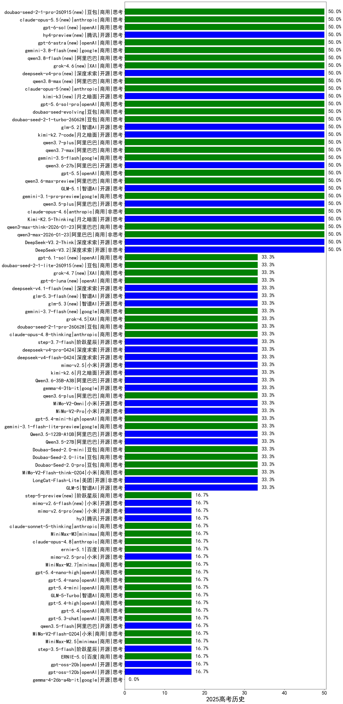

|类别|机构|大模型|【2025高考历史】准确率|平均耗时|平均消耗token|花费/千次（元）|排名（准确率）|
|---|---|-----|-------------------|-------|-----------|-----------|-----------|
|商用|minimax|MiniMax-M3.1-Flash(new)|50.0%|23s|1461|4.9|1|
|商用|XAI|grok-4.6|50.0%|164s|3623|142.7|2|
|商用|openAI|gpt-5.5|50.0%|12s|719|123.2|3|
|开源|阿里巴巴|qwen3.6-27b|50.0%|34s|2084|35.3|4|
|商用|阿里巴巴|qwen3.8-flash(new)|50.0%|123s|1135|2.7|5|
|商用|google|gemini-3.5-flash|50.0%|12s|2171|128.8|6|
|商用|阿里巴巴|qwen3.7-max|50.0%|31s|1678|56.8|7|
|商用|阿里巴巴|qwen3.7-plus|50.0%|35s|1882|14.2|8|
|开源|深度求索|deepseek-v4-pro|50.0%|27s|994|23.2|9|
|商用|openAI|gpt-6-astra(new)|50.0%|19s|374|86.5|10|
|开源|月之暗面|kimi-k2.7-code|50.0%|25s|924|22.3|11|
|开源|智谱AI|glm-5.2|50.0%|111s|4736|129.7|12|
|商用|阿里巴巴|qwen3.8-max|50.0%|17s|848|26.1|13|
|商用|豆包|doubao-seed-2-1-turbo-260628|50.0%|177s|5851|85.5|14|
|商用|豆包|doubao-seed-evolving|50.0%|254s|9925|293.2|15|
|商用|anthropic|claude-opus-5|50.0%|14s|776|106.7|16|
|商用|openAI|gpt-5.6-sol-pro|50.0%|22s|3652|273.3|17|
|商用|google|gemini-3.8-flash(new)|50.0%|18s|1369|65.5|18|
|商用|anthropic|claude-opus-5.5(new)|50.0%|18s|769|84.1|19|
|开源|腾讯|hy4-preview(new)|50.0%|93s|5974|105.8|20|
|开源|深度求索|DeepSeek-V3.2|50.0%|65s|455|1.2|21|
|开源|深度求索|DeepSeek-V3.2-Think|50.0%|137s|1236|3.6|22|
|商用|google|gemini-4-argon(new)|50.0%|40s|875|102.5|23|
|商用|google|gemini-3.1-pro-preview|50.0%|39s|2029|162.0|24|
|商用|anthropic|claude-sonnet-5.5(new)|50.0%|7s|570|28.1|25|
|商用|豆包|doubao-seed-2-1-pro-260915(new)|50.0%|79s|2514|70.9|26|
|开源|月之暗面|kimi-k3|50.0%|49s|1149|98.4|27|
|商用|openAI|gpt-6-sol(new)|50.0%|508s|334|14.5|28|
|开源|智谱AI|GLM-5.1|50.0%|224s|1851|41.9|29|
|商用|阿里巴巴|qwen3.6-max-preview|50.0%|64s|1997|101.1|30|
|商用|google|gemini-3.7-flash|33.3%|41s|990|22.8|31|
|开源|智谱AI|glm-5.3(new)|33.3%|98s|3340|90.6|32|
|商用|XAI|grok-4.7(new)|33.3%|104s|7051|257.7|33|
|商用|豆包|doubao-seed-2-1-lite-260915(new)|33.3%|56s|2322|5.9|34|
|商用|openAI|gpt-6.1-sol(new)|33.3%|6s|326|13.9|35|
|商用|openAI|gpt-6-luna(new)|33.3%|116s|765|2.2|36|
|开源|智谱AI|glm-5.3-flash(new)|33.3%|38s|1632|4.3|37|
|开源|深度求索|deepseek-v4.1-flash(new)|33.3%|6s|630|4.1|38|
|商用|豆包|doubao-seed-2-1-pro-260628|33.3%|322s|13947|413.8|39|
|商用|XAI|grok-4.5|33.3%|115s|3413|133.9|40|
|开源|google|gemma-4-31b-it|33.3%|85s|761|1.8|41|
|商用|阿里巴巴|qwen3.6-plus|33.3%|56s|2095|23.6|42|
|开源|月之暗面|kimi-k2.6|33.3%|90s|1681|42.8|43|
|开源|小米|mimo-v2.5|33.3%|20s|1589|17.8|44|
|商用|google|gemini-3.1-flash-lite-preview|33.3%|5s|635|5.3|45|
|开源|深度求索|deepseek-v4-flash-0424|33.3%|20s|791|1.5|46|
|开源|深度求索|deepseek-v4-pro-0424|33.3%|18s|674|14.7|47|
|开源|阿里巴巴|Qwen3.6-35B-A3B|33.3%|86s|2037|20.7|48|
|开源|阿里巴巴|Qwen3.5-122B-A10B|33.3%|295s|4989|31.1|49|
|开源|阿里巴巴|Qwen3.5-27B|33.3%|370s|4227|19.7|50|
|开源|阶跃星辰|step-3.7-flash|33.3%|118s|2259|17.4|51|
|商用|anthropic|claude-opus-4.8-thinking|33.3%|12s|851|119.8|52|
|商用|百度|ERNIE-5.0|16.7%|142s|1186|26.1|53|
|商用|minimax|MiniMax-M2.7|16.7%|37s|1449|11.2|54|
|商用|anthropic|claude-haiku-5.5(new)|16.7%|16s|767|2.1|55|
|商用|阶跃星辰|step-5-preview(new)|16.7%|76s|5126|100.8|56|
|开源|小米|mimo-v2.6-pro(new)|16.7%|35s|1131|6.3|57|
|开源|小米|mimo-v2.6-flash(new)|16.7%|56s|1423|2.7|58|
|开源|腾讯|hy3|16.7%|83s|296|0.8|59|
|开源|小米|mimo-v2.5-pro|16.7%|18s|1298|21.6|60|
|商用|百度|ernie-5.1|16.7%|24s|1073|17.3|61|
|商用|anthropic|claude-opus-4.8|16.7%|11s|626|80.5|62|
|商用|minimax|MiniMax-M3|16.7%|45s|1217|16.8|63|
|开源|openAI|gpt-oss-20b|16.7%|154s|945|0.9|64|
|商用|anthropic|claude-sonnet-5-thinking|16.7%|14s|837|47.0|65|
|开源|openAI|gpt-oss-120b|16.7%|3s|614|1.5|66|
|开源|google|gemma-4-26b-a4b-it|0.0%|84s|769|1.8|67|

