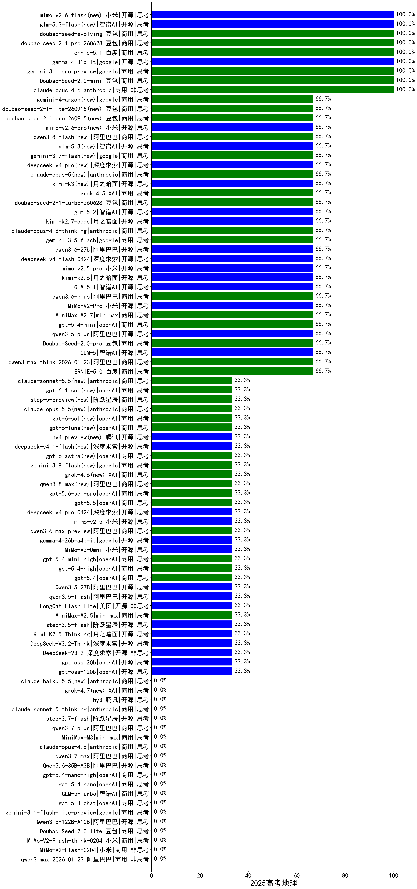

|类别|机构|大模型|【2025高考地理】准确率|平均耗时|平均消耗token|花费/千次（元）|排名（准确率）|
|---|---|-----|-------------------|-------|-----------|-----------|-----------|
|商用|豆包|doubao-seed-2-1-pro-260628|100.0%|354s|14014|416.8|1|
|开源|小米|mimo-v2.6-flash(new)|100.0%|141s|5344|10.6|2|
|商用|豆包|doubao-seed-evolving|100.0%|191s|7076|208.6|3|
|商用|百度|ernie-5.1|100.0%|39s|1135|18.9|4|
|开源|智谱AI|glm-5.3-flash(new)|100.0%|187s|6412|17.7|5|
|开源|google|gemma-4-31b-it|100.0%|89s|783|2.0|6|
|商用|google|gemini-3.1-pro-preview|100.0%|63s|3321|274.6|7|
|开源|月之暗面|kimi-k3|66.7%|107s|2991|284.6|8|
|商用|anthropic|claude-opus-4.8-thinking|66.7%|21s|1347|213.3|9|
|开源|月之暗面|kimi-k2.7-code|66.7%|181s|6328|168.7|10|
|开源|智谱AI|glm-5.2|66.7%|97s|4075|111.8|11|
|商用|豆包|doubao-seed-2-1-turbo-260628|66.7%|258s|13762|204.6|12|
|商用|google|gemini-4-argon(new)|66.7%|12s|494|53.0|13|
|商用|XAI|grok-4.5|66.7%|105s|4015|159.7|14|
|商用|anthropic|claude-opus-5|66.7%|17s|849|126.2|15|
|开源|小米|mimo-v2.6-pro(new)|66.7%|40s|1761|10.2|16|
|开源|深度求索|deepseek-v4-pro|66.7%|89s|3372|87.7|17|
|商用|google|gemini-3.7-flash|66.7%|41s|1112|26.7|18|
|商用|豆包|doubao-seed-2-1-lite-260915(new)|66.7%|661s|2602|6.8|19|
|开源|智谱AI|glm-5.3(new)|66.7%|253s|4845|133.3|20|
|商用|阿里巴巴|qwen3.8-flash(new)|66.7%|94s|4838|12.7|21|
|商用|豆包|doubao-seed-2-1-pro-260915(new)|66.7%|211s|5835|171.4|22|
|商用|google|gemini-3.5-flash|66.7%|15s|2982|181.7|23|
|商用|minimax|MiniMax-M3.1-Flash(new)|66.7%|159s|8681|33.8|24|
|开源|阿里巴巴|qwen3.6-27b|66.7%|46s|2807|48.8|25|
|商用|百度|ERNIE-5.0|66.7%|128s|2341|54.4|26|
|开源|智谱AI|GLM-5.1|66.7%|272s|2448|56.8|27|
|开源|月之暗面|kimi-k2.6|66.7%|209s|3324|87.6|28|
|商用|阿里巴巴|qwen3.6-plus|66.7%|74s|2610|30.1|29|
|开源|深度求索|deepseek-v4-flash-0424|66.7%|76s|3184|6.3|30|
|开源|小米|mimo-v2.5-pro|66.7%|44s|2557|48.6|31|
|商用|minimax|MiniMax-M2.7|66.7%|64s|2367|19.0|32|
|开源|深度求索|DeepSeek-V3.2-Think|33.3%|88s|2548|7.5|33|
|商用|阶跃星辰|step-5-preview(new)|33.3%|107s|8192|162.4|34|
|商用|anthropic|claude-opus-5.5(new)|33.3%|16s|965|117.0|35|
|商用|openAI|gpt-6.1-sol(new)|33.3%|8s|279|12.0|36|
|商用|openAI|gpt-6-sol(new)|33.3%|754s|245|9.6|37|
|商用|openAI|gpt-6-luna(new)|33.3%|336s|998|3.1|38|
|开源|阿里巴巴|Qwen3.5-27B|33.3%|374s|5194|24.4|39|
|商用|anthropic|claude-sonnet-5.5(new)|33.3%|10s|1049|64.4|40|
|开源|腾讯|hy4-preview(new)|33.3%|151s|9800|174.9|41|
|开源|深度求索|deepseek-v4.1-flash(new)|33.3%|25s|4073|31.8|42|
|商用|openAI|gpt-6-astra(new)|33.3%|13s|303|68.5|43|
|商用|google|gemini-3.8-flash(new)|33.3%|26s|1227|59.5|44|
|开源|深度求索|DeepSeek-V3.2|33.3%|71s|685|1.9|45|
|开源|google|gemma-4-26b-a4b-it|33.3%|77s|685|1.7|46|
|开源|小米|mimo-v2.5|33.3%|34s|2262|27.6|47|
|商用|openAI|gpt-5.6-sol-pro|33.3%|16s|3487|260.2|48|
|商用|openAI|gpt-5.5|33.3%|13s|820|148.8|49|
|开源|深度求索|deepseek-v4-pro-0424|33.3%|65s|2308|54.1|50|
|开源|openAI|gpt-oss-20b|33.3%|72s|955|0.9|51|
|商用|XAI|grok-4.6|33.3%|64s|2755|106.8|52|
|开源|openAI|gpt-oss-120b|33.3%|2s|633|1.5|53|
|商用|阿里巴巴|qwen3.6-max-preview|33.3%|95s|2751|143.2|54|
|商用|阿里巴巴|qwen3.8-max|33.3%|141s|5761|203.7|55|
|开源|阿里巴巴|Qwen3.5-122B-A10B|0.0%|607s|5497|34.5|56|
|开源|腾讯|hy3|0.0%|179s|338|1.0|57|
|商用|anthropic|claude-sonnet-5-thinking|0.0%|26s|1630|105.2|58|
|商用|XAI|grok-4.7(new)|0.0%|157s|9535|362.6|59|
|开源|阿里巴巴|Qwen3.6-35B-A3B|0.0%|22s|2397|24.8|60|
|商用|google|gemini-3.1-flash-lite-preview|0.0%|42s|680|6.1|61|
|开源|阶跃星辰|step-3.7-flash|0.0%|45s|3235|25.4|62|
|商用|阿里巴巴|qwen3.7-plus|0.0%|95s|5259|41.4|63|
|商用|minimax|MiniMax-M3|0.0%|136s|3448|54.5|64|
|商用|anthropic|claude-opus-4.8|0.0%|12s|711|102.1|65|
|商用|anthropic|claude-haiku-5.5(new)|0.0%|15s|1212|3.8|66|
|商用|阿里巴巴|qwen3.7-max|0.0%|56s|2739|95.8|67|

