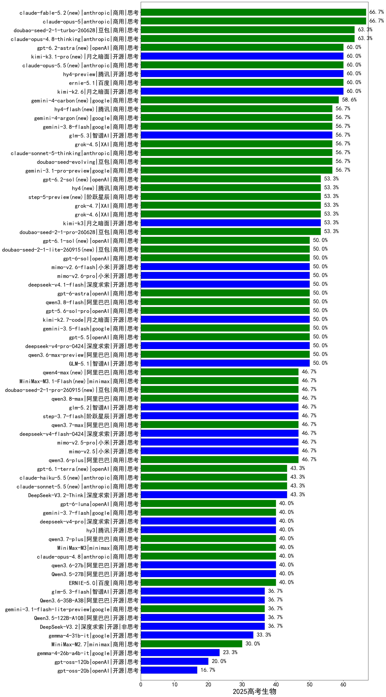

|类别|机构|大模型|【2025高考生物】准确率|平均耗时|平均消耗token|花费/千次（元）|排名（准确率）|
|---|---|-----|-------------------|-------|-----------|-----------|-----------|
|商用|anthropic|claude-opus-5|66.7%|24s|1857|280.3|1|
|商用|anthropic|claude-fable-5.2(new)|66.7%|31s|1221|270.0|2|
|商用|豆包|doubao-seed-2-1-turbo-260628|63.3%|336s|16322|241.9|3|
|商用|anthropic|claude-opus-4.8-thinking|63.3%|37s|2957|472.4|4|
|开源|腾讯|hy4-preview(new)|60.0%|152s|9306|165.1|5|
|开源|月之暗面|kimi-k3.1-pro(new)|60.0%|259s|8370|554.3|6|
|商用|anthropic|claude-opus-5.5(new)|60.0%|17s|1152|125.4|7|
|商用|百度|ernie-5.1|60.0%|100s|4420|76.7|8|
|开源|月之暗面|kimi-k2.6|60.0%|433s|8872|235.6|9|
|商用|google|gemini-4-carbon(new)|58.6%|45s|2146|274.6|10|
|商用|google|gemini-3.1-pro-preview|56.7%|71s|4886|401.2|11|
|商用|腾讯|hy4-flash(new)|56.7%|22s|3777|7.2|12|
|商用|anthropic|claude-sonnet-5-thinking|56.7%|47s|4478|295.6|13|
|商用|google|gemini-3.8-flash(new)|56.7%|16s|2470|120.7|14|
|商用|XAI|grok-4.5|56.7%|78s|5736|229.5|15|
|商用|google|gemini-4-argon(new)|56.7%|24s|1060|122.4|16|
|开源|智谱AI|glm-5.3(new)|56.7%|268s|9699|267.4|17|
|商用|豆包|doubao-seed-evolving|56.7%|556s|20760|616.9|18|
|商用|豆包|doubao-seed-2-1-pro-260628|53.3%|397s|20026|594.9|19|
|开源|月之暗面|kimi-k3|53.3%|182s|4682|446.5|20|
|商用|阶跃星辰|step-5-preview(new)|53.3%|87s|6755|132.5|21|
|商用|XAI|grok-4.6|53.3%|243s|5203|207.1|22|
|商用|XAI|grok-4.7(new)|53.3%|159s|10483|399.8|23|
|商用|腾讯|hy4(new)|53.3%|237s|11930|212.3|24|
|开源|月之暗面|kimi-k2.7-code|50.0%|132s|5265|138.1|25|
|商用|openAI|gpt-5.6-sol-pro|50.0%|49s|7122|678.7|26|
|商用|openAI|gpt-6-sol(new)|50.0%|249s|714|35.9|27|
|商用|openAI|gpt-6-astra(new)|50.0%|22s|698|174.0|28|
|开源|深度求索|deepseek-v4.1-flash(new)|50.0%|65s|6079|47.3|29|
|开源|小米|mimo-v2.6-pro(new)|50.0%|259s|12130|72.1|30|
|商用|阿里巴巴|qwen3.8-flash(new)|50.0%|174s|13600|36.2|31|
|开源|小米|mimo-v2.6-flash(new)|50.0%|258s|10306|20.4|32|
|开源|深度求索|deepseek-v4-pro-0424|50.0%|182s|7375|174.7|33|
|商用|豆包|doubao-seed-2-1-lite-260915(new)|50.0%|122s|5882|15.5|34|
|商用|openAI|gpt-6.1-sol(new)|50.0%|9s|593|27.5|35|
|开源|智谱AI|GLM-5.1|50.0%|491s|8820|208.1|36|
|商用|google|gemini-3.5-flash|50.0%|28s|4355|263.2|37|
|商用|阿里巴巴|qwen3.6-max-preview|50.0%|120s|4039|208.9|38|
|商用|openAI|gpt-5.5|50.0%|44s|1819|338.2|39|
|开源|深度求索|deepseek-v4-flash-0424|46.7%|102s|5454|10.7|40|
|商用|阿里巴巴|qwen3.6-plus|46.7%|77s|3940|45.3|41|
|商用|minimax|MiniMax-M3.1-Flash(new)|46.7%|112s|7268|27.9|42|
|开源|小米|mimo-v2.5|46.7%|79s|5703|74.7|43|
|开源|小米|mimo-v2.5-pro|46.7%|149s|8009|161.7|44|
|开源|智谱AI|glm-5.2|46.7%|177s|8231|226.3|45|
|开源|阶跃星辰|step-3.7-flash|46.7%|129s|8773|69.8|46|
|商用|阿里巴巴|qwen3.8-max|46.7%|254s|10873|385.6|47|
|商用|阿里巴巴|qwen3.7-max|46.7%|143s|9036|320.4|48|
|商用|豆包|doubao-seed-2-1-pro-260915(new)|46.7%|142s|4903|141.3|49|
|商用|阿里巴巴|qwen4-max(new)|46.7%|112s|2494|70.5|50|
|商用|anthropic|claude-sonnet-5.5(new)|43.3%|13s|1171|64.1|51|
|商用|anthropic|claude-haiku-5.5(new)|43.3%|14s|2083|6.4|52|
|商用|openAI|gpt-6.1-terra(new)|43.3%|7s|740|18.9|53|
|开源|深度求索|DeepSeek-V3.2-Think|43.3%|189s|6110|18.1|54|
|商用|openAI|gpt-6-luna(new)|40.0%|52s|1623|5.0|55|
|开源|腾讯|hy3|40.0%|64s|712|2.3|56|
|商用|百度|ERNIE-5.0|40.0%|297s|7708|181.7|57|
|开源|深度求索|deepseek-v4-pro|40.0%|125s|7795|205.6|58|
|商用|阿里巴巴|qwen3.7-plus|40.0%|227s|12571|99.3|59|
|商用|minimax|MiniMax-M3|40.0%|217s|3179|49.0|60|
|商用|anthropic|claude-opus-4.8|40.0%|13s|1063|141.4|61|
|开源|阿里巴巴|qwen3.6-27b|40.0%|69s|4325|74.8|62|
|商用|google|gemini-3.7-flash|40.0%|7s|1670|39.4|63|
|开源|阿里巴巴|Qwen3.5-27B|40.0%|174s|7827|36.7|64|
|开源|智谱AI|glm-5.3-flash(new)|36.7%|415s|17371|48.2|65|
|开源|深度求索|DeepSeek-V3.2|36.7%|137s|1285|3.7|66|
|开源|阿里巴巴|Qwen3.6-35B-A3B|36.7%|161s|4314|44.7|67|
|商用|google|gemini-3.1-flash-lite-preview|36.7%|4s|764|6.2|68|
|开源|阿里巴巴|Qwen3.5-122B-A10B|36.7%|642s|7306|45.6|69|
|开源|google|gemma-4-31b-it|33.3%|117s|1011|2.4|70|
|商用|minimax|MiniMax-M2.7|30.0%|182s|7728|63.5|71|
|开源|google|gemma-4-26b-a4b-it|23.3%|106s|1115|2.7|72|
|开源|openAI|gpt-oss-120b|20.0%|79s|1601|4.6|73|
|开源|openAI|gpt-oss-20b|16.7%|222s|2372|2.5|74|

