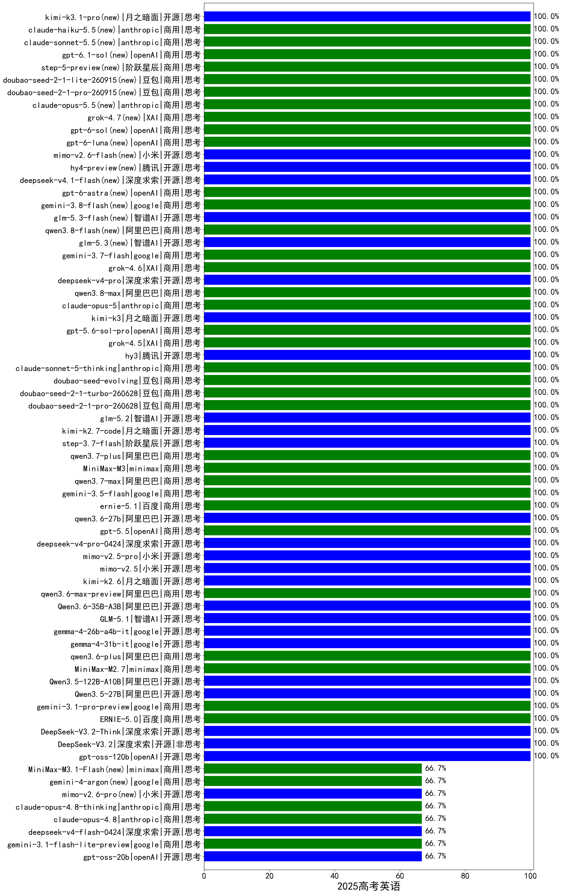

|类别|机构|大模型|【2025高考英语】准确率|平均耗时|平均消耗token|花费/千次（元）|排名（准确率）|
|---|---|-----|-------------------|-------|-----------|-----------|-----------|
|开源|openAI|gpt-oss-120b|100.0%|3s|785|1.3|1|
|开源|智谱AI|glm-5.2|100.0%|35s|1843|43.3|2|
|商用|豆包|doubao-seed-evolving|100.0%|109s|5039|140.0|3|
|商用|anthropic|claude-sonnet-5-thinking|100.0%|9s|774|18.6|4|
|开源|腾讯|hy3|100.0%|82s|677|1.5|5|
|商用|XAI|grok-4.5|100.0%|105s|1171|32.1|6|
|商用|openAI|gpt-5.6-sol-pro|100.0%|7s|3823|199.6|7|
|开源|月之暗面|kimi-k3|100.0%|39s|860|47.0|8|
|商用|anthropic|claude-opus-5|100.0%|8s|1044|93.7|9|
|商用|阿里巴巴|qwen3.8-max|100.0%|32s|1710|50.4|10|
|开源|深度求索|deepseek-v4-pro|100.0%|24s|1038|19.3|11|
|商用|XAI|grok-4.6|100.0%|27s|1828|59.7|12|
|商用|google|gemini-3.7-flash|100.0%|7s|1241|23.7|13|
|开源|智谱AI|glm-5.3(new)|100.0%|33s|1327|28.8|14|
|商用|阿里巴巴|qwen3.8-flash(new)|100.0%|21s|1309|2.6|15|
|开源|智谱AI|glm-5.3-flash(new)|100.0%|16s|1052|2.1|16|
|商用|google|gemini-3.8-flash(new)|100.0%|51s|1138|42.0|17|
|商用|openAI|gpt-6-astra(new)|100.0%|21s|554|78.8|18|
|开源|深度求索|deepseek-v4.1-flash(new)|100.0%|5s|1214|7.1|19|
|开源|腾讯|hy4-preview(new)|100.0%|53s|4263|71.6|20|
|开源|小米|mimo-v2.6-flash(new)|100.0%|40s|832|1.2|21|
|商用|openAI|gpt-6-luna(new)|100.0%|116s|560|0.8|22|
|商用|openAI|gpt-6-sol(new)|100.0%|85s|511|12.7|23|
|商用|XAI|grok-4.7(new)|100.0%|12s|2360|53.0|24|
|商用|anthropic|claude-opus-5.5(new)|100.0%|11s|1033|73.3|25|
|商用|豆包|doubao-seed-2-1-pro-260915(new)|100.0%|42s|1931|46.8|26|
|商用|豆包|doubao-seed-2-1-lite-260915(new)|100.0%|34s|2247|5.2|27|
|商用|阶跃星辰|step-5-preview(new)|100.0%|12s|1057|15.8|28|
|商用|openAI|gpt-6.1-sol(new)|100.0%|5s|542|14.9|29|
|商用|anthropic|claude-sonnet-5.5(new)|100.0%|6s|951|30.9|30|
|商用|anthropic|claude-haiku-5.5(new)|100.0%|4s|988|1.7|31|
|商用|豆包|doubao-seed-2-1-pro-260628|100.0%|84s|3674|99.1|32|
|商用|豆包|doubao-seed-2-1-turbo-260628|100.0%|73s|3594|48.3|33|
|开源|月之暗面|kimi-k2.7-code|100.0%|14s|835|14.1|34|
|开源|小米|mimo-v2.5|100.0%|12s|1783|17.6|35|
|开源|深度求索|DeepSeek-V3.2|100.0%|191s|501|1.1|36|
|开源|深度求索|DeepSeek-V3.2-Think|100.0%|34s|1102|2.9|37|
|商用|百度|ERNIE-5.0|100.0%|110s|1186|20.9|38|
|商用|google|gemini-3.1-pro-preview|100.0%|23s|1706|115.4|39|
|开源|阿里巴巴|Qwen3.5-27B|100.0%|464s|3593|15.4|40|
|开源|阿里巴巴|Qwen3.5-122B-A10B|100.0%|116s|3347|19.0|41|
|商用|minimax|MiniMax-M2.7|100.0%|31s|1486|9.7|42|
|商用|阿里巴巴|qwen3.6-plus|100.0%|24s|2173|21.8|43|
|开源|google|gemma-4-31b-it|100.0%|89s|763|1.3|44|
|开源|google|gemma-4-26b-a4b-it|100.0%|15s|828|1.5|45|
|开源|智谱AI|GLM-5.1|100.0%|195s|1564|30.2|46|
|开源|阿里巴巴|Qwen3.6-35B-A3B|100.0%|171s|2448|22.6|47|
|开源|月之暗面|kimi-k2.6|100.0%|65s|1391|29.2|48|
|商用|阿里巴巴|qwen3.6-max-preview|100.0%|57s|2122|95.3|49|
|开源|小米|mimo-v2.5-pro|100.0%|12s|1233|16.6|50|
|商用|百度|ernie-5.1|100.0%|18s|978|11.6|51|
|开源|阶跃星辰|step-3.7-flash|100.0%|16s|2118|14.4|52|
|商用|阿里巴巴|qwen3.7-plus|100.0%|18s|1299|7.8|53|
|商用|minimax|MiniMax-M3|100.0%|15s|877|7.5|54|
|商用|阿里巴巴|qwen3.7-max|100.0%|23s|1389|39.8|55|
|商用|google|gemini-3.5-flash|100.0%|6s|1437|68.4|56|
|开源|月之暗面|kimi-k3.1-pro(new)|100.0%|27s|1318|62.8|57|
|开源|阿里巴巴|qwen3.6-27b|100.0%|28s|2130|31.9|58|
|商用|openAI|gpt-5.5|100.0%|7s|566|46.9|59|
|开源|深度求索|deepseek-v4-pro-0424|100.0%|47s|1067|20.7|60|
|开源|openAI|gpt-oss-20b|66.7%|4s|1072|0.8|61|
|商用|anthropic|claude-opus-4.8|66.7%|5s|768|45.5|62|
|开源|小米|mimo-v2.6-pro(new)|66.7%|35s|1515|7.8|63|
|开源|深度求索|deepseek-v4-flash-0424|66.7%|17s|820|1.2|64|
|商用|google|gemini-4-argon(new)|66.7%|9s|886|73.6|65|
|商用|anthropic|claude-opus-4.8-thinking|66.7%|7s|872|63.6|66|
|商用|minimax|MiniMax-M3.1-Flash(new)|66.7%|12s|1178|2.9|67|
|商用|google|gemini-3.1-flash-lite-preview|66.7%|2s|671|3.4|68|

