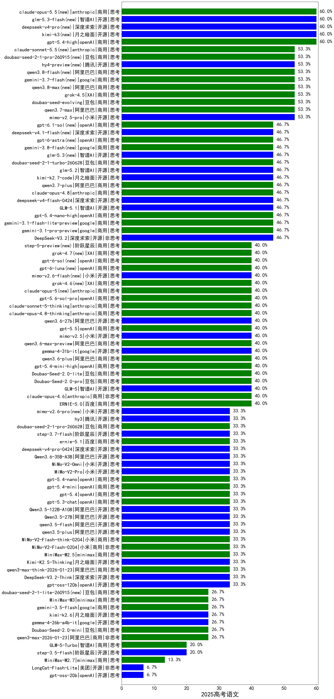

|类别|机构|大模型|【2025高考语文】准确率|平均耗时|平均消耗token|花费/千次（元）|排名（准确率）|
|---|---|-----|-------------------|-------|-----------|-----------|-----------|
|商用|anthropic|claude-opus-5.5(new)|60.0%|16s|2012|134.3|1|
|商用|openAI|gpt-5.4-high|60.0%|27s|2630|189.4|2|
|商用|google|gemini-4-argon(new)|60.0%|16s|1375|88.7|3|
|开源|深度求索|deepseek-v4-pro(new)|60.0%|219s|3972|91.3|4|
|开源|月之暗面|kimi-k3(new)|60.0%|90s|2339|166.2|5|
|开源|智谱AI|glm-5.3-flash(new)|60.0%|311s|8918|23.3|6|
|商用|阿里巴巴|qwen3.8-max(new)|53.3%|55s|3241|96.2|7|
|商用|anthropic|claude-sonnet-5.5(new)|53.3%|8s|1934|61.7|8|
|开源|小米|mimo-v2.5-pro|53.3%|57s|3112|49.7|9|
|开源|腾讯|hy4-preview(new)|53.3%|264s|13023|224.6|10|
|商用|豆包|doubao-seed-2-1-pro-260915(new)|53.3%|111s|5037|129.6|11|
|商用|google|gemini-3.7-flash(new)|53.3%|6s|1693|25.1|12|
|商用|XAI|grok-4.5|53.3%|98s|6513|242.9|13|
|商用|豆包|doubao-seed-evolving|53.3%|283s|10269|285.8|14|
|商用|阿里巴巴|qwen3.7-max|53.3%|29s|2519|71.1|15|
|商用|阿里巴巴|qwen3.8-flash(new)|53.3%|69s|2345|4.7|16|
|开源|智谱AI|glm-5.2|46.7%|99s|3820|90.2|17|
|开源|智谱AI|glm-5.3(new)|46.7%|-87s|4472|108.4|18|
|商用|google|gemini-3.1-flash-lite-preview|46.7%|2s|1235|4.9|19|
|开源|深度求索|deepseek-v4-flash-0424|46.7%|41s|1407|2.0|20|
|商用|openAI|gpt-5.4-nano-high|46.7%|86s|2306|12.9|21|
|商用|google|gemini-3.8-flash(new)|46.7%|38s|1794|55.5|22|
|商用|google|gemini-3.1-pro-preview|46.7%|42s|3042|193.8|23|
|商用|openAI|gpt-6-astra(new)|46.7%|12s|1192|139.4|24|
|开源|深度求索|deepseek-v4.1-flash(new)|46.7%|33s|3342|21.7|25|
|商用|anthropic|claude-opus-4.8|46.7%|9s|1704|114.2|26|
|商用|阿里巴巴|qwen3.7-plus|46.7%|38s|2605|15.9|27|
|商用|豆包|doubao-seed-2-1-turbo-260628|46.7%|174s|9644|133.9|28|
|商用|openAI|gpt-6.1-sol(new)|46.7%|25s|1151|25.0|29|
|开源|月之暗面|kimi-k2.7-code|46.7%|106s|4665|110.2|30|
|开源|深度求索|DeepSeek-V3.2|46.7%|89s|1039|2.3|31|
|开源|智谱AI|GLM-5.1|46.7%|359s|3156|60.7|32|
|商用|openAI|gpt-5.5|40.0%|11s|1602|162.9|33|
|开源|阿里巴巴|qwen3.6-27b|40.0%|49s|3690|54.2|34|
|商用|anthropic|claude-sonnet-5-thinking|40.0%|20s|2333|89.8|35|
|商用|anthropic|claude-opus-4.8-thinking|40.0%|16s|2290|216.8|36|
|开源|小米|mimo-v2.5|40.0%|48s|2853|27.4|37|
|商用|openAI|gpt-5.6-sol-pro|40.0%|24s|8140|543.7|38|
|商用|阿里巴巴|qwen3.6-max-preview|40.0%|92s|3636|159.7|39|
|商用|openAI|gpt-5.4-mini-high|40.0%|48s|2833|63.2|40|
|商用|anthropic|claude-opus-5(new)|40.0%|16s|2016|168.9|41|
|开源|google|gemma-4-31b-it|40.0%|81s|1315|2.0|42|
|商用|百度|ERNIE-5.0|40.0%|131s|1833|29.9|43|
|商用|阶跃星辰|step-5-preview(new)|40.0%|38s|3929|68.0|44|
|商用|anthropic|claude-opus-4.6|40.0%|17s|1899|148.8|45|
|开源|智谱AI|GLM-5|40.0%|196s|4523|69.7|46|
|商用|XAI|grok-4.7(new)|40.0%|155s|11938|440.8|47|
|商用|openAI|gpt-6-sol(new)|40.0%|233s|1283|34.2|48|
|商用|openAI|gpt-6-luna(new)|40.0%|344s|1603|2.8|49|
|商用|豆包|Doubao-Seed-2.0-pro|40.0%|277s|2019|20.8|50|
|商用|豆包|Doubao-Seed-2.0-lite|40.0%|280s|2081|4.8|51|
|开源|小米|mimo-v2.6-flash(new)|40.0%|473s|2138|3.4|52|
|商用|XAI|grok-4.6(new)|40.0%|128s|4240|147.4|53|
|商用|阿里巴巴|qwen3.6-plus|40.0%|52s|3535|34.0|54|
|开源|腾讯|hy3|33.3%|67s|1177|2.3|55|
|开源|小米|mimo-v2.6-pro(new)|33.3%|103s|4680|25.5|56|
|商用|豆包|doubao-seed-2-1-pro-260628|33.3%|398s|9970|277.6|57|
|开源|openAI|gpt-oss-120b|33.3%|57s|2225|4.1|58|
|开源|深度求索|deepseek-v4-pro-0424|33.3%|31s|1289|21.2|59|
|开源|阶跃星辰|step-3.7-flash|33.3%|79s|7965|59.0|60|
|商用|openAI|gpt-5.4|33.3%|5s|1225|41.8|61|
|开源|深度求索|DeepSeek-V3.2-Think|33.3%|34s|1733|4.4|62|
|商用|阿里巴巴|qwen3-max-think-2026-01-23|33.3%|129s|5187|45.3|63|
|开源|月之暗面|Kimi-K2.5-Thinking|33.3%|545s|3438|59.1|64|
|商用|minimax|MiniMax-M2.5|33.3%|42s|2777|18.3|65|
|商用|小米|MiMo-V2-Flash-0204|33.3%|462s|1558|2.0|66|
|商用|小米|MiMo-V2-Flash-think-0204|33.3%|457s|4002|7.2|67|
|开源|阿里巴巴|qwen3.5-plus|33.3%|66s|5880|25.0|68|
|开源|阿里巴巴|qwen3.5-flash|33.3%|730s|5937|10.4|69|
|开源|阿里巴巴|Qwen3.5-27B|33.3%|196s|5275|21.9|70|
|商用|openAI|gpt-5.3-chat|33.3%|84s|1320|44.3|71|
|开源|阿里巴巴|Qwen3.5-122B-A10B|33.3%|684s|5310|29.4|72|
|开源|阿里巴巴|Qwen3.6-35B-A3B|33.3%|159s|3595|31.5|73|
|商用|openAI|gpt-5.4-nano|33.3%|41s|1246|3.6|74|
|开源|小米|MiMo-V2-Pro|33.3%|27s|2696|41.0|75|
|开源|小米|MiMo-V2-Omni|33.3%|373s|2571|23.5|76|
|商用|百度|ernie-5.1|33.3%|32s|2018|23.8|77|
|商用|openAI|gpt-5.4-mini|33.3%|4s|1209|12.0|78|
|开源|月之暗面|kimi-k2.6|26.7%|248s|3213|71.0|79|
|商用|google|gemini-3.5-flash|26.7%|19s|2888|133.6|80|
|商用|阿里巴巴|qwen3-max-2026-01-23|26.7%|196s|1401|7.4|81|
|商用|豆包|doubao-seed-2-1-lite-260915(new)|26.7%|113s|6365|15.5|82|
|商用|anthropic|claude-haiku-5.5(new)|26.7%|9s|2402|4.7|83|
|开源|google|gemma-4-26b-a4b-it|26.7%|51s|1436|2.3|84|
|商用|豆包|Doubao-Seed-2.0-mini|26.7%|428s|2942|4.3|85|
|商用|minimax|MiniMax-M3|26.7%|46s|1923|21.1|86|
|开源|阶跃星辰|step-3.5-flash|20.0%|33s|2646|4.4|87|
|商用|智谱AI|GLM-5-Turbo|20.0%|31s|2971|51.2|88|
|商用|minimax|MiniMax-M2.7|13.3%|84s|4193|30.5|89|
|开源|美团|LongCat-Flash-Lite|6.7%|334s|1290|0.0|90|
|开源|openAI|gpt-oss-20b|6.7%|26s|3480|3.0|91|

