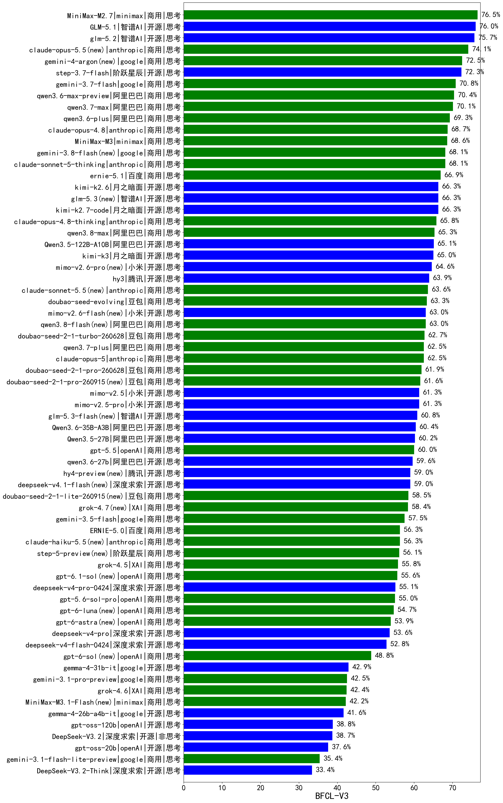

|类别|机构|大模型|【BFCL-V3】准确率|平均耗时|平均消耗token|花费/千次（元）|排名（准确率）|
|---|---|-----|-------------------|-------|-----------|-----------|-----------|
|商用|minimax|MiniMax-M2.7|76.5%|/|/|/|1|
|开源|智谱AI|GLM-5.1|76.0%|/|/|/|2|
|开源|智谱AI|glm-5.2|75.7%|/|/|/|3|
|商用|anthropic|claude-opus-5.5(new)|74.1%|/|/|/|4|
|商用|google|gemini-4-argon(new)|72.5%|/|/|/|5|
|开源|阶跃星辰|step-3.7-flash|72.3%|/|/|/|6|
|商用|google|gemini-3.7-flash|70.8%|/|/|/|7|
|商用|阿里巴巴|qwen3.6-max-preview|70.4%|/|/|/|8|
|商用|阿里巴巴|qwen3.7-max|70.1%|/|/|/|9|
|商用|阿里巴巴|qwen3.6-plus|69.3%|/|/|/|10|
|商用|anthropic|claude-opus-4.8|68.7%|/|/|/|11|
|商用|minimax|MiniMax-M3|68.6%|/|/|/|12|
|商用|google|gemini-3.8-flash(new)|68.1%|/|/|/|13|
|商用|anthropic|claude-sonnet-5-thinking|68.1%|/|/|/|14|
|商用|百度|ernie-5.1|66.9%|/|/|/|15|
|开源|月之暗面|kimi-k2.6|66.3%|/|/|/|16|
|开源|智谱AI|glm-5.3(new)|66.3%|/|/|/|17|
|开源|月之暗面|kimi-k2.7-code|66.3%|/|/|/|18|
|商用|anthropic|claude-opus-4.8-thinking|65.8%|/|/|/|19|
|商用|阿里巴巴|qwen3.8-max|65.3%|/|/|/|20|
|开源|阿里巴巴|Qwen3.5-122B-A10B|65.1%|/|/|/|21|
|开源|月之暗面|kimi-k3|65.0%|/|/|/|22|
|开源|小米|mimo-v2.6-pro(new)|64.6%|/|/|/|23|
|开源|腾讯|hy3|63.9%|/|/|/|24|
|商用|anthropic|claude-sonnet-5.5(new)|63.6%|/|/|/|25|
|商用|豆包|doubao-seed-evolving|63.3%|/|/|/|26|
|开源|小米|mimo-v2.6-flash(new)|63.0%|/|/|/|27|
|商用|阿里巴巴|qwen3.8-flash(new)|63.0%|/|/|/|28|
|商用|豆包|doubao-seed-2-1-turbo-260628|62.7%|/|/|/|29|
|商用|阿里巴巴|qwen3.7-plus|62.5%|/|/|/|30|
|商用|anthropic|claude-opus-5|62.5%|/|/|/|31|
|商用|豆包|doubao-seed-2-1-pro-260628|61.9%|/|/|/|32|
|商用|豆包|doubao-seed-2-1-pro-260915(new)|61.6%|/|/|/|33|
|开源|小米|mimo-v2.5|61.3%|/|/|/|34|
|开源|小米|mimo-v2.5-pro|61.3%|/|/|/|35|
|开源|智谱AI|glm-5.3-flash(new)|60.8%|/|/|/|36|
|开源|阿里巴巴|Qwen3.6-35B-A3B|60.4%|/|/|/|37|
|开源|阿里巴巴|Qwen3.5-27B|60.2%|/|/|/|38|
|商用|openAI|gpt-5.5|60.0%|/|/|/|39|
|开源|阿里巴巴|qwen3.6-27b|59.6%|/|/|/|40|
|开源|腾讯|hy4-preview(new)|59.0%|/|/|/|41|
|开源|深度求索|deepseek-v4.1-flash(new)|59.0%|/|/|/|42|
|商用|豆包|doubao-seed-2-1-lite-260915(new)|58.5%|/|/|/|43|
|商用|XAI|grok-4.7(new)|58.4%|/|/|/|44|
|商用|google|gemini-3.5-flash|57.5%|/|/|/|45|
|商用|百度|ERNIE-5.0|56.3%|/|/|/|46|
|商用|anthropic|claude-haiku-5.5(new)|56.3%|/|/|/|47|
|商用|阶跃星辰|step-5-preview(new)|56.1%|/|/|/|48|
|开源|月之暗面|kimi-k3.1-pro(new)|55.9%|/|/|/|49|
|商用|XAI|grok-4.5|55.8%|/|/|/|50|
|商用|openAI|gpt-6.1-sol(new)|55.6%|/|/|/|51|
|开源|深度求索|deepseek-v4-pro-0424|55.1%|/|/|/|52|
|商用|openAI|gpt-5.6-sol-pro|55.0%|/|/|/|53|
|商用|openAI|gpt-6-luna(new)|54.7%|/|/|/|54|
|商用|openAI|gpt-6-astra(new)|53.9%|/|/|/|55|
|开源|深度求索|deepseek-v4-pro|53.6%|/|/|/|56|
|开源|深度求索|deepseek-v4-flash-0424|52.8%|/|/|/|57|
|商用|openAI|gpt-6-sol(new)|48.8%|/|/|/|58|
|开源|google|gemma-4-31b-it|42.9%|/|/|/|59|
|商用|google|gemini-3.1-pro-preview|42.5%|/|/|/|60|
|商用|XAI|grok-4.6|42.4%|/|/|/|61|
|商用|minimax|MiniMax-M3.1-Flash(new)|42.2%|/|/|/|62|
|开源|google|gemma-4-26b-a4b-it|41.6%|/|/|/|63|
|开源|openAI|gpt-oss-120b|38.8%|/|/|/|64|
|开源|深度求索|DeepSeek-V3.2|38.7%|/|/|/|65|
|开源|openAI|gpt-oss-20b|37.6%|/|/|/|66|
|商用|google|gemini-3.1-flash-lite-preview|35.4%|/|/|/|67|
|开源|深度求索|DeepSeek-V3.2-Think|33.4%|/|/|/|68|

