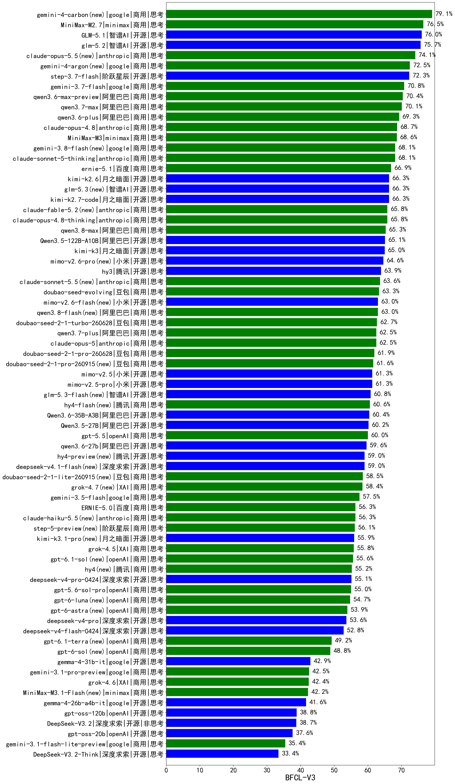

|类别|机构|大模型|【BFCL-V3】准确率|平均耗时|平均消耗token|花费/千次（元）|排名（准确率）|
|---|---|-----|-------------------|-------|-----------|-----------|-----------|
|商用|google|gemini-4-carbon(new)|79.1%|/|/|/|1|
|商用|minimax|MiniMax-M2.7|76.5%|/|/|/|2|
|开源|智谱AI|GLM-5.1|76.0%|/|/|/|3|
|开源|智谱AI|glm-5.2|75.7%|/|/|/|4|
|商用|anthropic|claude-opus-5.5(new)|74.1%|/|/|/|5|
|商用|google|gemini-4-argon(new)|72.5%|/|/|/|6|
|开源|阶跃星辰|step-3.7-flash|72.3%|/|/|/|7|
|商用|google|gemini-3.7-flash|70.8%|/|/|/|8|
|商用|阿里巴巴|qwen3.6-max-preview|70.4%|/|/|/|9|
|商用|阿里巴巴|qwen3.7-max|70.1%|/|/|/|10|
|商用|阿里巴巴|qwen3.6-plus|69.3%|/|/|/|11|
|商用|anthropic|claude-opus-4.8|68.7%|/|/|/|12|
|商用|minimax|MiniMax-M3|68.6%|/|/|/|13|
|商用|google|gemini-3.8-flash|68.1%|/|/|/|14|
|商用|anthropic|claude-sonnet-5-thinking|68.1%|/|/|/|15|
|商用|百度|ernie-5.1|66.9%|/|/|/|16|
|开源|月之暗面|kimi-k2.6|66.3%|/|/|/|17|
|开源|智谱AI|glm-5.3|66.3%|/|/|/|18|
|开源|月之暗面|kimi-k2.7-code|66.3%|/|/|/|19|
|商用|anthropic|claude-fable-5.2(new)|65.8%|/|/|/|20|
|商用|anthropic|claude-opus-4.8-thinking|65.8%|/|/|/|21|
|商用|阿里巴巴|qwen3.8-max|65.3%|/|/|/|22|
|开源|阿里巴巴|Qwen3.5-122B-A10B|65.1%|/|/|/|23|
|开源|月之暗面|kimi-k3|65.0%|/|/|/|24|
|开源|小米|mimo-v2.6-pro|64.6%|/|/|/|25|
|开源|腾讯|hy3|63.9%|/|/|/|26|
|商用|anthropic|claude-sonnet-5.5(new)|63.6%|/|/|/|27|
|商用|豆包|doubao-seed-evolving|63.3%|/|/|/|28|
|开源|小米|mimo-v2.6-flash|63.0%|/|/|/|29|
|商用|阿里巴巴|qwen3.8-flash|63.0%|/|/|/|30|
|商用|豆包|doubao-seed-2-1-turbo-260628|62.7%|/|/|/|31|
|商用|阿里巴巴|qwen3.7-plus|62.5%|/|/|/|32|
|商用|anthropic|claude-opus-5|62.5%|/|/|/|33|
|商用|豆包|doubao-seed-2-1-pro-260628|61.9%|/|/|/|34|
|商用|豆包|doubao-seed-2-1-pro-260915(new)|61.6%|/|/|/|35|
|开源|小米|mimo-v2.5|61.3%|/|/|/|36|
|开源|小米|mimo-v2.5-pro|61.3%|/|/|/|37|
|开源|智谱AI|glm-5.3-flash|60.8%|/|/|/|38|
|商用|腾讯|hy4-flash(new)|60.6%|/|/|/|39|
|商用|阿里巴巴|qwen4-max(new)|60.4%|/|/|/|40|
|开源|阿里巴巴|Qwen3.6-35B-A3B|60.4%|/|/|/|41|
|开源|阿里巴巴|Qwen3.5-27B|60.2%|/|/|/|42|
|商用|openAI|gpt-5.5|60.0%|/|/|/|43|
|开源|阿里巴巴|qwen3.6-27b|59.6%|/|/|/|44|
|开源|腾讯|hy4-preview|59.0%|/|/|/|45|
|开源|深度求索|deepseek-v4.1-flash|59.0%|/|/|/|46|
|商用|豆包|doubao-seed-2-1-lite-260915(new)|58.5%|/|/|/|47|
|商用|XAI|grok-4.7|58.4%|/|/|/|48|
|商用|google|gemini-3.5-flash|57.5%|/|/|/|49|
|商用|百度|ERNIE-5.0|56.3%|/|/|/|50|
|商用|anthropic|claude-haiku-5.5(new)|56.3%|/|/|/|51|
|商用|阶跃星辰|step-5-preview(new)|56.1%|/|/|/|52|
|开源|月之暗面|kimi-k3.1-pro(new)|55.9%|/|/|/|53|
|商用|XAI|grok-4.5|55.8%|/|/|/|54|
|商用|openAI|gpt-6.1-sol(new)|55.6%|/|/|/|55|
|商用|腾讯|hy4(new)|55.2%|/|/|/|56|
|开源|深度求索|deepseek-v4-pro-0424|55.1%|/|/|/|57|
|商用|openAI|gpt-5.6-sol-pro|55.0%|/|/|/|58|
|商用|openAI|gpt-6-luna|54.7%|/|/|/|59|
|商用|openAI|gpt-6-astra|53.9%|/|/|/|60|
|开源|深度求索|deepseek-v4-pro|53.6%|/|/|/|61|
|开源|深度求索|deepseek-v4-flash-0424|52.8%|/|/|/|62|
|商用|openAI|gpt-6.1-terra(new)|49.2%|/|/|/|63|
|商用|openAI|gpt-6-sol|48.8%|/|/|/|64|
|商用|openAI|gpt-6.2-astra(new)|46.4%|/|/|/|65|
|商用|openAI|gpt-6.2-sol(new)|45.4%|/|/|/|66|
|开源|google|gemma-4-31b-it|42.9%|/|/|/|67|
|商用|google|gemini-3.1-pro-preview|42.5%|/|/|/|68|
|商用|XAI|grok-4.6|42.4%|/|/|/|69|
|商用|minimax|MiniMax-M3.1-Flash(new)|42.2%|/|/|/|70|
|开源|google|gemma-4-26b-a4b-it|41.6%|/|/|/|71|
|开源|openAI|gpt-oss-120b|38.8%|/|/|/|72|
|开源|深度求索|DeepSeek-V3.2|38.7%|/|/|/|73|
|开源|openAI|gpt-oss-20b|37.6%|/|/|/|74|
|商用|google|gemini-3.1-flash-lite-preview|35.4%|/|/|/|75|
|开源|深度求索|DeepSeek-V3.2-Think|33.4%|/|/|/|76|

