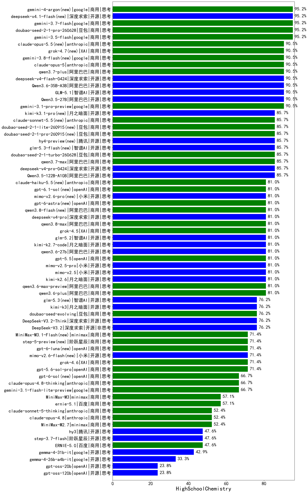

|类别|机构|大模型|【HighSchoolChemistry】准确率|平均耗时|平均消耗token|花费/千次（元）|排名（准确率）|
|---|---|-----|-------------------|-------|-----------|-----------|-----------|
|商用|豆包|doubao-seed-2-1-pro-260628|95.2%|494s|15763|467.9|1|
|商用|google|gemini-4-argon(new)|95.2%|21s|818|93.0|2|
|商用|google|gemini-3.7-flash|95.2%|26s|1280|30.1|3|
|开源|深度求索|deepseek-v4.1-flash(new)|95.2%|29s|3054|23.4|4|
|商用|google|gemini-3.5-flash|95.2%|20s|2972|178.5|5|
|商用|google|gemini-3.1-pro-preview|90.5%|57s|2714|219.4|6|
|开源|阿里巴巴|Qwen3.6-35B-A3B|90.5%|21s|3850|40.0|7|
|商用|anthropic|claude-opus-5|90.5%|17s|1076|151.6|8|
|商用|XAI|grok-4.7(new)|90.5%|120s|9068|341.6|9|
|商用|阿里巴巴|qwen3.7-plus|90.5%|155s|8167|64.3|10|
|开源|阿里巴巴|Qwen3.5-27B|90.5%|213s|8560|40.4|11|
|商用|google|gemini-3.8-flash(new)|90.5%|22s|1385|65.8|12|
|开源|深度求索|deepseek-v4-flash-0424|90.5%|75s|2304|4.5|13|
|商用|anthropic|claude-opus-5.5(new)|90.5%|14s|884|94.2|14|
|开源|智谱AI|GLM-5.1|90.5%|394s|4290|99.9|15|
|商用|豆包|doubao-seed-2-1-lite-260915(new)|85.7%|64s|2730|7.0|16|
|开源|阿里巴巴|Qwen3.5-122B-A10B|85.7%|617s|5946|37.1|17|
|开源|腾讯|hy4-preview(new)|85.7%|107s|7385|131.0|18|
|商用|豆包|doubao-seed-2-1-turbo-260628|85.7%|262s|11978|177.2|19|
|商用|anthropic|claude-sonnet-5.5(new)|85.7%|8s|818|42.5|20|
|商用|豆包|doubao-seed-2-1-pro-260915(new)|85.7%|74s|2708|76.3|21|
|商用|阿里巴巴|qwen3.7-max|85.7%|79s|3947|137.9|22|
|开源|智谱AI|glm-5.3-flash(new)|85.7%|270s|6783|18.6|23|
|开源|深度求索|deepseek-v4-pro-0424|85.7%|102s|3475|81.6|24|
|开源|阿里巴巴|qwen3.6-27b|81.0%|68s|4467|77.8|25|
|开源|小米|mimo-v2.5-pro|81.0%|112s|5602|111.7|26|
|商用|阿里巴巴|qwen3.8-flash(new)|81.0%|172s|10825|28.8|27|
|商用|openAI|gpt-6-astra(new)|81.0%|14s|561|141.0|28|
|开源|深度求索|deepseek-v4-pro|81.0%|239s|3221|82.8|29|
|商用|阿里巴巴|qwen3.8-max|81.0%|236s|9544|338.5|30|
|开源|月之暗面|kimi-k2.6|81.0%|365s|10287|274.4|31|
|商用|XAI|grok-4.5|81.0%|107s|7847|319.3|32|
|开源|小米|mimo-v2.5|81.0%|138s|3976|50.9|33|
|商用|openAI|gpt-6.1-sol(new)|81.0%|8s|542|26.9|34|
|开源|小米|mimo-v2.6-pro(new)|81.0%|173s|8197|48.6|35|
|开源|智谱AI|glm-5.2|81.0%|105s|4776|130.1|36|
|商用|阿里巴巴|qwen3.6-max-preview|81.0%|96s|3258|168.1|37|
|商用|anthropic|claude-haiku-5.5(new)|81.0%|8s|1243|3.6|38|
|商用|阿里巴巴|qwen3.6-plus|81.0%|59s|4041|46.7|39|
|商用|openAI|gpt-5.5|81.0%|20s|1383|255.8|40|
|开源|月之暗面|kimi-k2.7-code|81.0%|86s|4035|105.6|41|
|商用|豆包|doubao-seed-evolving|76.2%|303s|14551|431.6|42|
|开源|深度求索|DeepSeek-V3.2-Think|76.2%|321s|4207|12.5|43|
|开源|月之暗面|kimi-k3|76.2%|92s|2004|181.0|44|
|开源|深度求索|DeepSeek-V3.2|76.2%|36s|1155|3.3|45|
|开源|智谱AI|glm-5.3(new)|76.2%|115s|3941|106.8|46|
|开源|小米|mimo-v2.6-flash(new)|71.4%|340s|4546|8.9|47|
|商用|openAI|gpt-6-luna(new)|71.4%|272s|1366|4.2|48|
|商用|阶跃星辰|step-5-preview(new)|71.4%|74s|5499|107.9|49|
|商用|minimax|MiniMax-M3.1-Flash(new)|71.4%|54s|3926|14.7|50|
|商用|XAI|grok-4.6|71.4%|88s|4445|176.5|51|
|商用|openAI|gpt-5.6-sol-pro|71.4%|38s|6842|667.0|52|
|商用|openAI|gpt-6-sol(new)|66.7%|462s|509|24.6|53|
|商用|google|gemini-3.1-flash-lite-preview|66.7%|6s|752|6.4|54|
|商用|anthropic|claude-opus-4.8-thinking|66.7%|27s|2177|344.4|55|
|商用|百度|ernie-5.1|57.1%|99s|4131|72.1|56|
|商用|minimax|MiniMax-M3|57.1%|170s|3187|49.5|57|
|商用|anthropic|claude-opus-4.8|52.4%|11s|808|104.8|58|
|商用|anthropic|claude-sonnet-5-thinking|52.4%|40s|2023|126.9|59|
|商用|minimax|MiniMax-M2.7|52.4%|171s|7239|59.6|60|
|开源|阶跃星辰|step-3.7-flash|47.6%|126s|18610|149.7|61|
|开源|腾讯|hy3|47.6%|63s|612|2.0|62|
|商用|百度|ERNIE-5.0|47.6%|580s|9497|225.3|63|
|开源|google|gemma-4-31b-it|42.9%|94s|991|2.5|64|
|开源|google|gemma-4-26b-a4b-it|33.3%|45s|1299|3.3|65|
|开源|openAI|gpt-oss-20b|23.8%|229s|3357|3.7|66|
|开源|openAI|gpt-oss-120b|23.8%|10s|1667|4.8|67|

