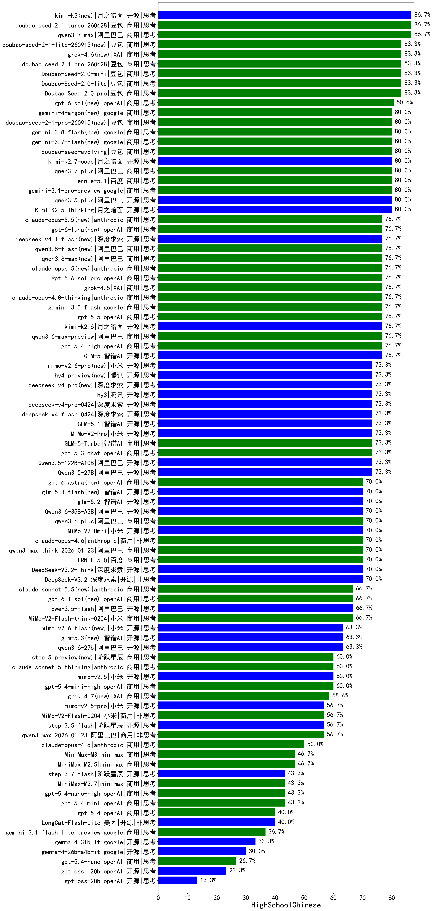

|类别|机构|大模型|【HighSchoolChinese】准确率|平均耗时|平均消耗token|花费/千次（元）|排名（准确率）|
|---|---|-----|-------------------|-------|-----------|-----------|-----------|
|开源|月之暗面|kimi-k3|86.7%|127s|3298|295.1|1|
|商用|阿里巴巴|qwen3.7-max|86.7%|71s|3645|122.3|2|
|商用|豆包|doubao-seed-2-1-turbo-260628|86.7%|206s|9191|132.7|3|
|商用|豆包|doubao-seed-2-1-pro-260628|83.3%|216s|10269|297.7|4|
|商用|豆包|doubao-seed-2-1-lite-260915(new)|83.3%|112s|5972|15.3|5|
|商用|XAI|grok-4.6|83.3%|99s|3957|149.0|6|
|商用|openAI|gpt-6-sol(new)|80.6%|142s|719|24.0|7|
|商用|google|gemini-3.1-pro-preview|80.0%|52s|2647|194.6|8|
|商用|google|gemini-3.7-flash|80.0%|5s|1145|20.9|9|
|商用|阿里巴巴|qwen3.7-plus|80.0%|96s|5433|41.2|10|
|商用|豆包|doubao-seed-2-1-pro-260915(new)|80.0%|90s|3298|88.5|11|
|开源|月之暗面|kimi-k2.7-code|80.0%|58s|2470|59.4|12|
|商用|豆包|doubao-seed-evolving|80.0%|326s|9733|281.6|13|
|商用|google|gemini-3.8-flash(new)|80.0%|18s|1283|49.1|14|
|商用|google|gemini-4-argon(new)|80.0%|19s|769|57.4|15|
|商用|百度|ernie-5.1|80.0%|44s|2013|30.5|16|
|开源|深度求索|deepseek-v4.1-flash(new)|76.7%|36s|4409|32.9|17|
|商用|阿里巴巴|qwen3.8-max|76.7%|69s|3111|102.1|18|
|商用|XAI|grok-4.5|76.7%|98s|5841|228.1|19|
|商用|openAI|gpt-5.6-sol-pro|76.7%|28s|6620|539.9|20|
|商用|anthropic|claude-opus-4.8-thinking|76.7%|17s|1647|197.2|21|
|商用|openAI|gpt-6-luna(new)|76.7%|286s|1352|3.4|22|
|商用|阿里巴巴|qwen3.8-flash(new)|76.7%|46s|2687|6.5|23|
|商用|anthropic|claude-opus-5|76.7%|16s|1308|137.8|24|
|商用|google|gemini-3.5-flash|76.7%|11s|2461|132.2|25|
|商用|openAI|gpt-5.5|76.7%|16s|1401|210.1|26|
|商用|阿里巴巴|qwen3.6-max-preview|76.7%|127s|2990|144.7|27|
|商用|anthropic|claude-opus-5.5(new)|76.7%|15s|1339|114.4|28|
|开源|月之暗面|kimi-k2.6|76.7%|149s|2918|71.5|29|
|开源|深度求索|deepseek-v4-pro|73.3%|56s|3511|86.8|30|
|开源|阿里巴巴|Qwen3.5-27B|73.3%|596s|5633|25.5|31|
|开源|阿里巴巴|Qwen3.5-122B-A10B|73.3%|544s|4920|29.4|32|
|开源|深度求索|deepseek-v4-pro-0424|73.3%|68s|1684|36.0|33|
|开源|智谱AI|GLM-5.1|73.3%|105s|3807|84.5|34|
|开源|腾讯|hy3|73.3%|69s|720|1.8|35|
|开源|腾讯|hy4-preview(new)|73.3%|193s|14161|250.4|36|
|开源|小米|mimo-v2.6-pro(new)|73.3%|74s|3842|21.9|37|
|开源|深度求索|deepseek-v4-flash-0424|73.3%|37s|1413|2.5|38|
|开源|阿里巴巴|Qwen3.6-35B-A3B|70.0%|159s|3095|30.1|39|
|开源|智谱AI|glm-5.2|70.0%|65s|3199|81.8|40|
|商用|阿里巴巴|qwen3.6-plus|70.0%|68s|2945|31.5|41|
|商用|百度|ERNIE-5.0|70.0%|162s|1565|31.2|42|
|开源|深度求索|DeepSeek-V3.2-Think|70.0%|48s|1758|4.9|43|
|商用|openAI|gpt-6-astra(new)|70.0%|18s|725|119.0|44|
|开源|深度求索|DeepSeek-V3.2|70.0%|119s|686|1.7|45|
|开源|智谱AI|glm-5.3-flash(new)|70.0%|181s|9244|25.1|46|
|商用|openAI|gpt-6.1-sol(new)|66.7%|7s|701|22.1|47|
|商用|anthropic|claude-sonnet-5.5(new)|66.7%|9s|1307|55.0|48|
|开源|小米|mimo-v2.6-flash(new)|63.3%|79s|3166|5.9|49|
|商用|minimax|MiniMax-M3.1-Flash(new)|63.3%|133s|11732|45.3|50|
|开源|智谱AI|glm-5.3(new)|63.3%|154s|6021|160.8|51|
|开源|阿里巴巴|qwen3.6-27b|63.3%|47s|3175|51.6|52|
|商用|阶跃星辰|step-5-preview(new)|60.0%|68s|4670|88.6|53|
|开源|小米|mimo-v2.5|60.0%|60s|3372|40.0|54|
|商用|anthropic|claude-sonnet-5-thinking|60.0%|16s|1443|63.6|55|
|商用|XAI|grok-4.7(new)|58.6%|196s|14051|543.7|56|
|开源|小米|mimo-v2.5-pro|56.7%|54s|2734|48.4|57|
|商用|anthropic|claude-opus-4.8|50.0%|8s|987|81.8|58|
|商用|minimax|MiniMax-M3|46.7%|69s|2232|30.9|59|
|商用|anthropic|claude-haiku-5.5(new)|46.7%|11s|1773|4.4|60|
|开源|阶跃星辰|step-3.7-flash|43.3%|310s|4164|31.2|61|
|商用|minimax|MiniMax-M2.7|43.3%|124s|5780|46.1|62|
|商用|google|gemini-3.1-flash-lite-preview|36.7%|3s|784|4.4|63|
|开源|google|gemma-4-31b-it|33.3%|100s|841|1.5|64|
|开源|google|gemma-4-26b-a4b-it|30.0%|80s|925|1.7|65|
|开源|openAI|gpt-oss-120b|23.3%|145s|1583|4.1|66|
|开源|openAI|gpt-oss-20b|13.3%|341s|4664|5.1|67|

