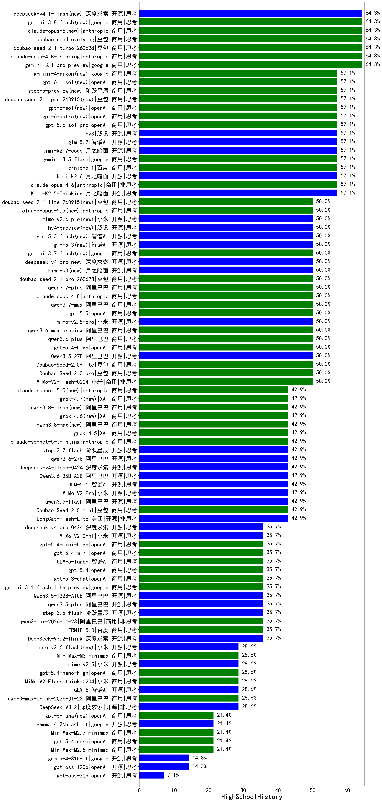

|类别|机构|大模型|【HighSchoolHistory】准确率|平均耗时|平均消耗token|花费/千次（元）|排名（准确率）|
|---|---|-----|-------------------|-------|-----------|-----------|-----------|
|商用|anthropic|claude-opus-5|64.3%|13s|775|108.5|1|
|商用|google|gemini-3.1-pro-preview|64.3%|53s|2550|207.6|2|
|开源|深度求索|deepseek-v4.1-flash(new)|64.3%|12s|1177|8.6|3|
|商用|google|gemini-3.8-flash(new)|64.3%|13s|916|42.4|4|
|商用|豆包|doubao-seed-2-1-turbo-260628|64.3%|180s|7168|105.6|5|
|商用|豆包|doubao-seed-evolving|64.3%|287s|11664|346.0|6|
|商用|anthropic|claude-opus-4.8-thinking|64.3%|13s|970|142.5|7|
|商用|豆包|doubao-seed-2-1-pro-260915(new)|57.1%|86s|2316|65.5|8|
|开源|月之暗面|kimi-k2.7-code|57.1%|44s|1926|49.6|9|
|开源|智谱AI|glm-5.2|57.1%|88s|4112|112.7|10|
|商用|google|gemini-3.5-flash|57.1%|11s|2043|121.6|11|
|商用|百度|ernie-5.1|57.1%|28s|1115|18.4|12|
|开源|腾讯|hy3|57.1%|61s|341|1.0|13|
|商用|openAI|gpt-5.6-sol-pro|57.1%|25s|3854|314.7|14|
|开源|月之暗面|kimi-k2.6|57.1%|221s|2327|60.4|15|
|商用|openAI|gpt-6-sol(new)|57.1%|161s|388|19.0|16|
|商用|阶跃星辰|step-5-preview(new)|57.1%|65s|4602|90.5|17|
|商用|openAI|gpt-6.1-sol(new)|57.1%|8s|312|13.7|18|
|商用|openAI|gpt-6-astra(new)|57.1%|11s|340|78.3|19|
|商用|google|gemini-4-argon(new)|57.1%|12s|553|59.3|20|
|商用|google|gemini-3.7-flash|50.0%|6s|817|18.6|21|
|开源|月之暗面|kimi-k3|50.0%|72s|1474|131.8|22|
|开源|智谱AI|glm-5.3(new)|50.0%|-114s|5365|147.8|23|
|开源|智谱AI|glm-5.3-flash(new)|50.0%|115s|3936|10.8|24|
|商用|anthropic|claude-opus-5.5(new)|50.0%|15s|800|90.1|25|
|开源|腾讯|hy4-preview(new)|50.0%|104s|6498|115.4|26|
|开源|小米|mimo-v2.6-pro(new)|50.0%|93s|5855|34.7|27|
|开源|深度求索|deepseek-v4-pro|50.0%|66s|1346|32.9|28|
|商用|豆包|doubao-seed-2-1-pro-260628|50.0%|309s|10629|314.9|29|
|商用|anthropic|claude-opus-4.8|50.0%|10s|690|93.6|30|
|商用|阿里巴巴|qwen3.7-max|50.0%|29s|1556|53.1|31|
|开源|阿里巴巴|Qwen3.5-27B|50.0%|194s|4432|20.8|32|
|商用|openAI|gpt-5.5|50.0%|13s|794|141.4|33|
|商用|阿里巴巴|qwen3.6-plus|50.0%|48s|1891|21.5|34|
|开源|小米|mimo-v2.5-pro|50.0%|37s|1645|29.3|35|
|商用|豆包|doubao-seed-2-1-lite-260915(new)|50.0%|82s|3875|10.2|36|
|商用|阿里巴巴|qwen3.6-max-preview|50.0%|69s|2020|103.5|37|
|商用|阿里巴巴|qwen3.7-plus|50.0%|41s|2039|15.6|38|
|开源|阶跃星辰|step-3.7-flash|42.9%|23s|2558|19.9|39|
|商用|XAI|grok-4.6|42.9%|59s|2817|109.2|40|
|商用|anthropic|claude-sonnet-5.5(new)|42.9%|8s|598|30.9|41|
|商用|阿里巴巴|qwen3.8-flash(new)|42.9%|37s|2295|5.9|42|
|开源|智谱AI|GLM-5.1|42.9%|59s|1734|39.5|43|
|商用|阿里巴巴|qwen3.8-max|42.9%|53s|1930|65.6|44|
|开源|阿里巴巴|Qwen3.6-35B-A3B|42.9%|164s|2028|20.8|45|
|商用|XAI|grok-4.5|42.9%|177s|2190|82.8|46|
|开源|深度求索|deepseek-v4-flash-0424|42.9%|21s|822|1.5|47|
|商用|anthropic|claude-sonnet-5-thinking|42.9%|16s|1037|61.7|48|
|开源|阿里巴巴|qwen3.6-27b|42.9%|40s|2297|39.5|49|
|商用|XAI|grok-4.7(new)|42.9%|116s|8102|302.1|50|
|开源|深度求索|deepseek-v4-pro-0424|35.7%|59s|1141|26.0|51|
|商用|google|gemini-3.1-flash-lite-preview|35.7%|74s|543|4.5|52|
|开源|阿里巴巴|Qwen3.5-122B-A10B|35.7%|617s|4268|26.6|53|
|商用|百度|ERNIE-5.0|35.7%|114s|1225|27.4|54|
|开源|深度求索|DeepSeek-V3.2-Think|35.7%|188s|1356|4.0|55|
|商用|minimax|MiniMax-M3.1-Flash(new)|28.6%|23s|1482|5.0|56|
|开源|小米|mimo-v2.6-flash(new)|28.6%|168s|1004|1.9|57|
|商用|minimax|MiniMax-M3|28.6%|36s|1036|13.8|58|
|开源|小米|mimo-v2.5|28.6%|39s|1516|17.1|59|
|开源|深度求索|DeepSeek-V3.2|28.6%|11s|394|1.1|60|
|商用|openAI|gpt-6-luna(new)|21.4%|170s|468|1.2|61|
|开源|google|gemma-4-26b-a4b-it|21.4%|31s|724|1.7|62|
|商用|minimax|MiniMax-M2.7|21.4%|39s|1578|12.3|63|
|开源|google|gemma-4-31b-it|14.3%|136s|647|1.5|64|
|商用|anthropic|claude-haiku-5.5(new)|14.3%|12s|865|2.5|65|
|开源|openAI|gpt-oss-120b|14.3%|11s|678|1.7|66|
|开源|openAI|gpt-oss-20b|7.1%|16s|1149|1.2|67|

