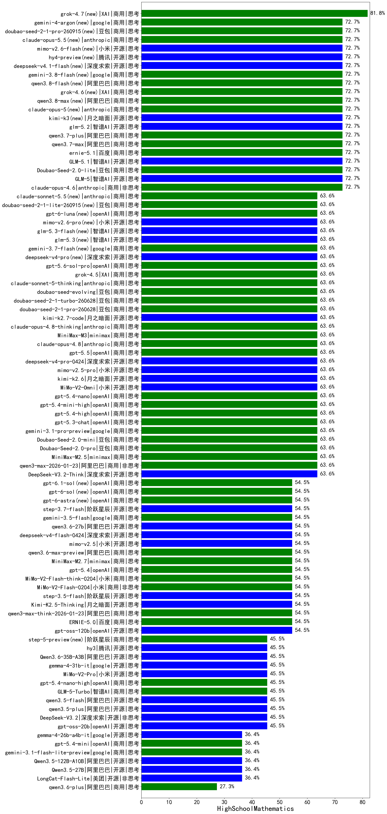

|类别|机构|大模型|【HighSchoolMathematics】准确率|平均耗时|平均消耗token|花费/千次（元）|排名（准确率）|
|---|---|-----|-------------------|-------|-----------|-----------|-----------|
|商用|XAI|grok-4.7(new)|81.8%|192s|15564|614.4|1|
|开源|月之暗面|kimi-k3.1-pro(new)|72.7%|242s|7837|520.1|2|
|开源|智谱AI|GLM-5.1|72.7%|296s|9851|233.5|3|
|商用|阿里巴巴|qwen3.7-plus|72.7%|176s|9476|74.8|4|
|开源|月之暗面|kimi-k3|72.7%|113s|2980|279.3|5|
|商用|阿里巴巴|qwen3.7-max|72.7%|158s|7640|270.9|6|
|商用|anthropic|claude-opus-5|72.7%|16s|1414|212.8|7|
|商用|百度|ernie-5.1|72.7%|163s|6753|119.4|8|
|商用|阿里巴巴|qwen3.8-max|72.7%|169s|7203|254.3|9|
|商用|XAI|grok-4.6|72.7%|364s|6066|244.7|10|
|商用|阿里巴巴|qwen3.8-flash(new)|72.7%|134s|10050|26.7|11|
|商用|google|gemini-3.8-flash(new)|72.7%|22s|2991|150.2|12|
|开源|深度求索|deepseek-v4.1-flash(new)|72.7%|22s|5350|41.8|13|
|开源|智谱AI|glm-5.2|72.7%|226s|8921|246.4|14|
|开源|腾讯|hy4-preview(new)|72.7%|87s|6460|114.4|15|
|商用|anthropic|claude-opus-5.5(new)|72.7%|17s|1305|154.8|16|
|商用|google|gemini-4-argon(new)|72.7%|25s|1352|167.9|17|
|商用|豆包|doubao-seed-2-1-pro-260915(new)|72.7%|76s|3249|92.7|18|
|开源|小米|mimo-v2.6-flash(new)|72.7%|427s|10314|20.5|19|
|开源|智谱AI|glm-5.3(new)|63.6%|532s|6361|174.7|20|
|商用|google|gemini-3.7-flash|63.6%|8s|2295|56.9|21|
|商用|openAI|gpt-6-luna(new)|63.6%|55s|1533|4.9|22|
|开源|深度求索|deepseek-v4-pro|63.6%|137s|7718|204.4|23|
|开源|小米|mimo-v2.6-pro(new)|63.6%|250s|11680|69.6|24|
|商用|豆包|doubao-seed-2-1-lite-260915(new)|63.6%|77s|3576|9.3|25|
|商用|anthropic|claude-sonnet-5.5(new)|63.6%|16s|1227|71.9|26|
|商用|豆包|doubao-seed-2-1-pro-260628|63.6%|498s|24438|728.4|27|
|商用|openAI|gpt-5.6-sol-pro|63.6%|39s|8813|914.9|28|
|商用|minimax|MiniMax-M3.1-Flash(new)|63.6%|48s|3741|14.0|29|
|商用|XAI|grok-4.5|63.6%|126s|8502|347.0|30|
|商用|anthropic|claude-sonnet-5-thinking|63.6%|30s|3226|212.0|31|
|商用|豆包|doubao-seed-evolving|63.6%|382s|19279|573.9|32|
|开源|智谱AI|glm-5.3-flash(new)|63.6%|307s|8017|22.1|33|
|商用|豆包|doubao-seed-2-1-turbo-260628|63.6%|687s|17674|262.8|34|
|开源|小米|mimo-v2.5-pro|63.6%|184s|8982|182.8|35|
|商用|anthropic|claude-opus-4.8-thinking|63.6%|23s|2297|367.3|36|
|商用|minimax|MiniMax-M3|63.6%|136s|5750|92.7|37|
|商用|anthropic|claude-opus-4.8|63.6%|13s|1166|169.4|38|
|商用|openAI|gpt-5.5|63.6%|43s|1774|342.8|39|
|开源|深度求索|deepseek-v4-pro-0424|63.6%|277s|10761|256.5|40|
|开源|深度求索|DeepSeek-V3.2-Think|63.6%|332s|7778|23.2|41|
|商用|google|gemini-3.1-pro-preview|63.6%|98s|7929|664.1|42|
|开源|月之暗面|kimi-k2.6|63.6%|511s|9972|242.1|43|
|开源|月之暗面|kimi-k2.7-code|63.6%|77s|4414|116.0|44|
|商用|openAI|gpt-6-astra(new)|54.5%|22s|856|251.8|45|
|商用|openAI|gpt-6.1-sol(new)|54.5%|11s|778|44.9|46|
|商用|openAI|gpt-6-sol(new)|54.5%|401s|732|41.7|47|
|商用|minimax|MiniMax-M2.7|54.5%|198s|8789|72.7|48|
|商用|百度|ERNIE-5.0|54.5%|570s|13517|321.7|49|
|商用|anthropic|claude-haiku-5.5(new)|54.5%|23s|1874|5.9|50|
|开源|openAI|gpt-oss-120b|54.5%|131s|2226|6.8|51|
|商用|阿里巴巴|qwen3.6-max-preview|54.5%|199s|7161|379.0|52|
|开源|小米|mimo-v2.5|54.5%|120s|7331|98.0|53|
|开源|深度求索|deepseek-v4-flash-0424|54.5%|117s|5369|10.6|54|
|开源|阿里巴巴|qwen3.6-27b|54.5%|97s|6846|120.7|55|
|商用|google|gemini-3.5-flash|54.5%|21s|4694|287.2|56|
|开源|阶跃星辰|step-3.7-flash|54.5%|75s|10028|80.2|57|
|开源|深度求索|DeepSeek-V3.2|45.5%|72s|2238|6.6|58|
|商用|阶跃星辰|step-5-preview(new)|45.5%|56s|4892|95.9|59|
|开源|openAI|gpt-oss-20b|45.5%|179s|2977|3.3|60|
|开源|google|gemma-4-31b-it|45.5%|205s|1219|3.1|61|
|开源|腾讯|hy3|45.5%|76s|1290|4.7|62|
|开源|阿里巴巴|Qwen3.6-35B-A3B|45.5%|226s|8862|94.2|63|
|开源|阿里巴巴|Qwen3.5-27B|36.4%|274s|19218|91.5|64|
|开源|阿里巴巴|Qwen3.5-122B-A10B|36.4%|808s|17377|110.3|65|
|商用|google|gemini-3.1-flash-lite-preview|36.4%|41s|1047|9.6|66|
|开源|google|gemma-4-26b-a4b-it|36.4%|112s|1653|4.3|67|
|商用|阿里巴巴|qwen3.6-plus|27.3%|187s|5674|66.7|68|

