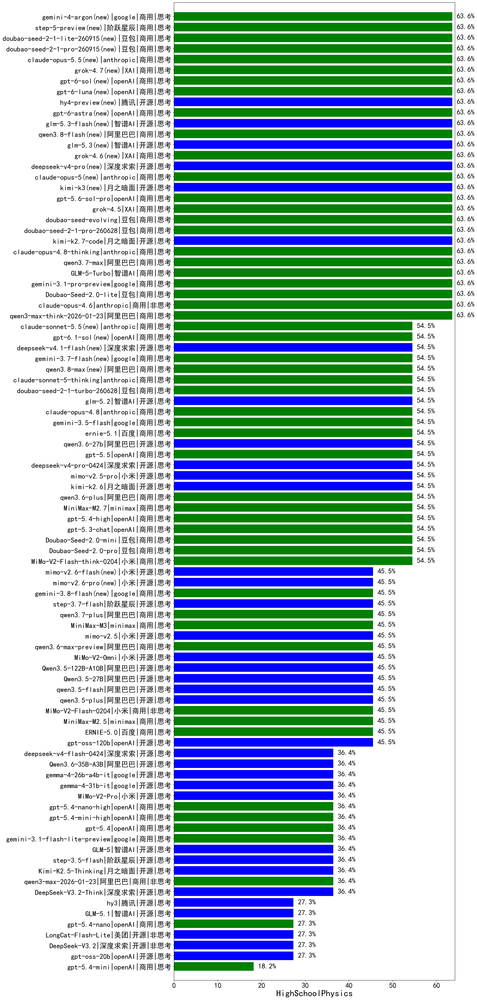

|类别|机构|大模型|【HighSchoolPhysics】准确率|平均耗时|平均消耗token|花费/千次（元）|排名（准确率）|
|---|---|-----|-------------------|-------|-----------|-----------|-----------|
|开源|月之暗面|kimi-k3.1-pro(new)|63.6%|93s|3222|208.3|1|
|商用|豆包|doubao-seed-2-1-pro-260628|63.6%|308s|16424|488.8|2|
|开源|月之暗面|kimi-k2.7-code|63.6%|56s|2220|57.5|3|
|商用|anthropic|claude-opus-4.8-thinking|63.6%|16s|1209|183.3|4|
|商用|XAI|grok-4.5|63.6%|173s|3435|135.2|5|
|商用|openAI|gpt-5.6-sol-pro|63.6%|43s|5433|495.3|6|
|开源|月之暗面|kimi-k3|63.6%|61s|1363|120.7|7|
|商用|阿里巴巴|qwen3.7-max|63.6%|129s|5731|203.3|8|
|商用|anthropic|claude-opus-5|63.6%|12s|898|128.8|9|
|开源|深度求索|deepseek-v4-pro|63.6%|179s|3709|96.7|10|
|商用|XAI|grok-4.6|63.6%|63s|3262|127.9|11|
|开源|智谱AI|glm-5.3(new)|63.6%|612s|12004|333.5|12|
|商用|阿里巴巴|qwen3.8-flash(new)|63.6%|145s|8266|22.0|13|
|开源|智谱AI|glm-5.3-flash(new)|63.6%|165s|2903|7.9|14|
|商用|openAI|gpt-6-astra(new)|63.6%|21s|525|140.7|15|
|商用|豆包|doubao-seed-2-1-lite-260915(new)|63.6%|45s|2654|6.9|16|
|商用|豆包|doubao-seed-2-1-pro-260915(new)|63.6%|57s|1459|39.8|17|
|商用|google|gemini-4-argon(new)|63.6%|13s|827|98.3|18|
|商用|google|gemini-3.1-pro-preview|63.6%|75s|4809|400.3|19|
|商用|阶跃星辰|step-5-preview(new)|63.6%|59s|4354|85.5|20|
|开源|腾讯|hy4-preview(new)|63.6%|93s|5398|95.6|21|
|商用|豆包|doubao-seed-evolving|63.6%|335s|13818|410.6|22|
|商用|anthropic|claude-opus-5.5(new)|63.6%|17s|829|93.2|23|
|商用|XAI|grok-4.7(new)|63.6%|92s|7396|272.5|24|
|商用|openAI|gpt-6-sol(new)|63.6%|431s|429|21.5|25|
|商用|openAI|gpt-6-luna(new)|63.6%|146s|799|2.4|26|
|商用|阿里巴巴|qwen3.8-max|54.5%|177s|7349|260.7|27|
|商用|google|gemini-3.7-flash|54.5%|6s|1481|36.1|28|
|商用|openAI|gpt-6.1-sol(new)|54.5%|7s|494|26.0|29|
|商用|anthropic|claude-sonnet-5.5(new)|54.5%|7s|815|45.6|30|
|商用|anthropic|claude-sonnet-5-thinking|54.5%|37s|2965|196.2|31|
|商用|anthropic|claude-haiku-5.5(new)|54.5%|10s|1400|4.3|32|
|开源|深度求索|deepseek-v4.1-flash(new)|54.5%|19s|3016|23.3|33|
|商用|豆包|doubao-seed-2-1-turbo-260628|54.5%|384s|12960|192.4|34|
|开源|阿里巴巴|qwen3.6-27b|54.5%|73s|4545|79.9|35|
|商用|百度|ernie-5.1|54.5%|73s|3051|53.2|36|
|开源|月之暗面|kimi-k2.6|54.5%|357s|9625|257.5|37|
|商用|阿里巴巴|qwen3.6-plus|54.5%|108s|6207|73.2|38|
|开源|小米|mimo-v2.5-pro|54.5%|96s|4438|87.9|39|
|商用|minimax|MiniMax-M2.7|54.5%|109s|4391|36.0|40|
|开源|深度求索|deepseek-v4-pro-0424|54.5%|102s|3556|84.0|41|
|商用|openAI|gpt-5.5|54.5%|13s|921|166.5|42|
|开源|智谱AI|glm-5.2|54.5%|125s|5764|158.7|43|
|商用|google|gemini-3.5-flash|54.5%|14s|2981|180.8|44|
|商用|anthropic|claude-opus-4.8|54.5%|9s|888|127.1|45|
|开源|小米|mimo-v2.6-pro(new)|45.5%|227s|11016|65.7|46|
|开源|阿里巴巴|Qwen3.5-122B-A10B|45.5%|823s|6782|42.7|47|
|开源|阿里巴巴|Qwen3.5-27B|45.5%|994s|8000|37.9|48|
|商用|百度|ERNIE-5.0|45.5%|335s|5877|139.1|49|
|开源|小米|mimo-v2.6-flash(new)|45.5%|157s|3945|7.8|50|
|商用|minimax|MiniMax-M3.1-Flash(new)|45.5%|54s|3317|12.3|51|
|商用|阿里巴巴|qwen3.6-max-preview|45.5%|111s|3839|201.7|52|
|开源|openAI|gpt-oss-120b|45.5%|106s|1349|3.9|53|
|商用|google|gemini-3.8-flash(new)|45.5%|32s|1743|85.9|54|
|开源|小米|mimo-v2.5|45.5%|77s|3544|45.4|55|
|商用|minimax|MiniMax-M3|45.5%|160s|5634|91.1|56|
|商用|阿里巴巴|qwen3.7-plus|45.5%|263s|14619|116.2|57|
|开源|阶跃星辰|step-3.7-flash|45.5%|45s|5036|40.0|58|
|开源|阿里巴巴|Qwen3.6-35B-A3B|36.4%|23s|4231|44.6|59|
|开源|google|gemma-4-26b-a4b-it|36.4%|86s|876|2.2|60|
|开源|google|gemma-4-31b-it|36.4%|138s|909|2.3|61|
|开源|深度求索|deepseek-v4-flash-0424|36.4%|71s|2773|5.4|62|
|商用|google|gemini-3.1-flash-lite-preview|36.4%|35s|764|6.9|63|
|开源|深度求索|DeepSeek-V3.2-Think|36.4%|128s|3998|11.9|64|
|开源|智谱AI|GLM-5.1|27.3%|722s|6306|149.1|65|
|开源|腾讯|hy3|27.3%|57s|642|2.2|66|
|开源|深度求索|DeepSeek-V3.2|27.3%|35s|997|2.9|67|
|开源|openAI|gpt-oss-20b|27.3%|213s|1665|1.8|68|

