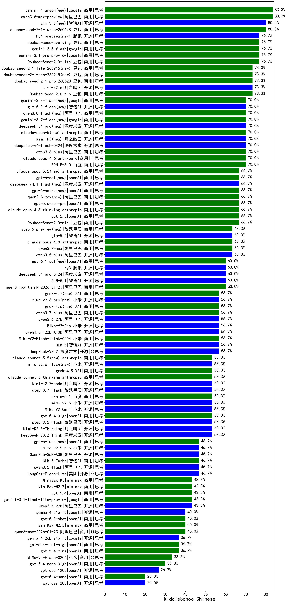

|类别|机构|大模型|【MiddleSchoolChinese】准确率|平均耗时|平均消耗token|花费/千次（元）|排名（准确率）|
|---|---|-----|-------------------|-------|-----------|-----------|-----------|
|商用|阿里巴巴|qwen3.6-max-preview|83.3%|96s|2899|148.1|1|
|商用|google|gemini-4-argon(new)|83.3%|17s|620|59.3|2|
|商用|豆包|doubao-seed-2-1-turbo-260628|80.0%|260s|11351|167.6|3|
|开源|智谱AI|glm-5.3(new)|80.0%|416s|6061|165.9|4|
|商用|豆包|doubao-seed-evolving|76.7%|384s|12169|359.7|5|
|商用|google|gemini-3.5-flash|76.7%|13s|2734|160.6|6|
|商用|google|gemini-3.1-pro-preview|76.7%|54s|3244|260.6|7|
|开源|腾讯|hy4-preview(new)|76.7%|212s|14126|252.0|8|
|开源|月之暗面|kimi-k2.6|73.3%|172s|3635|94.5|9|
|商用|豆包|doubao-seed-2-1-pro-260628|73.3%|294s|13225|391.4|10|
|商用|豆包|doubao-seed-2-1-lite-260915(new)|73.3%|140s|6938|18.3|11|
|商用|豆包|doubao-seed-2-1-pro-260915(new)|73.3%|96s|3295|93.5|12|
|商用|阿里巴巴|qwen3.6-plus|70.0%|56s|2917|33.1|13|
|开源|深度求索|deepseek-v4-flash-0424|70.0%|68s|3033|5.9|14|
|开源|月之暗面|kimi-k3|70.0%|101s|2335|213.2|15|
|商用|anthropic|claude-opus-5|70.0%|13s|926|122.4|16|
|商用|百度|ERNIE-5.0|70.0%|175s|4184|97.5|17|
|开源|深度求索|deepseek-v4-pro|70.0%|70s|3207|82.0|18|
|商用|google|gemini-3.7-flash|70.0%|21s|1051|22.9|19|
|商用|阿里巴巴|qwen3.8-flash(new)|70.0%|35s|2441|6.1|20|
|开源|智谱AI|glm-5.3-flash(new)|70.0%|199s|7019|19.3|21|
|商用|google|gemini-3.8-flash(new)|70.0%|15s|1332|60.6|22|
|商用|anthropic|claude-opus-5.5(new)|66.7%|17s|1066|117.2|23|
|商用|openAI|gpt-6-astra(new)|66.7%|17s|459|97.1|24|
|商用|openAI|gpt-5.5|66.7%|11s|865|141.8|25|
|商用|阿里巴巴|qwen3.8-max|66.7%|80s|3500|120.6|26|
|商用|openAI|gpt-6-sol(new)|66.7%|291s|505|22.6|27|
|商用|openAI|gpt-5.6-sol-pro|66.7%|25s|5410|472.9|28|
|开源|深度求索|deepseek-v4.1-flash(new)|66.7%|20s|2821|21.4|29|
|商用|anthropic|claude-opus-4.8-thinking|66.7%|32s|2135|334.0|30|
|开源|智谱AI|glm-5.2|63.3%|115s|5316|145.1|31|
|商用|阶跃星辰|step-5-preview(new)|63.3%|65s|4934|96.3|32|
|商用|anthropic|claude-opus-4.8|63.3%|7s|643|72.9|33|
|商用|阿里巴巴|qwen3.7-max|63.3%|83s|3939|137.3|34|
|商用|openAI|gpt-6.1-sol(new)|60.0%|8s|422|16.8|35|
|开源|智谱AI|GLM-5.1|60.0%|354s|3994|92.6|36|
|开源|腾讯|hy3|60.0%|61s|542|1.6|37|
|开源|深度求索|deepseek-v4-pro-0424|60.0%|102s|3786|88.8|38|
|开源|深度求索|DeepSeek-V3.2|56.7%|121s|600|1.6|39|
|商用|阿里巴巴|qwen3.7-plus|56.7%|101s|5148|40.1|40|
|商用|XAI|grok-4.7(new)|56.7%|173s|12425|481.9|41|
|开源|阿里巴巴|Qwen3.5-122B-A10B|56.7%|151s|5215|32.3|42|
|开源|阿里巴巴|qwen3.6-27b|56.7%|49s|3045|52.0|43|
|商用|XAI|grok-4.6|56.7%|462s|4807|190.9|44|
|开源|小米|mimo-v2.6-pro(new)|56.7%|121s|5244|30.9|45|
|开源|深度求索|DeepSeek-V3.2-Think|53.3%|222s|2397|7.0|46|
|开源|小米|mimo-v2.6-flash(new)|53.3%|373s|2281|4.4|47|
|开源|小米|mimo-v2.5|53.3%|53s|3050|37.8|48|
|商用|anthropic|claude-sonnet-5.5(new)|53.3%|79s|1040|56.8|49|
|商用|百度|ernie-5.1|53.3%|64s|2412|40.8|50|
|商用|XAI|grok-4.5|53.3%|123s|7235|292.8|51|
|商用|anthropic|claude-sonnet-5-thinking|53.3%|22s|1680|101.8|52|
|开源|阶跃星辰|step-3.7-flash|53.3%|58s|5078|39.9|53|
|开源|月之暗面|kimi-k2.7-code|53.3%|70s|2847|73.3|54|
|开源|阿里巴巴|Qwen3.6-35B-A3B|46.7%|18s|3192|32.8|55|
|开源|小米|mimo-v2.5-pro|46.7%|72s|3373|64.6|56|
|商用|openAI|gpt-6-luna(new)|46.7%|276s|1088|3.2|57|
|商用|minimax|MiniMax-M2.7|43.3%|118s|5005|40.7|58|
|商用|google|gemini-3.1-flash-lite-preview|43.3%|5s|558|3.9|59|
|商用|minimax|MiniMax-M3|43.3%|115s|3731|58.4|60|
|开源|阿里巴巴|Qwen3.5-27B|43.3%|579s|5069|23.5|61|
|开源|google|gemma-4-31b-it|40.0%|115s|710|1.6|62|
|商用|minimax|MiniMax-M3.1-Flash(new)|36.7%|90s|5295|20.1|63|
|开源|google|gemma-4-26b-a4b-it|36.7%|40s|886|2.0|64|
|商用|anthropic|claude-haiku-5.5(new)|26.7%|18s|1532|4.6|65|
|开源|openAI|gpt-oss-120b|26.7%|8s|1475|4.1|66|
|开源|openAI|gpt-oss-20b|20.0%|164s|3275|3.6|67|

