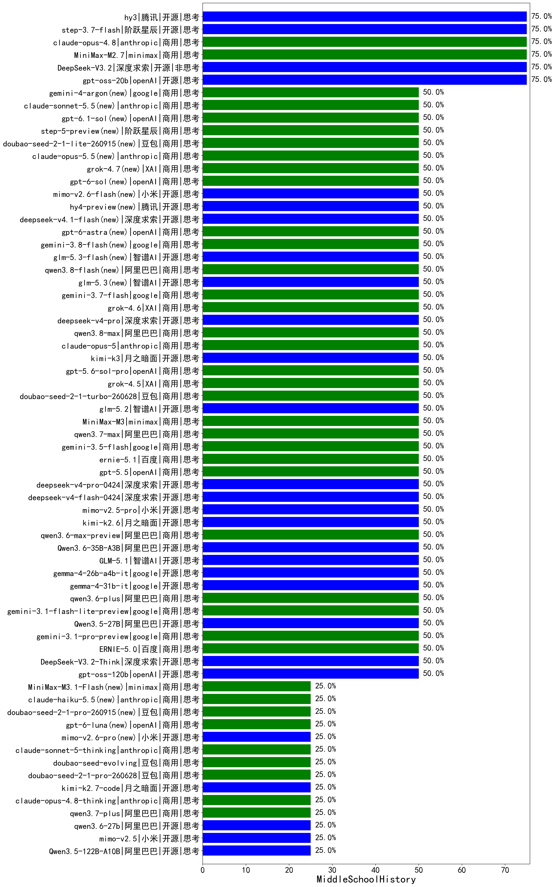

|类别|机构|大模型|【MiddleSchoolHistory】准确率|平均耗时|平均消耗token|花费/千次（元）|排名（准确率）|
|---|---|-----|-------------------|-------|-----------|-----------|-----------|
|开源|深度求索|DeepSeek-V3.2|75.0%|13s|391|1.0|1|
|商用|anthropic|claude-opus-4.8|75.0%|10s|703|91.2|2|
|开源|openAI|gpt-oss-20b|75.0%|8s|1126|1.1|3|
|商用|minimax|MiniMax-M2.7|75.0%|30s|1196|9.1|4|
|开源|腾讯|hy3|75.0%|57s|308|0.8|5|
|开源|阶跃星辰|step-3.7-flash|75.0%|19s|1568|11.8|6|
|开源|openAI|gpt-oss-120b|50.0%|8s|642|1.6|7|
|商用|anthropic|claude-opus-5|50.0%|13s|748|99.0|8|
|商用|豆包|doubao-seed-2-1-lite-260915(new)|50.0%|69s|3098|8.1|9|
|开源|智谱AI|glm-5.2|50.0%|107s|1889|50.1|10|
|商用|豆包|doubao-seed-2-1-turbo-260628|50.0%|176s|7318|107.6|11|
|商用|anthropic|claude-opus-5.5(new)|50.0%|13s|853|93.6|12|
|商用|XAI|grok-4.5|50.0%|82s|3151|122.8|13|
|商用|openAI|gpt-5.6-sol-pro|50.0%|18s|3714|283.0|14|
|开源|月之暗面|kimi-k3|50.0%|63s|686|52.4|15|
|开源|深度求索|deepseek-v4-pro|50.0%|740s|956|22.1|16|
|商用|阿里巴巴|qwen3.8-max|50.0%|11s|543|15.4|17|
|商用|XAI|grok-4.6|50.0%|161s|2375|90.2|18|
|商用|google|gemini-3.7-flash|50.0%|4s|745|16.4|19|
|开源|智谱AI|glm-5.3(new)|50.0%|1513s|7905|218.6|20|
|商用|阿里巴巴|qwen3.8-flash(new)|50.0%|54s|4053|10.6|21|
|开源|智谱AI|glm-5.3-flash(new)|50.0%|64s|2489|6.7|22|
|商用|google|gemini-3.8-flash(new)|50.0%|14s|760|33.6|23|
|商用|openAI|gpt-6-astra(new)|50.0%|13s|328|69.1|24|
|开源|深度求索|deepseek-v4.1-flash(new)|50.0%|25s|2249|17.1|25|
|开源|腾讯|hy4-preview(new)|50.0%|27s|1724|29.3|26|
|商用|XAI|grok-4.7(new)|50.0%|125s|9020|340.3|27|
|商用|阶跃星辰|step-5-preview(new)|50.0%|19s|1585|29.9|28|
|商用|minimax|MiniMax-M3|50.0%|27s|753|9.0|29|
|商用|openAI|gpt-6.1-sol(new)|50.0%|6s|296|11.6|30|
|商用|openAI|gpt-6-sol(new)|50.0%|292s|310|12.5|31|
|开源|深度求索|DeepSeek-V3.2-Think|50.0%|207s|1107|3.2|32|
|商用|百度|ERNIE-5.0|50.0%|61s|1177|26.1|33|
|商用|google|gemini-3.1-pro-preview|50.0%|23s|1516|118.4|34|
|开源|阿里巴巴|Qwen3.5-27B|50.0%|146s|3485|16.2|35|
|商用|google|gemini-3.1-flash-lite-preview|50.0%|5s|601|5.0|36|
|商用|阿里巴巴|qwen3.6-plus|50.0%|60s|1762|19.8|37|
|开源|google|gemma-4-31b-it|50.0%|33s|763|1.8|38|
|开源|google|gemma-4-26b-a4b-it|50.0%|65s|737|1.8|39|
|开源|智谱AI|GLM-5.1|50.0%|204s|1517|34.1|40|
|开源|阿里巴巴|Qwen3.6-35B-A3B|50.0%|134s|1690|17.0|41|
|商用|阿里巴巴|qwen3.6-max-preview|50.0%|52s|1940|98.6|42|
|开源|月之暗面|kimi-k2.6|50.0%|66s|1670|42.5|43|
|商用|google|gemini-4-argon(new)|50.0%|16s|506|51.1|44|
|开源|小米|mimo-v2.5-pro|50.0%|223s|17113|354.0|45|
|开源|深度求索|deepseek-v4-flash-0424|50.0%|17s|885|1.6|46|
|开源|深度求索|deepseek-v4-pro-0424|50.0%|25s|734|16.1|47|
|商用|openAI|gpt-5.5|50.0%|23s|582|93.5|48|
|商用|anthropic|claude-sonnet-5.5(new)|50.0%|9s|577|27.5|49|
|商用|百度|ernie-5.1|50.0%|22s|845|13.3|50|
|商用|google|gemini-3.5-flash|50.0%|13s|1671|97.3|51|
|商用|阿里巴巴|qwen3.7-max|50.0%|28s|1308|43.8|52|
|开源|小米|mimo-v2.6-flash(new)|50.0%|362s|826|1.5|53|
|商用|豆包|doubao-seed-2-1-pro-260915(new)|25.0%|178s|3219|92.3|54|
|商用|anthropic|claude-haiku-5.5(new)|25.0%|5s|867|2.4|55|
|商用|豆包|doubao-seed-2-1-pro-260628|25.0%|223s|9106|268.9|56|
|商用|openAI|gpt-6-luna(new)|25.0%|441s|411|1.0|57|
|开源|小米|mimo-v2.6-pro(new)|25.0%|83s|3689|21.7|58|
|商用|anthropic|claude-sonnet-5-thinking|25.0%|15s|909|50.8|59|
|商用|豆包|doubao-seed-evolving|25.0%|290s|13005|385.9|60|
|开源|月之暗面|kimi-k2.7-code|25.0%|18s|620|14.2|61|
|商用|anthropic|claude-opus-4.8-thinking|25.0%|16s|985|140.4|62|
|商用|阿里巴巴|qwen3.7-plus|25.0%|95s|5167|40.5|63|
|开源|阿里巴巴|qwen3.6-27b|25.0%|37s|2228|38.1|64|
|开源|小米|mimo-v2.5|25.0%|20s|1377|15.0|65|
|开源|阿里巴巴|Qwen3.5-122B-A10B|25.0%|504s|5076|31.7|66|
|商用|minimax|MiniMax-M3.1-Flash(new)|25.0%|24s|1196|3.8|67|

