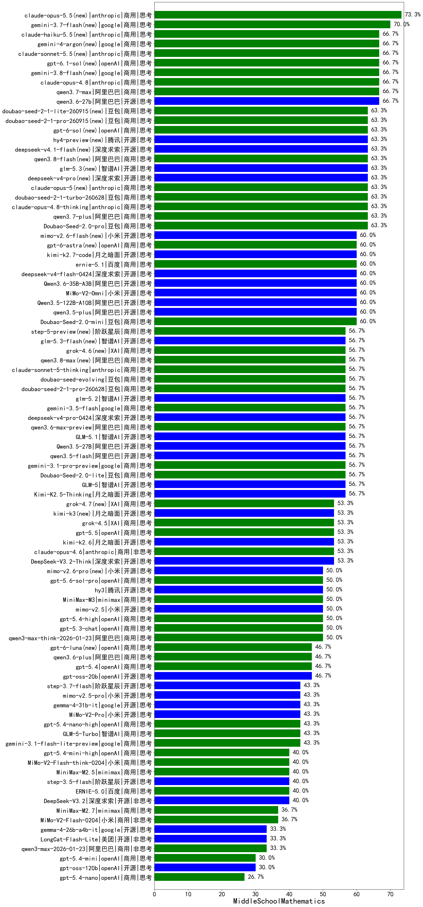

|类别|机构|大模型|【MiddleSchoolMathematics】准确率|平均耗时|平均消耗token|花费/千次（元）|排名（准确率）|
|---|---|-----|-------------------|-------|-----------|-----------|-----------|
|商用|anthropic|claude-opus-5.5(new)|73.3%|21s|895|106.8|1|
|商用|google|gemini-3.7-flash|70.0%|6s|1443|35.5|2|
|开源|阿里巴巴|qwen3.6-27b|66.7%|171s|11389|203.2|3|
|商用|anthropic|claude-opus-4.8|66.7%|15s|1147|177.6|4|
|商用|google|gemini-3.8-flash(new)|66.7%|22s|1856|92.6|5|
|商用|openAI|gpt-6.1-sol(new)|66.7%|8s|503|28.4|6|
|商用|阿里巴巴|qwen3.7-max|66.7%|76s|4126|145.7|7|
|商用|anthropic|claude-sonnet-5.5(new)|66.7%|10s|815|47.7|8|
|商用|google|gemini-4-argon(new)|66.7%|22s|848|102.8|9|
|商用|anthropic|claude-haiku-5.5(new)|66.7%|8s|1248|3.9|10|
|开源|智谱AI|glm-5.3(new)|63.3%|269s|7533|208.6|11|
|商用|anthropic|claude-opus-5|63.3%|12s|967|146.2|12|
|开源|腾讯|hy4-preview(new)|63.3%|80s|5675|100.8|13|
|商用|豆包|doubao-seed-2-1-turbo-260628|63.3%|224s|10792|160.0|14|
|商用|anthropic|claude-opus-4.8-thinking|63.3%|18s|1507|240.7|15|
|商用|阿里巴巴|qwen3.7-plus|63.3%|110s|5886|46.4|16|
|开源|深度求索|deepseek-v4.1-flash(new)|63.3%|28s|3159|24.5|17|
|商用|阿里巴巴|qwen3.8-flash(new)|63.3%|117s|7756|20.6|18|
|开源|深度求索|deepseek-v4-pro|63.3%|129s|5701|150.7|19|
|商用|豆包|doubao-seed-2-1-lite-260915(new)|63.3%|82s|2879|7.5|20|
|商用|豆包|doubao-seed-2-1-pro-260915(new)|63.3%|66s|2368|67.4|21|
|商用|openAI|gpt-6-sol(new)|63.3%|273s|472|26.3|22|
|开源|深度求索|deepseek-v4-flash-0424|60.0%|74s|3722|7.3|23|
|开源|阿里巴巴|Qwen3.6-35B-A3B|60.0%|185s|9270|99.1|24|
|开源|阿里巴巴|Qwen3.5-122B-A10B|60.0%|168s|7627|48.2|25|
|商用|openAI|gpt-6-astra(new)|60.0%|16s|528|150.9|26|
|开源|月之暗面|kimi-k2.7-code|60.0%|72s|2893|75.9|27|
|开源|小米|mimo-v2.6-flash(new)|60.0%|140s|3747|7.4|28|
|商用|百度|ernie-5.1|60.0%|74s|3132|54.8|29|
|商用|阿里巴巴|qwen3.6-max-preview|56.7%|170s|3664|192.6|30|
|商用|anthropic|claude-sonnet-5-thinking|56.7%|23s|2252|148.4|31|
|商用|阿里巴巴|qwen3.8-max|56.7%|149s|6700|237.5|32|
|商用|google|gemini-3.1-pro-preview|56.7%|68s|3910|324.4|33|
|开源|阿里巴巴|Qwen3.5-27B|56.7%|615s|8259|39.2|34|
|商用|阶跃星辰|step-5-preview(new)|56.7%|67s|4362|85.8|35|
|开源|智谱AI|glm-5.3-flash(new)|56.7%|144s|4227|11.6|36|
|商用|豆包|doubao-seed-evolving|56.7%|286s|13764|409.3|37|
|商用|XAI|grok-4.6|56.7%|465s|3341|131.5|38|
|开源|智谱AI|glm-5.2|56.7%|114s|5249|144.6|39|
|开源|深度求索|deepseek-v4-pro-0424|56.7%|89s|2444|57.4|40|
|开源|智谱AI|GLM-5.1|56.7%|350s|5833|138.0|41|
|商用|google|gemini-3.5-flash|56.7%|22s|3159|193.0|42|
|商用|豆包|doubao-seed-2-1-pro-260628|56.7%|313s|14871|442.4|43|
|商用|XAI|grok-4.7(new)|53.3%|154s|7104|260.8|44|
|商用|minimax|MiniMax-M3.1-Flash(new)|53.3%|43s|3123|11.6|45|
|开源|月之暗面|kimi-k3|53.3%|123s|3145|299.7|46|
|商用|openAI|gpt-5.5|53.3%|17s|1229|236.8|47|
|商用|XAI|grok-4.5|53.3%|86s|3666|145.2|48|
|开源|深度求索|DeepSeek-V3.2-Think|53.3%|249s|3884|11.6|49|
|开源|月之暗面|kimi-k2.6|53.3%|248s|8000|213.8|50|
|商用|openAI|gpt-5.6-sol-pro|50.0%|25s|5999|579.5|51|
|开源|小米|mimo-v2.6-pro(new)|50.0%|167s|8610|51.3|52|
|开源|小米|mimo-v2.5|50.0%|53s|4500|59.0|53|
|商用|minimax|MiniMax-M3|50.0%|115s|3977|63.4|54|
|开源|腾讯|hy3|50.0%|23s|1203|4.5|55|
|商用|openAI|gpt-6-luna(new)|46.7%|302s|973|3.1|56|
|开源|openAI|gpt-oss-20b|46.7%|218s|2356|2.6|57|
|商用|阿里巴巴|qwen3.6-plus|46.7%|172s|10476|124.6|58|
|开源|小米|mimo-v2.5-pro|43.3%|145s|9414|192.6|59|
|开源|阶跃星辰|step-3.7-flash|43.3%|2192s|16170|130.2|60|
|开源|google|gemma-4-31b-it|43.3%|157s|813|2.0|61|
|商用|google|gemini-3.1-flash-lite-preview|43.3%|5s|769|7.1|62|
|商用|百度|ERNIE-5.0|40.0%|368s|8503|202.2|63|
|开源|深度求索|DeepSeek-V3.2|40.0%|43s|1443|4.2|64|
|商用|minimax|MiniMax-M2.7|36.7%|122s|5342|44.0|65|
|开源|google|gemma-4-26b-a4b-it|33.3%|37s|987|2.5|66|
|开源|openAI|gpt-oss-120b|30.0%|253s|1658|4.9|67|

