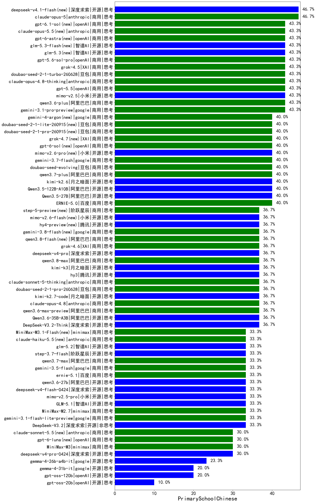

|类别|机构|大模型|【PrimarySchoolChinese】准确率|平均耗时|平均消耗token|花费/千次（元）|排名（准确率）|
|---|---|-----|-------------------|-------|-----------|-----------|-----------|
|开源|深度求索|deepseek-v4.1-flash(new)|46.7%|31s|1729|13.4|1|
|商用|anthropic|claude-opus-5|46.7%|12s|608|94.4|2|
|商用|阿里巴巴|qwen3.6-plus|43.3%|32s|1490|17.3|3|
|商用|openAI|gpt-5.5|43.3%|7s|383|68.6|4|
|商用|XAI|grok-4.5|43.3%|66s|2933|115.8|5|
|商用|openAI|gpt-5.6-sol-pro|43.3%|26s|3105|238.5|6|
|开源|小米|mimo-v2.5|43.3%|35s|1667|20.0|7|
|开源|智谱AI|glm-5.3(new)|43.3%|181s|2270|62.3|8|
|开源|智谱AI|glm-5.3-flash(new)|43.3%|109s|1906|5.2|9|
|商用|openAI|gpt-6-astra(new)|43.3%|9s|191|47.9|10|
|商用|豆包|doubao-seed-2-1-turbo-260628|43.3%|124s|6270|92.9|11|
|商用|anthropic|claude-opus-5.5(new)|43.3%|12s|536|65.2|12|
|商用|google|gemini-3.1-pro-preview|43.3%|38s|1489|122.5|13|
|商用|openAI|gpt-6.1-sol(new)|43.3%|5s|180|8.8|14|
|商用|anthropic|claude-opus-4.8-thinking|43.3%|11s|646|101.0|15|
|开源|小米|mimo-v2.6-pro(new)|40.0%|50s|2168|12.8|16|
|商用|阿里巴巴|qwen3.7-plus|40.0%|57s|3044|24.0|17|
|商用|openAI|gpt-6-sol(new)|40.0%|126s|198|10.1|18|
|商用|XAI|grok-4.7(new)|40.0%|96s|6599|240.8|19|
|商用|google|gemini-3.7-flash|40.0%|5s|593|14.3|20|
|商用|豆包|doubao-seed-2-1-pro-260915(new)|40.0%|148s|1977|56.9|21|
|商用|豆包|doubao-seed-2-1-lite-260915(new)|40.0%|91s|3639|9.7|22|
|商用|google|gemini-4-argon(new)|40.0%|14s|345|38.1|23|
|商用|豆包|doubao-seed-evolving|40.0%|222s|7647|227.0|24|
|开源|月之暗面|kimi-k3.1-pro(new)|40.0%|36s|1229|76.2|25|
|开源|阿里巴巴|Qwen3.5-122B-A10B|40.0%|459s|3355|21.1|26|
|开源|月之暗面|kimi-k2.6|40.0%|105s|2019|53.4|27|
|商用|百度|ERNIE-5.0|40.0%|151s|3100|73.5|28|
|开源|阿里巴巴|Qwen3.5-27B|40.0%|130s|3023|14.3|29|
|开源|腾讯|hy4-preview(new)|36.7%|88s|5485|97.9|30|
|商用|google|gemini-3.8-flash(new)|36.7%|14s|605|29.2|31|
|开源|阿里巴巴|Qwen3.6-35B-A3B|36.7%|10s|1563|16.3|32|
|商用|阿里巴巴|qwen3.8-flash(new)|36.7%|63s|1634|4.2|33|
|商用|anthropic|claude-opus-4.8|36.7%|8s|386|55.5|34|
|商用|XAI|grok-4.6|36.7%|48s|2302|89.4|35|
|开源|深度求索|deepseek-v4-pro|36.7%|39s|1913|49.3|36|
|商用|阿里巴巴|qwen3.8-max|36.7%|34s|1499|51.6|37|
|开源|月之暗面|kimi-k3|36.7%|116s|983|87.5|38|
|商用|阿里巴巴|qwen3.6-max-preview|36.7%|93s|1618|84.7|39|
|开源|腾讯|hy3|36.7%|57s|217|0.7|40|
|商用|anthropic|claude-sonnet-5-thinking|36.7%|17s|823|52.8|41|
|商用|豆包|doubao-seed-2-1-pro-260628|36.7%|219s|7706|228.8|42|
|商用|阶跃星辰|step-5-preview(new)|36.7%|15s|1061|20.4|43|
|开源|月之暗面|kimi-k2.7-code|36.7%|20s|735|18.7|44|
|开源|深度求索|DeepSeek-V3.2-Think|36.7%|204s|1811|5.4|45|
|开源|小米|mimo-v2.6-flash(new)|36.7%|34s|966|1.9|46|
|商用|google|gemini-3.1-flash-lite-preview|33.3%|2s|267|2.3|47|
|商用|minimax|MiniMax-M2.7|33.3%|103s|4466|37.0|48|
|开源|深度求索|DeepSeek-V3.2|33.3%|9s|299|0.8|49|
|商用|anthropic|claude-haiku-5.5(new)|33.3%|8s|595|1.8|50|
|商用|minimax|MiniMax-M3.1-Flash(new)|33.3%|21s|1200|4.1|51|
|商用|阿里巴巴|qwen3.7-max|33.3%|40s|1224|42.6|52|
|开源|智谱AI|GLM-5.1|33.3%|62s|1711|40.0|53|
|开源|小米|mimo-v2.5-pro|33.3%|40s|1817|33.9|54|
|开源|深度求索|deepseek-v4-flash-0424|33.3%|32s|1258|2.5|55|
|开源|阿里巴巴|qwen3.6-27b|33.3%|29s|1781|31.2|56|
|开源|智谱AI|glm-5.2|33.3%|49s|2148|58.9|57|
|商用|百度|ernie-5.1|33.3%|24s|699|11.8|58|
|开源|阶跃星辰|step-3.7-flash|33.3%|29s|2548|20.2|59|
|商用|google|gemini-3.5-flash|33.3%|11s|1652|100.8|60|
|商用|openAI|gpt-6-luna(new)|30.0%|94s|473|1.5|61|
|开源|深度求索|deepseek-v4-pro-0424|30.0%|44s|1072|25.1|62|
|商用|anthropic|claude-sonnet-5.5(new)|30.0%|7s|466|27.7|63|
|商用|minimax|MiniMax-M3|30.0%|32s|934|12.9|64|
|开源|google|gemma-4-26b-a4b-it|23.3%|39s|439|1.1|65|
|开源|google|gemma-4-31b-it|20.0%|46s|358|0.9|66|
|开源|openAI|gpt-oss-120b|20.0%|216s|696|2.0|67|
|开源|openAI|gpt-oss-20b|10.0%|232s|1839|2.0|68|

