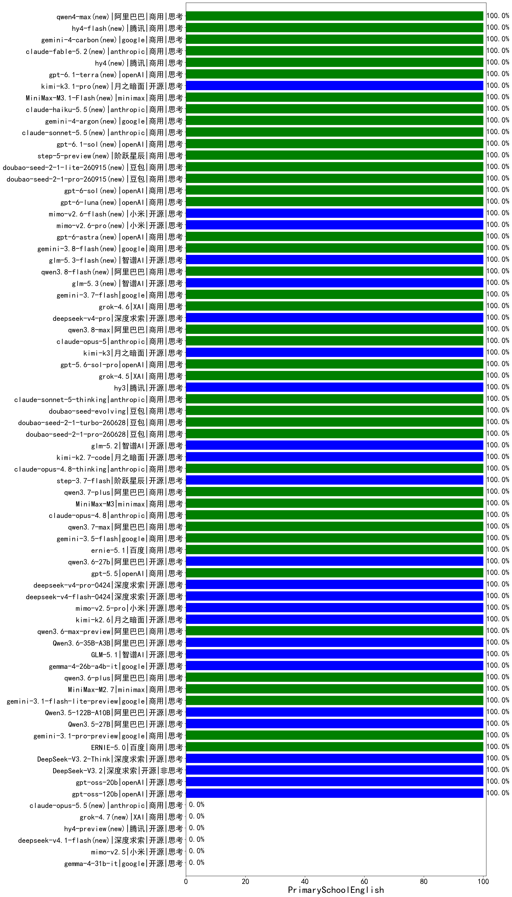

|类别|机构|大模型|【PrimarySchoolEnglish】准确率|平均耗时|平均消耗token|花费/千次（元）|排名（准确率）|
|---|---|-----|-------------------|-------|-----------|-----------|-----------|
|开源|openAI|gpt-oss-120b|100.0%|104s|257|0.6|1|
|商用|anthropic|claude-sonnet-5-thinking|100.0%|23s|226|11.9|2|
|开源|小米|mimo-v2.6-flash|100.0%|9s|233|0.4|3|
|开源|小米|mimo-v2.6-pro|100.0%|12s|213|1.1|4|
|商用|openAI|gpt-6-astra|100.0%|13s|118|28.4|5|
|商用|google|gemini-3.8-flash|100.0%|12s|265|12.0|6|
|开源|智谱AI|glm-5.3-flash|100.0%|25s|736|2.0|7|
|商用|阿里巴巴|qwen3.8-flash|100.0%|12s|373|0.8|8|
|开源|智谱AI|glm-5.3|100.0%|11s|321|7.9|9|
|商用|google|gemini-3.7-flash|100.0%|3s|238|5.3|10|
|商用|XAI|grok-4.6|100.0%|14s|809|26.9|11|
|开源|深度求索|deepseek-v4-pro|100.0%|91s|1361|34.5|12|
|商用|阿里巴巴|qwen3.8-max|100.0%|38s|1042|35.4|13|
|商用|anthropic|claude-opus-5|100.0%|11s|397|59.7|14|
|开源|月之暗面|kimi-k3|100.0%|19s|350|24.9|15|
|商用|openAI|gpt-5.6-sol-pro|100.0%|7s|2041|116.1|16|
|开源|openAI|gpt-oss-20b|100.0%|3s|401|0.4|17|
|商用|openAI|gpt-6-luna|100.0%|212s|115|0.3|18|
|商用|openAI|gpt-6-sol|100.0%|495s|81|3.1|19|
|商用|豆包|doubao-seed-2-1-pro-260915(new)|100.0%|10s|266|5.8|20|
|商用|openAI|gpt-6.1-terra(new)|100.0%|6s|151|4.0|21|
|商用|openAI|gpt-6.2-astra(new)|100.0%|5s|88|14.3|22|
|商用|阿里巴巴|qwen4-max(new)|100.0%|10s|231|5.7|23|
|商用|腾讯|hy4-flash(new)|100.0%|5s|236|0.4|24|
|商用|google|gemini-4-carbon(new)|100.0%|33s|1061|140.1|25|
|商用|anthropic|claude-fable-5.2(new)|100.0%|23s|234|49.4|26|
|商用|腾讯|hy4(new)|100.0%|16s|549|9.1|27|
|开源|月之暗面|kimi-k3.1-pro(new)|100.0%|12s|425|22.0|28|
|商用|豆包|doubao-seed-2-1-lite-260915(new)|100.0%|1820s|850|2.2|29|
|商用|minimax|MiniMax-M3.1-Flash(new)|100.0%|9s|401|0.9|30|
|商用|anthropic|claude-haiku-5.5(new)|100.0%|6s|369|1.1|31|
|商用|google|gemini-4-argon(new)|100.0%|12s|296|33.0|32|
|商用|anthropic|claude-sonnet-5.5(new)|100.0%|6s|179|8.5|33|
|商用|openAI|gpt-6.1-sol(new)|100.0%|26s|101|4.5|34|
|商用|阶跃星辰|step-5-preview(new)|100.0%|4s|250|4.3|35|
|开源|腾讯|hy3|100.0%|35s|158|0.5|36|
|商用|XAI|grok-4.5|100.0%|15s|980|34.1|37|
|商用|豆包|doubao-seed-evolving|100.0%|106s|3962|116.7|38|
|商用|minimax|MiniMax-M2.7|100.0%|11s|428|3.1|39|
|开源|月之暗面|kimi-k2.6|100.0%|33s|496|12.4|40|
|商用|阿里巴巴|qwen3.6-max-preview|100.0%|38s|920|47.4|41|
|开源|阿里巴巴|Qwen3.6-35B-A3B|100.0%|7s|715|7.3|42|
|开源|智谱AI|GLM-5.1|100.0%|156s|484|10.8|43|
|开源|google|gemma-4-26b-a4b-it|100.0%|21s|268|0.6|44|
|商用|阿里巴巴|qwen3.6-plus|100.0%|56s|860|9.8|45|
|商用|google|gemini-3.1-flash-lite-preview|100.0%|27s|116|0.8|46|
|开源|深度求索|deepseek-v4-flash-0424|100.0%|48s|983|1.9|47|
|开源|阿里巴巴|Qwen3.5-122B-A10B|100.0%|220s|1027|6.3|48|
|开源|阿里巴巴|Qwen3.5-27B|100.0%|64s|1366|6.3|49|
|商用|google|gemini-3.1-pro-preview|100.0%|21s|964|78.9|50|
|商用|百度|ERNIE-5.0|100.0%|93s|488|10.9|51|
|开源|深度求索|DeepSeek-V3.2-Think|100.0%|29s|809|2.4|52|
|开源|深度求索|DeepSeek-V3.2|100.0%|8s|175|0.5|53|
|商用|豆包|doubao-seed-2-1-turbo-260628|100.0%|74s|4145|61.1|54|
|开源|小米|mimo-v2.5-pro|100.0%|14s|838|13.5|55|
|开源|深度求索|deepseek-v4-pro-0424|100.0%|36s|630|14.6|56|
|商用|阿里巴巴|qwen3.7-max|100.0%|21s|836|28.9|57|
|商用|豆包|doubao-seed-2-1-pro-260628|100.0%|41s|610|16.1|58|
|开源|智谱AI|glm-5.2|100.0%|41s|642|16.9|59|
|开源|月之暗面|kimi-k2.7-code|100.0%|9s|165|3.5|60|
|商用|anthropic|claude-opus-4.8-thinking|100.0%|5s|306|43.8|61|
|开源|阶跃星辰|step-3.7-flash|100.0%|10s|297|2.0|62|
|商用|阿里巴巴|qwen3.7-plus|100.0%|13s|551|4.1|63|
|商用|minimax|MiniMax-M3|100.0%|13s|343|3.0|64|
|商用|anthropic|claude-opus-4.8|100.0%|5s|241|32.4|65|
|商用|openAI|gpt-6.2-sol(new)|100.0%|6s|82|3.2|66|
|商用|openAI|gpt-5.5|100.0%|45s|109|14.8|67|
|商用|google|gemini-3.5-flash|100.0%|4s|450|25.9|68|
|商用|百度|ernie-5.1|100.0%|9s|243|3.7|69|
|开源|阿里巴巴|qwen3.6-27b|100.0%|12s|675|11.4|70|
|开源|深度求索|deepseek-v4.1-flash|0.0%|11s|1131|8.6|71|
|开源|腾讯|hy4-preview|0.0%|154s|11546|207.0|72|
|开源|小米|mimo-v2.5|0.0%|19s|2083|25.9|73|
|商用|anthropic|claude-opus-5.5(new)|0.0%|13s|423|51.2|74|
|商用|XAI|grok-4.7|0.0%|14s|2135|53.6|75|
|开源|google|gemma-4-31b-it|0.0%|44s|300|0.7|76|

