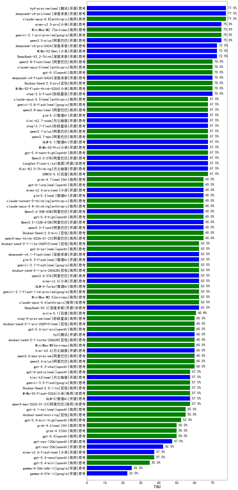

|类别|机构|大模型|【TAU】准确率|平均耗时|平均消耗token|花费/千次（元）|排名（准确率）|
|---|---|-----|-------------------|-------|-----------|-----------|-----------|
|开源|月之暗面|kimi-k3.1-pro(new)|77.5%|/|/|/|1|
|开源|腾讯|hy4-preview(new)|77.5%|/|/|/|2|
|商用|anthropic|claude-opus-4.8|77.5%|/|/|/|3|
|开源|深度求索|deepseek-v4-pro|77.5%|/|/|/|4|
|开源|小米|mimo-v2.5-pro|75.0%|/|/|/|5|
|商用|google|gemini-3.1-pro-preview|75.0%|/|/|/|6|
|商用|minimax|MiniMax-M2.7|75.0%|/|/|/|7|
|商用|minimax|MiniMax-M3.1-Flash(new)|75.0%|/|/|/|8|
|商用|google|gemini-4-argon(new)|75.0%|/|/|/|9|
|开源|深度求索|DeepSeek-V3.2-Think|72.5%|/|/|/|10|
|开源|深度求索|deepseek-v4-pro-0424|72.5%|/|/|/|11|
|商用|anthropic|claude-opus-5|70.0%|/|/|/|12|
|商用|openAI|gpt-5.5|70.0%|/|/|/|13|
|开源|深度求索|deepseek-v4-flash-0424|70.0%|/|/|/|14|
|商用|anthropic|claude-haiku-5.5(new)|70.0%|/|/|/|15|
|商用|阿里巴巴|qwen3.8-flash(new)|70.0%|/|/|/|16|
|开源|阿里巴巴|Qwen3.5-27B|67.5%|/|/|/|17|
|开源|智谱AI|GLM-5.1|67.5%|/|/|/|18|
|商用|anthropic|claude-opus-5.5(new)|67.5%|/|/|/|19|
|开源|智谱AI|glm-5.2|67.5%|/|/|/|20|
|商用|阿里巴巴|qwen3.8-max|67.5%|/|/|/|21|
|商用|google|gemini-3.8-flash(new)|67.5%|/|/|/|22|
|商用|阿里巴巴|qwen3.7-max|67.5%|/|/|/|23|
|开源|月之暗面|kimi-k2.7-code|67.5%|/|/|/|24|
|商用|百度|ERNIE-5.0|67.5%|/|/|/|25|
|商用|阿里巴巴|qwen3.7-plus|67.5%|/|/|/|26|
|开源|阶跃星辰|step-3.7-flash|67.5%|/|/|/|27|
|商用|anthropic|claude-opus-4.8-thinking|65.0%|/|/|/|28|
|商用|anthropic|claude-sonnet-5-thinking|65.0%|/|/|/|29|
|商用|XAI|grok-4.7(new)|65.0%|/|/|/|30|
|开源|阿里巴巴|Qwen3.6-35B-A3B|65.0%|/|/|/|31|
|商用|anthropic|claude-sonnet-5.5(new)|65.0%|/|/|/|32|
|开源|阿里巴巴|Qwen3.5-122B-A10B|65.0%|/|/|/|33|
|开源|智谱AI|glm-5.3(new)|65.0%|/|/|/|34|
|商用|openAI|gpt-6-luna(new)|65.0%|/|/|/|35|
|开源|小米|mimo-v2.6-pro(new)|65.0%|/|/|/|36|
|开源|深度求索|deepseek-v4.1-flash(new)|62.5%|/|/|/|37|
|商用|google|gemini-3.7-flash|62.5%|/|/|/|38|
|商用|豆包|doubao-seed-2-1-lite-260915(new)|62.5%|/|/|/|39|
|商用|openAI|gpt-6-sol(new)|62.5%|/|/|/|40|
|商用|豆包|doubao-seed-2-1-pro-260628|62.5%|/|/|/|41|
|开源|阿里巴巴|qwen3.6-27b|62.5%|/|/|/|42|
|开源|小米|mimo-v2.5|62.5%|/|/|/|43|
|商用|google|gemini-3.1-flash-lite-preview|62.5%|/|/|/|44|
|开源|深度求索|DeepSeek-V3.2|62.5%|/|/|/|45|
|开源|智谱AI|glm-5.3-flash(new)|62.5%|/|/|/|46|
|商用|百度|ernie-5.1|60.8%|/|/|/|47|
|商用|豆包|doubao-seed-2-1-pro-260915(new)|60.0%|/|/|/|48|
|商用|阶跃星辰|step-5-preview(new)|60.0%|/|/|/|49|
|商用|豆包|doubao-seed-2-1-turbo-260628|60.0%|/|/|/|50|
|商用|minimax|MiniMax-M3|60.0%|/|/|/|51|
|商用|阿里巴巴|qwen3.6-plus|60.0%|/|/|/|52|
|商用|openAI|gpt-5.6-sol-pro|60.0%|/|/|/|53|
|商用|阿里巴巴|qwen3.6-max-preview|60.0%|/|/|/|54|
|开源|月之暗面|kimi-k2.6|60.0%|/|/|/|55|
|开源|腾讯|hy3|60.0%|/|/|/|56|
|商用|google|gemini-3.5-flash|57.5%|/|/|/|57|
|商用|openAI|gpt-6-astra(new)|57.5%|/|/|/|58|
|开源|月之暗面|kimi-k3|57.5%|/|/|/|59|
|商用|豆包|doubao-seed-evolving|55.0%|/|/|/|60|
|商用|openAI|gpt-6.1-sol(new)|55.0%|/|/|/|61|
|商用|XAI|grok-4.6|50.0%|/|/|/|62|
|商用|XAI|grok-4.5|50.0%|/|/|/|63|
|开源|openAI|gpt-oss-120b|47.5%|/|/|/|64|
|开源|openAI|gpt-oss-20b|42.5%|/|/|/|65|
|开源|小米|mimo-v2.6-flash(new)|37.5%|/|/|/|66|
|开源|google|gemma-4-26b-a4b-it|25.0%|/|/|/|67|
|开源|google|gemma-4-31b-it|22.5%|/|/|/|68|

