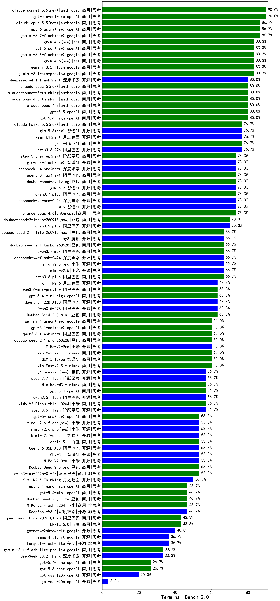

|类别|机构|大模型|【Terminal-Bench-2.0】准确率|平均耗时|平均消耗token|花费/千次（元）|排名（准确率）|
|---|---|-----|-------------------|-------|-----------|-----------|-----------|
|商用|anthropic|claude-sonnet-5.5(new)|90.0%|367s|/|2871.2|1|
|商用|openAI|gpt-5.6-sol-pro|90.0%|291s|/|7480.7|2|
|商用|anthropic|claude-opus-5.5(new)|86.7%|324s|/|2660.2|3|
|商用|google|gemini-3.7-flash|86.7%|262s|/|1516.8|4|
|商用|openAI|gpt-6-astra(new)|86.7%|175s|/|1945.8|5|
|商用|openAI|gpt-6-sol(new)|83.3%|408s|/|366.3|6|
|商用|XAI|grok-4.6|83.3%|326s|/|1464.3|7|
|商用|google|gemini-3.1-pro-preview|83.3%|329s|/|2507.0|8|
|商用|google|gemini-3.5-flash|83.3%|278s|/|3978.1|9|
|商用|google|gemini-3.8-flash(new)|83.3%|402s|/|5040.5|10|
|商用|XAI|grok-4.7(new)|83.3%|281s|/|1758.6|11|
|商用|anthropic|claude-opus-4.8|80.0%|260s|/|9994.1|12|
|开源|深度求索|deepseek-v4.1-flash(new)|80.0%|355s|/|415.1|13|
|商用|anthropic|claude-sonnet-5-thinking|80.0%|400s|/|5050.8|14|
|商用|anthropic|claude-opus-4.8-thinking|80.0%|359s|/|6563.8|15|
|商用|openAI|gpt-5.5|80.0%|205s|/|2592.3|16|
|商用|anthropic|claude-opus-5|80.0%|377s|/|3938.2|17|
|商用|XAI|grok-4.5|76.7%|317s|/|1347.2|18|
|开源|月之暗面|kimi-k3|76.7%|440s|/|841.8|19|
|开源|阿里巴巴|qwen3.6-27b|76.7%|465s|/|1023.0|20|
|商用|minimax|MiniMax-M3.1-Flash(new)|76.7%|238s|/|77.1|21|
|开源|智谱AI|glm-5.3(new)|76.7%|506s|/|961.0|22|
|商用|anthropic|claude-haiku-5.5(new)|76.7%|288s|/|125.7|23|
|开源|智谱AI|glm-5.2|73.3%|477s|/|1063.4|24|
|开源|深度求索|deepseek-v4-pro|73.3%|469s|/|145.6|25|
|商用|阿里巴巴|qwen3.8-max|73.3%|514s|/|1174.9|26|
|商用|阶跃星辰|step-5-preview(new)|73.3%|447s|/|717.6|27|
|商用|豆包|doubao-seed-evolving|73.3%|516s|/|1237.0|28|
|开源|智谱AI|glm-5.3-flash(new)|73.3%|397s|/|31.4|29|
|开源|深度求索|deepseek-v4-pro-0424|73.3%|535s|/|676.9|30|
|商用|阿里巴巴|qwen3.7-plus|73.3%|460s|/|260.0|31|
|商用|豆包|doubao-seed-2-1-pro-260915(new)|70.0%|438s|/|508.2|32|
|开源|腾讯|hy3|66.7%|429s|/|179.8|33|
|开源|小米|mimo-v2.5-pro|66.7%|478s|/|516.2|34|
|商用|阿里巴巴|qwen3.7-max|66.7%|418s|/|2077.0|35|
|商用|豆包|doubao-seed-2-1-lite-260915(new)|66.7%|367s|/|112.4|36|
|开源|小米|mimo-v2.5|66.7%|406s|/|618.2|37|
|商用|阿里巴巴|qwen3.6-plus|66.7%|457s|/|497.1|38|
|开源|深度求索|deepseek-v4-flash-0424|66.7%|521s|/|555.6|39|
|商用|豆包|doubao-seed-2-1-turbo-260628|66.7%|494s|/|547.0|40|
|开源|月之暗面|kimi-k2.6|63.3%|540s|/|658.0|41|
|开源|阿里巴巴|Qwen3.5-122B-A10B|63.3%|1450s|/|312.5|42|
|开源|阿里巴巴|Qwen3.5-27B|63.3%|424s|/|230.0|43|
|商用|阿里巴巴|qwen3.6-max-preview|63.3%|1035s|/|3727.4|44|
|商用|openAI|gpt-6.1-sol(new)|60.0%|605s|/|230.6|45|
|商用|google|gemini-4-argon(new)|60.0%|557s|/|651.3|46|
|商用|阿里巴巴|qwen3.8-flash(new)|60.0%|547s|/|67.1|47|
|商用|豆包|doubao-seed-2-1-pro-260628|60.0%|564s|/|1002.1|48|
|商用|minimax|MiniMax-M2.7|60.0%|777s|/|245.9|49|
|开源|阶跃星辰|step-3.7-flash|56.7%|461s|/|440.5|50|
|商用|minimax|MiniMax-M3|56.7%|519s|/|877.2|51|
|开源|腾讯|hy4-preview(new)|56.7%|590s|/|669.6|52|
|开源|阿里巴巴|Qwen3.6-35B-A3B|53.3%|383s|/|1451.9|53|
|开源|月之暗面|kimi-k2.7-code|53.3%|523s|/|585.7|54|
|开源|智谱AI|GLM-5.1|53.3%|567s|/|531.8|55|
|商用|百度|ernie-5.1|53.3%|459s|/|1059.0|56|
|商用|openAI|gpt-6-luna(new)|53.3%|526s|/|26.6|57|
|开源|小米|mimo-v2.6-flash(new)|53.3%|682s|/|66.8|58|
|开源|小米|mimo-v2.6-pro(new)|53.3%|716s|/|218.5|59|
|开源|深度求索|DeepSeek-V3.2|46.7%|422s|/|77.2|60|
|商用|百度|ERNIE-5.0|43.3%|713s|/|1405.2|61|
|开源|google|gemma-4-26b-a4b-it|40.0%|532s|/|177.1|62|
|开源|google|gemma-4-31b-it|36.7%|749s|/|70.3|63|
|商用|google|gemini-3.1-flash-lite-preview|33.3%|462s|/|265.3|64|
|开源|深度求索|DeepSeek-V3.2-Think|33.3%|616s|/|104.8|65|
|开源|openAI|gpt-oss-120b|20.0%|173s|/|18.8|66|
|开源|openAI|gpt-oss-20b|3.3%|48s|/|2.8|67|

