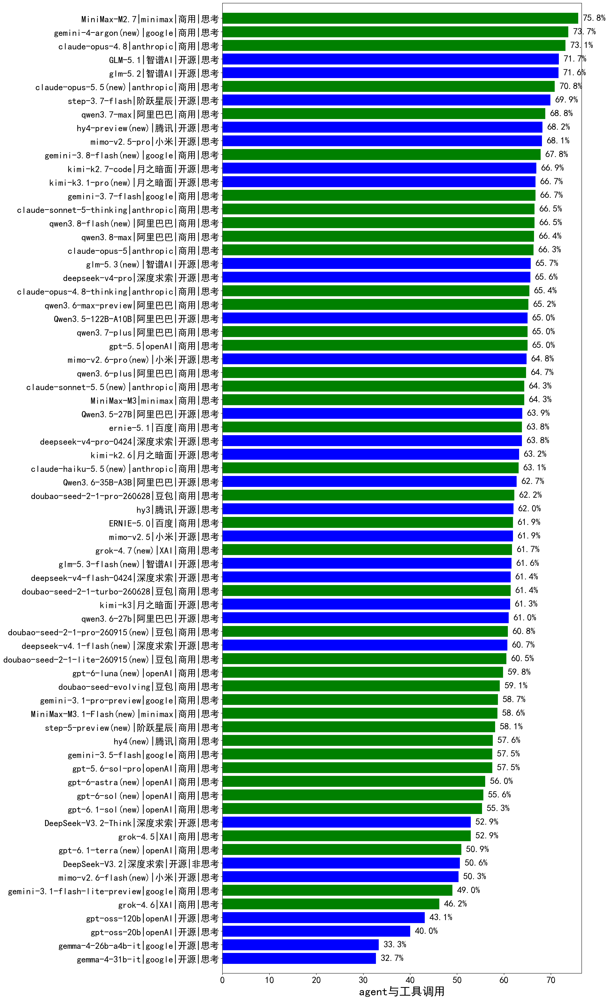

|类别|机构|大模型|【agent与工具调用】准确率|平均耗时|平均消耗token|花费/千次（元）|排名（准确率）|
|---|---|-----|-------------------|-------|-----------|-----------|-----------|
|商用|minimax|MiniMax-M2.7|75.8%|/|/|/|1|
|商用|google|gemini-4-argon(new)|73.7%|/|/|/|2|
|商用|anthropic|claude-opus-4.8|73.1%|/|/|/|3|
|开源|智谱AI|GLM-5.1|71.7%|/|/|/|4|
|开源|智谱AI|glm-5.2|71.6%|/|/|/|5|
|商用|anthropic|claude-opus-5.5(new)|70.8%|/|/|/|6|
|商用|anthropic|claude-fable-5.2(new)|70.4%|/|/|/|7|
|开源|阶跃星辰|step-3.7-flash|69.9%|/|/|/|8|
|商用|阿里巴巴|qwen3.7-max|68.8%|/|/|/|9|
|开源|腾讯|hy4-preview(new)|68.2%|/|/|/|10|
|开源|小米|mimo-v2.5-pro|68.1%|/|/|/|11|
|商用|google|gemini-3.8-flash(new)|67.8%|/|/|/|12|
|开源|月之暗面|kimi-k2.7-code|66.9%|/|/|/|13|
|开源|月之暗面|kimi-k3.1-pro(new)|66.7%|/|/|/|14|
|商用|google|gemini-3.7-flash|66.7%|/|/|/|15|
|商用|anthropic|claude-sonnet-5-thinking|66.5%|/|/|/|16|
|商用|阿里巴巴|qwen3.8-flash(new)|66.5%|/|/|/|17|
|商用|阿里巴巴|qwen3.8-max|66.4%|/|/|/|18|
|商用|anthropic|claude-opus-5|66.3%|/|/|/|19|
|开源|智谱AI|glm-5.3(new)|65.7%|/|/|/|20|
|开源|深度求索|deepseek-v4-pro|65.6%|/|/|/|21|
|商用|anthropic|claude-opus-4.8-thinking|65.4%|/|/|/|22|
|商用|阿里巴巴|qwen3.6-max-preview|65.2%|/|/|/|23|
|开源|阿里巴巴|Qwen3.5-122B-A10B|65.0%|/|/|/|24|
|商用|阿里巴巴|qwen3.7-plus|65.0%|/|/|/|25|
|商用|openAI|gpt-5.5|65.0%|/|/|/|26|
|开源|小米|mimo-v2.6-pro(new)|64.8%|/|/|/|27|
|商用|阿里巴巴|qwen3.6-plus|64.7%|/|/|/|28|
|商用|anthropic|claude-sonnet-5.5(new)|64.3%|/|/|/|29|
|商用|minimax|MiniMax-M3|64.3%|/|/|/|30|
|开源|阿里巴巴|Qwen3.5-27B|63.9%|/|/|/|31|
|商用|百度|ernie-5.1|63.8%|/|/|/|32|
|开源|深度求索|deepseek-v4-pro-0424|63.8%|/|/|/|33|
|开源|月之暗面|kimi-k2.6|63.2%|/|/|/|34|
|商用|anthropic|claude-haiku-5.5(new)|63.1%|/|/|/|35|
|开源|阿里巴巴|Qwen3.6-35B-A3B|62.7%|/|/|/|36|
|商用|豆包|doubao-seed-2-1-pro-260628|62.2%|/|/|/|37|
|开源|腾讯|hy3|62.0%|/|/|/|38|
|商用|百度|ERNIE-5.0|61.9%|/|/|/|39|
|开源|小米|mimo-v2.5|61.9%|/|/|/|40|
|商用|XAI|grok-4.7(new)|61.7%|/|/|/|41|
|开源|智谱AI|glm-5.3-flash(new)|61.6%|/|/|/|42|
|开源|深度求索|deepseek-v4-flash-0424|61.4%|/|/|/|43|
|商用|豆包|doubao-seed-2-1-turbo-260628|61.4%|/|/|/|44|
|开源|月之暗面|kimi-k3|61.3%|/|/|/|45|
|开源|阿里巴巴|qwen3.6-27b|61.0%|/|/|/|46|
|商用|豆包|doubao-seed-2-1-pro-260915(new)|60.8%|/|/|/|47|
|开源|深度求索|deepseek-v4.1-flash(new)|60.7%|/|/|/|48|
|商用|豆包|doubao-seed-2-1-lite-260915(new)|60.5%|/|/|/|49|
|商用|openAI|gpt-6-luna(new)|59.8%|/|/|/|50|
|商用|豆包|doubao-seed-evolving|59.1%|/|/|/|51|
|商用|google|gemini-3.1-pro-preview|58.7%|/|/|/|52|
|商用|minimax|MiniMax-M3.1-Flash(new)|58.6%|/|/|/|53|
|商用|阶跃星辰|step-5-preview(new)|58.1%|/|/|/|54|
|商用|腾讯|hy4(new)|57.6%|/|/|/|55|
|商用|google|gemini-3.5-flash|57.5%|/|/|/|56|
|商用|openAI|gpt-5.6-sol-pro|57.5%|/|/|/|57|
|商用|openAI|gpt-6-astra(new)|56.0%|/|/|/|58|
|商用|openAI|gpt-6-sol(new)|55.6%|/|/|/|59|
|商用|openAI|gpt-6.1-sol(new)|55.3%|/|/|/|60|
|开源|深度求索|DeepSeek-V3.2-Think|52.9%|/|/|/|61|
|商用|XAI|grok-4.5|52.9%|/|/|/|62|
|商用|openAI|gpt-6.1-terra(new)|50.9%|/|/|/|63|
|开源|深度求索|DeepSeek-V3.2|50.6%|/|/|/|64|
|开源|小米|mimo-v2.6-flash(new)|50.3%|/|/|/|65|
|商用|google|gemini-3.1-flash-lite-preview|49.0%|/|/|/|66|
|商用|XAI|grok-4.6|46.2%|/|/|/|67|
|开源|openAI|gpt-oss-120b|43.1%|/|/|/|68|
|开源|openAI|gpt-oss-20b|40.0%|/|/|/|69|
|开源|google|gemma-4-26b-a4b-it|33.3%|/|/|/|70|
|开源|google|gemma-4-31b-it|32.7%|/|/|/|71|

