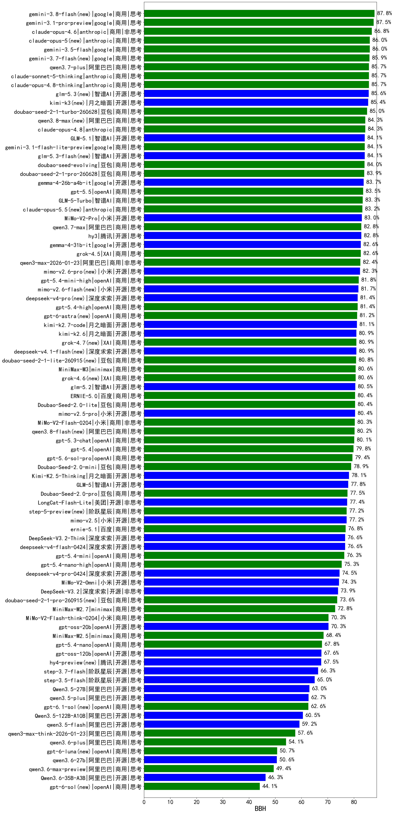

|类别|机构|大模型|【BBH】准确率|平均耗时|平均消耗token|花费/千次（元）|排名（准确率）|
|---|---|-----|-------------------|-------|-----------|-----------|-----------|
|商用|google|gemini-3.8-flash(new)|87.8%|15s|1410|37.0|1|
|商用|google|gemini-4-argon(new)|87.5%|17s|1144|58.3|2|
|商用|google|gemini-3.1-pro-preview|87.5%|32s|2267|130.6|3|
|商用|google|gemini-3.5-flash|86.0%|8s|1792|66.6|4|
|商用|anthropic|claude-opus-5|86.0%|7s|1646|120.5|5|
|商用|google|gemini-3.7-flash|85.9%|9s|1327|16.3|6|
|商用|阿里巴巴|qwen3.7-plus|85.7%|30s|2369|13.6|7|
|商用|anthropic|claude-opus-4.8-thinking|85.7%|8s|1699|129.8|8|
|商用|anthropic|claude-sonnet-5-thinking|85.7%|12s|1631|47.1|9|
|开源|智谱AI|glm-5.3(new)|85.6%|59s|1780|33.1|10|
|开源|月之暗面|kimi-k3|85.4%|39s|1497|77.1|11|
|商用|豆包|doubao-seed-2-1-turbo-260628|85.0%|150s|6413|85.1|12|
|商用|anthropic|claude-sonnet-5.5(new)|84.4%|15s|1483|36.7|13|
|商用|阿里巴巴|qwen3.8-max|84.3%|35s|2225|57.9|14|
|商用|anthropic|claude-opus-4.8|84.3%|6s|1502|95.3|15|
|开源|智谱AI|GLM-5.1|84.1%|142s|1874|30.0|16|
|商用|google|gemini-3.1-flash-lite-preview|84.1%|8s|1125|4.1|17|
|开源|智谱AI|glm-5.3-flash(new)|84.1%|36s|1557|2.7|18|
|商用|豆包|doubao-seed-evolving|84.0%|303s|13058|369.5|19|
|商用|豆包|doubao-seed-2-1-pro-260628|83.9%|299s|13052|369.3|20|
|开源|google|gemma-4-26b-a4b-it|83.7%|32s|1196|1.7|21|
|商用|openAI|gpt-5.5|83.5%|12s|1122|91.7|22|
|商用|anthropic|claude-opus-5.5(new)|83.2%|28s|1593|88.7|23|
|商用|阿里巴巴|qwen3.7-max|82.8%|31s|2380|64.4|24|
|开源|腾讯|hy3|82.8%|53s|1081|1.8|25|
|开源|google|gemma-4-31b-it|82.6%|55s|1146|1.6|26|
|商用|XAI|grok-4.5|82.6%|75s|2320|68.5|27|
|开源|小米|mimo-v2.6-pro(new)|82.3%|27s|1414|5.9|28|
|开源|小米|mimo-v2.6-flash(new)|81.7%|99s|1318|1.8|29|
|开源|深度求索|deepseek-v4-pro|81.4%|71s|2229|43.9|30|
|商用|openAI|gpt-6-astra(new)|81.2%|7s|/|79.5|31|
|开源|月之暗面|kimi-k2.7-code|81.1%|25s|1531|24.3|32|
|开源|月之暗面|kimi-k2.6|80.9%|133s|2795|58.4|33|
|商用|XAI|grok-4.7(new)|80.9%|44s|4656|137.6|34|
|开源|深度求索|deepseek-v4.1-flash(new)|80.9%|12s|1707|8.5|35|
|商用|豆包|doubao-seed-2-1-lite-260915(new)|80.8%|60s|2920|6.2|36|
|商用|minimax|MiniMax-M3|80.6%|22s|1627|14.9|37|
|商用|XAI|grok-4.6|80.6%|104s|2265|66.2|38|
|开源|智谱AI|glm-5.2|80.5%|34s|1871|35.6|39|
|商用|百度|ERNIE-5.0|80.4%|128s|2507|44.1|40|
|开源|小米|mimo-v2.5-pro|80.4%|21s|1989|26.3|41|
|商用|阿里巴巴|qwen3.8-flash(new)|80.2%|43s|2611|5.3|42|
|商用|anthropic|claude-haiku-5.5(new)|79.9%|7s|1670|2.5|43|
|商用|openAI|gpt-5.6-sol-pro|79.4%|21s|5760|292.1|44|
|商用|阶跃星辰|step-5-preview(new)|77.2%|18s|1878|26.7|45|
|开源|小米|mimo-v2.5|77.2%|27s|2610|24.2|46|
|商用|百度|ernie-5.1|76.8%|30s|1792|19.6|47|
|开源|深度求索|DeepSeek-V3.2-Think|76.6%|129s|2125|5.5|48|
|开源|深度求索|deepseek-v4-flash-0424|76.6%|26s|1578|2.3|49|
|开源|深度求索|deepseek-v4-pro-0424|74.5%|40s|1772|32.6|50|
|开源|深度求索|DeepSeek-V3.2|73.9%|49s|1114|2.5|51|
|商用|豆包|doubao-seed-2-1-pro-260915(new)|73.6%|32s|1538|23.9|52|
|商用|minimax|MiniMax-M2.7|72.8%|32s|2233|13.4|53|
|开源|openAI|gpt-oss-20b|70.3%|29s|1543|1.0|54|
|开源|openAI|gpt-oss-120b|67.6%|50s|1374|2.2|55|
|开源|腾讯|hy4-preview(new)|67.5%|89s|6597|108.5|56|
|开源|阶跃星辰|step-3.7-flash|66.3%|62s|5283|37.2|57|
|商用|minimax|MiniMax-M3.1-Flash(new)|63.2%|15s|1668|3.6|58|
|开源|阿里巴巴|Qwen3.5-27B|63.0%|205s|3306|12.1|59|
|商用|openAI|gpt-6.1-sol(new)|62.6%|19s|/|16.0|60|
|开源|阿里巴巴|Qwen3.5-122B-A10B|60.5%|267s|3388|16.7|61|
|商用|阿里巴巴|qwen3.6-plus|54.1%|62s|3509|33.2|62|
|商用|openAI|gpt-6-luna(new)|50.7%|211s|/|1.1|63|
|开源|阿里巴巴|qwen3.6-27b|50.6%|38s|3450|48.8|64|
|商用|阿里巴巴|qwen3.6-max-preview|49.4%|73s|3164|131.0|65|
|开源|阿里巴巴|Qwen3.6-35B-A3B|46.3%|106s|3345|28.2|66|
|商用|openAI|gpt-6-sol(new)|44.1%|199s|/|15.8|67|

