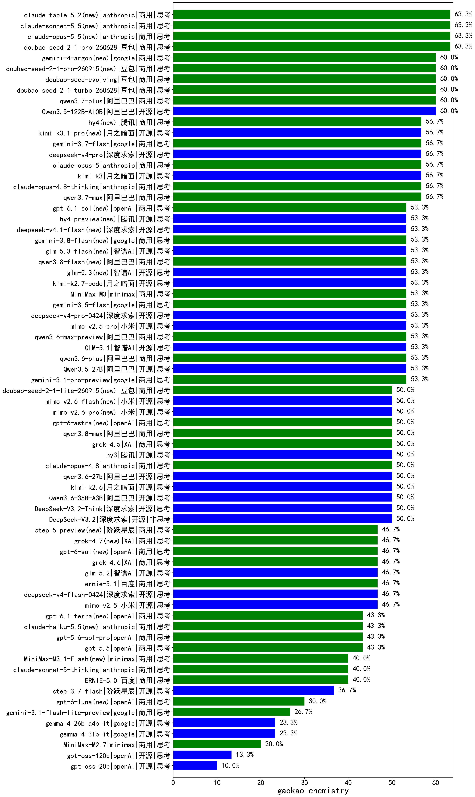

|类别|机构|大模型|【gaokao-chemistry】准确率|平均耗时|平均消耗token|花费/千次（元）|排名（准确率）|
|---|---|-----|-------------------|-------|-----------|-----------|-----------|
|商用|anthropic|claude-opus-5.5(new)|63.3%|15s|1011|104.8|1|
|商用|anthropic|claude-sonnet-5.5(new)|63.3%|10s|905|45.0|2|
|商用|豆包|doubao-seed-2-1-pro-260628|63.3%|286s|11920|352.5|3|
|商用|anthropic|claude-fable-5.2(new)|63.3%|24s|774|143.2|4|
|商用|豆包|doubao-seed-evolving|60.0%|256s|10758|317.7|5|
|商用|豆包|doubao-seed-2-1-turbo-260628|60.0%|233s|9197|135.4|6|
|开源|阿里巴巴|Qwen3.5-122B-A10B|60.0%|177s|6820|42.6|7|
|商用|阿里巴巴|qwen3.7-plus|60.0%|133s|7367|57.8|8|
|商用|google|gemini-4-argon(new)|60.0%|23s|1138|136.6|9|
|商用|豆包|doubao-seed-2-1-pro-260915(new)|60.0%|88s|3173|90.1|10|
|商用|google|gemini-4-carbon(new)|58.6%|24s|1366|168.2|11|
|商用|anthropic|claude-opus-5|56.7%|16s|1319|185.2|12|
|开源|月之暗面|kimi-k3|56.7%|197s|3738|353.5|13|
|商用|anthropic|claude-opus-4.8-thinking|56.7%|29s|2604|410.1|14|
|商用|阿里巴巴|qwen3.7-max|56.7%|59s|3351|116.2|15|
|商用|google|gemini-3.7-flash|56.7%|7s|1486|35.3|16|
|开源|深度求索|deepseek-v4-pro|56.7%|79s|3302|84.8|17|
|开源|月之暗面|kimi-k3.1-pro(new)|56.7%|143s|4802|312.6|18|
|商用|腾讯|hy4(new)|56.7%|164s|8349|148.2|19|
|商用|openAI|gpt-6.1-sol(new)|53.3%|8s|610|31.3|20|
|开源|月之暗面|kimi-k2.7-code|53.3%|98s|4376|114.6|21|
|开源|智谱AI|glm-5.3|53.3%|165s|7113|195.4|22|
|商用|openAI|gpt-6.2-astra(new)|53.3%|7s|488|91.0|23|
|商用|阿里巴巴|qwen4-max(new)|53.3%|24s|1252|33.6|24|
|商用|阿里巴巴|qwen3.8-flash|53.3%|157s|10746|28.6|25|
|开源|智谱AI|glm-5.3-flash|53.3%|272s|9504|26.2|26|
|商用|google|gemini-3.8-flash|53.3%|16s|1622|77.8|27|
|商用|google|gemini-3.1-pro-preview|53.3%|69s|4762|393.3|28|
|开源|阿里巴巴|Qwen3.5-27B|53.3%|654s|6737|31.5|29|
|开源|深度求索|deepseek-v4.1-flash|53.3%|24s|4112|31.8|30|
|商用|阿里巴巴|qwen3.6-plus|53.3%|114s|6109|71.5|31|
|开源|小米|mimo-v2.5-pro|53.3%|147s|8425|170.8|32|
|开源|腾讯|hy4-preview|53.3%|121s|7601|134.7|33|
|商用|minimax|MiniMax-M3|53.3%|204s|7366|119.6|34|
|商用|google|gemini-3.5-flash|53.3%|23s|3367|202.9|35|
|开源|智谱AI|GLM-5.1|53.3%|371s|5767|135.1|36|
|商用|阿里巴巴|qwen3.6-max-preview|53.3%|188s|6414|337.9|37|
|开源|深度求索|deepseek-v4-pro-0424|53.3%|148s|5081|120.0|38|
|开源|小米|mimo-v2.6-pro|50.0%|291s|9492|56.4|39|
|商用|腾讯|hy4-flash(new)|50.0%|35s|3844|7.4|40|
|商用|openAI|gpt-6-astra|50.0%|21s|642|167.7|41|
|开源|小米|mimo-v2.6-flash|50.0%|467s|4743|9.3|42|
|商用|豆包|doubao-seed-2-1-lite-260915(new)|50.0%|93s|4422|11.6|43|
|商用|XAI|grok-4.5|50.0%|101s|7451|302.2|44|
|商用|openAI|gpt-6.2-sol(new)|50.0%|5s|536|26.1|45|
|开源|深度求索|DeepSeek-V3.2|50.0%|37s|1278|3.7|46|
|开源|深度求索|DeepSeek-V3.2-Think|50.0%|276s|4018|11.9|47|
|开源|腾讯|hy3|50.0%|113s|708|2.3|48|
|开源|阿里巴巴|Qwen3.6-35B-A3B|50.0%|19s|3861|40.0|49|
|开源|月之暗面|kimi-k2.6|50.0%|249s|6636|175.6|50|
|商用|anthropic|claude-opus-4.8|50.0%|11s|948|120.3|51|
|商用|阿里巴巴|qwen3.8-max|50.0%|226s|9976|353.7|52|
|开源|阿里巴巴|qwen3.6-27b|50.0%|81s|5361|93.7|53|
|商用|XAI|grok-4.6|46.7%|214s|6470|261.0|54|
|商用|XAI|grok-4.7|46.7%|147s|10854|416.2|55|
|开源|小米|mimo-v2.5|46.7%|73s|4323|55.7|56|
|商用|阶跃星辰|step-5-preview(new)|46.7%|81s|6794|133.7|57|
|开源|深度求索|deepseek-v4-flash-0424|46.7%|89s|4348|8.5|58|
|商用|openAI|gpt-6-sol|46.7%|236s|576|28.9|59|
|商用|百度|ernie-5.1|46.7%|88s|3541|61.3|60|
|开源|智谱AI|glm-5.2|46.7%|134s|6514|178.6|61|
|商用|anthropic|claude-haiku-5.5(new)|43.3%|9s|1483|4.3|62|
|商用|openAI|gpt-5.5|43.3%|33s|1733|328.3|63|
|商用|openAI|gpt-6.1-terra(new)|43.3%|8s|757|20.8|64|
|商用|openAI|gpt-5.6-sol-pro|43.3%|45s|8387|858.9|65|
|商用|anthropic|claude-sonnet-5-thinking|40.0%|36s|3189|205.0|66|
|商用|minimax|MiniMax-M3.1-Flash(new)|40.0%|89s|6060|23.2|67|
|商用|百度|ERNIE-5.0|40.0%|412s|7324|172.7|68|
|开源|阶跃星辰|step-3.7-flash|36.7%|123s|7874|62.6|69|
|商用|openAI|gpt-6-luna|30.0%|201s|1843|5.9|70|
|商用|google|gemini-3.1-flash-lite-preview|26.7%|47s|886|7.8|71|
|开源|google|gemma-4-26b-a4b-it|23.3%|141s|1468|3.8|72|
|开源|google|gemma-4-31b-it|23.3%|97s|1296|3.3|73|
|商用|minimax|MiniMax-M2.7|20.0%|189s|7837|64.6|74|
|开源|openAI|gpt-oss-120b|13.3%|151s|1864|5.4|75|
|开源|openAI|gpt-oss-20b|10.0%|183s|3744|4.1|76|

