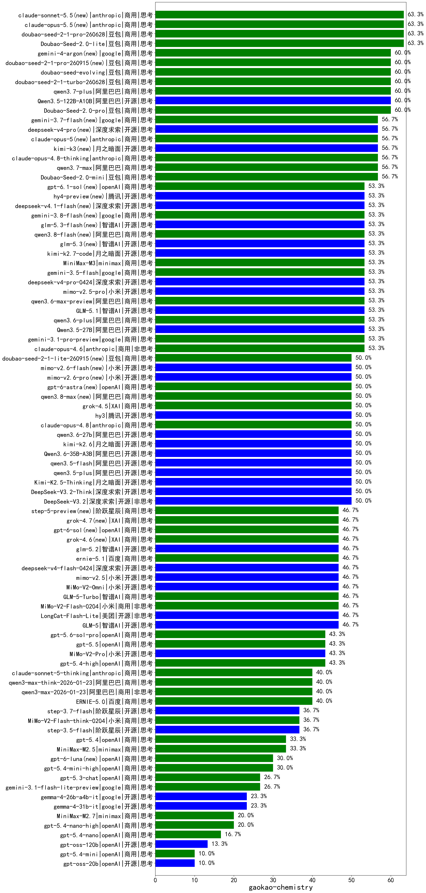

|类别|机构|大模型|【gaokao-chemistry】准确率|平均耗时|平均消耗token|花费/千次（元）|排名（准确率）|
|---|---|-----|-------------------|-------|-----------|-----------|-----------|
|商用|anthropic|claude-sonnet-5.5(new)|63.3%|10s|905|45.0|1|
|商用|anthropic|claude-opus-5.5(new)|63.3%|15s|1011|104.8|2|
|商用|豆包|doubao-seed-2-1-pro-260628|63.3%|286s|11920|352.5|3|
|商用|豆包|doubao-seed-2-1-turbo-260628|60.0%|233s|9197|135.4|4|
|商用|google|gemini-4-argon(new)|60.0%|23s|1138|136.6|5|
|商用|豆包|doubao-seed-2-1-pro-260915(new)|60.0%|88s|3173|90.1|6|
|开源|阿里巴巴|Qwen3.5-122B-A10B|60.0%|177s|6820|42.6|7|
|商用|豆包|doubao-seed-evolving|60.0%|256s|10758|317.7|8|
|商用|阿里巴巴|qwen3.7-plus|60.0%|133s|7367|57.8|9|
|商用|阿里巴巴|qwen3.7-max|56.7%|59s|3351|116.2|10|
|商用|google|gemini-3.7-flash|56.7%|7s|1486|35.3|11|
|开源|深度求索|deepseek-v4-pro|56.7%|79s|3302|84.8|12|
|商用|anthropic|claude-opus-5|56.7%|16s|1319|185.2|13|
|开源|月之暗面|kimi-k3|56.7%|197s|3738|353.5|14|
|商用|anthropic|claude-opus-4.8-thinking|56.7%|29s|2604|410.1|15|
|开源|月之暗面|kimi-k3.1-pro(new)|56.7%|143s|4802|312.6|16|
|开源|阿里巴巴|Qwen3.5-27B|53.3%|654s|6737|31.5|17|
|商用|google|gemini-3.1-pro-preview|53.3%|69s|4762|393.3|18|
|开源|腾讯|hy4-preview(new)|53.3%|121s|7601|134.7|19|
|开源|月之暗面|kimi-k2.7-code|53.3%|98s|4376|114.6|20|
|开源|智谱AI|GLM-5.1|53.3%|371s|5767|135.1|21|
|商用|google|gemini-3.8-flash(new)|53.3%|16s|1622|77.8|22|
|商用|阿里巴巴|qwen3.6-plus|53.3%|114s|6109|71.5|23|
|商用|minimax|MiniMax-M3|53.3%|204s|7366|119.6|24|
|商用|阿里巴巴|qwen3.6-max-preview|53.3%|188s|6414|337.9|25|
|商用|google|gemini-3.5-flash|53.3%|23s|3367|202.9|26|
|开源|智谱AI|glm-5.3-flash(new)|53.3%|272s|9504|26.2|27|
|商用|openAI|gpt-6.1-sol(new)|53.3%|8s|610|31.3|28|
|商用|阿里巴巴|qwen3.8-flash(new)|53.3%|157s|10746|28.6|29|
|开源|深度求索|deepseek-v4-pro-0424|53.3%|148s|5081|120.0|30|
|开源|智谱AI|glm-5.3(new)|53.3%|165s|7113|195.4|31|
|开源|小米|mimo-v2.5-pro|53.3%|147s|8425|170.8|32|
|开源|深度求索|deepseek-v4.1-flash(new)|53.3%|24s|4112|31.8|33|
|商用|openAI|gpt-6-astra(new)|50.0%|21s|642|167.7|34|
|开源|月之暗面|kimi-k2.6|50.0%|249s|6636|175.6|35|
|开源|小米|mimo-v2.6-pro(new)|50.0%|291s|9492|56.4|36|
|商用|豆包|doubao-seed-2-1-lite-260915(new)|50.0%|93s|4422|11.6|37|
|开源|深度求索|DeepSeek-V3.2-Think|50.0%|276s|4018|11.9|38|
|开源|深度求索|DeepSeek-V3.2|50.0%|37s|1278|3.7|39|
|开源|小米|mimo-v2.6-flash(new)|50.0%|467s|4743|9.3|40|
|商用|阿里巴巴|qwen3.8-max|50.0%|226s|9976|353.7|41|
|开源|阿里巴巴|Qwen3.6-35B-A3B|50.0%|19s|3861|40.0|42|
|开源|阿里巴巴|qwen3.6-27b|50.0%|81s|5361|93.7|43|
|商用|XAI|grok-4.5|50.0%|101s|7451|302.2|44|
|开源|腾讯|hy3|50.0%|113s|708|2.3|45|
|商用|anthropic|claude-opus-4.8|50.0%|11s|948|120.3|46|
|开源|智谱AI|glm-5.2|46.7%|134s|6514|178.6|47|
|商用|阶跃星辰|step-5-preview(new)|46.7%|81s|6794|133.7|48|
|商用|百度|ernie-5.1|46.7%|88s|3541|61.3|49|
|商用|XAI|grok-4.7(new)|46.7%|147s|10854|416.2|50|
|商用|openAI|gpt-6-sol(new)|46.7%|236s|576|28.9|51|
|开源|小米|mimo-v2.5|46.7%|73s|4323|55.7|52|
|开源|深度求索|deepseek-v4-flash-0424|46.7%|89s|4348|8.5|53|
|商用|XAI|grok-4.6|46.7%|214s|6470|261.0|54|
|商用|anthropic|claude-haiku-5.5(new)|43.3%|9s|1483|4.3|55|
|商用|openAI|gpt-5.6-sol-pro|43.3%|45s|8387|858.9|56|
|商用|openAI|gpt-5.5|43.3%|33s|1733|328.3|57|
|商用|minimax|MiniMax-M3.1-Flash(new)|40.0%|89s|6060|23.2|58|
|商用|anthropic|claude-sonnet-5-thinking|40.0%|36s|3189|205.0|59|
|商用|百度|ERNIE-5.0|40.0%|412s|7324|172.7|60|
|开源|阶跃星辰|step-3.7-flash|36.7%|123s|7874|62.6|61|
|商用|openAI|gpt-6-luna(new)|30.0%|201s|1843|5.9|62|
|商用|google|gemini-3.1-flash-lite-preview|26.7%|47s|886|7.8|63|
|开源|google|gemma-4-26b-a4b-it|23.3%|141s|1468|3.8|64|
|开源|google|gemma-4-31b-it|23.3%|97s|1296|3.3|65|
|商用|minimax|MiniMax-M2.7|20.0%|189s|7837|64.6|66|
|开源|openAI|gpt-oss-120b|13.3%|151s|1864|5.4|67|
|开源|openAI|gpt-oss-20b|10.0%|183s|3744|4.1|68|

