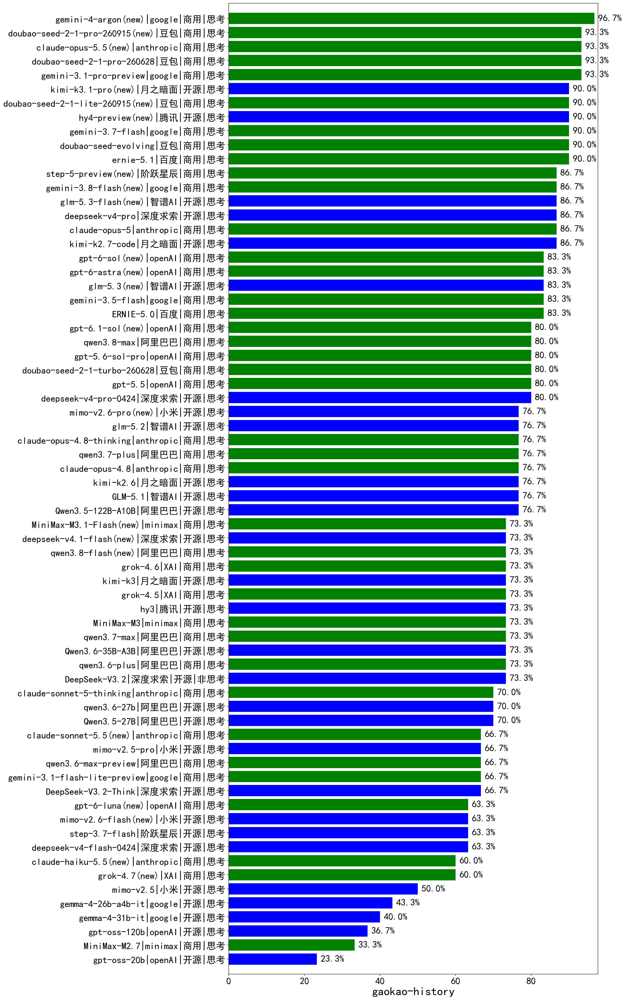

|类别|机构|大模型|【gaokao-history】准确率|平均耗时|平均消耗token|花费/千次（元）|排名（准确率）|
|---|---|-----|-------------------|-------|-----------|-----------|-----------|
|商用|google|gemini-4-argon(new)|96.7%|17s|654|74.5|1|
|商用|豆包|doubao-seed-2-1-pro-260628|93.3%|216s|7628|225.1|2|
|商用|google|gemini-3.1-pro-preview|93.3%|84s|1767|141.5|3|
|商用|豆包|doubao-seed-2-1-pro-260915(new)|93.3%|76s|2398|68.2|4|
|商用|anthropic|claude-opus-5.5(new)|93.3%|15s|792|90.9|5|
|开源|腾讯|hy4-preview(new)|90.0%|131s|5786|102.7|6|
|商用|豆包|doubao-seed-evolving|90.0%|207s|8347|246.6|7|
|商用|豆包|doubao-seed-2-1-lite-260915(new)|90.0%|46s|2000|5.1|8|
|商用|google|gemini-3.7-flash|90.0%|5s|838|19.3|9|
|商用|百度|ernie-5.1|90.0%|33s|1104|18.3|10|
|商用|anthropic|claude-opus-5|86.7%|13s|749|106.2|11|
|开源|深度求索|deepseek-v4-pro|86.7%|102s|1574|39.2|12|
|开源|月之暗面|kimi-k2.7-code|86.7%|43s|1613|40.0|13|
|商用|google|gemini-3.8-flash(new)|86.7%|10s|924|43.2|14|
|开源|智谱AI|glm-5.3-flash(new)|86.7%|83s|3227|8.8|15|
|商用|阶跃星辰|step-5-preview(new)|86.7%|27s|1891|36.4|16|
|商用|openAI|gpt-6-sol(new)|83.3%|99s|333|15.8|17|
|商用|google|gemini-3.5-flash|83.3%|16s|1901|113.1|18|
|商用|百度|ERNIE-5.0|83.3%|72s|1474|33.5|19|
|开源|智谱AI|glm-5.3(new)|83.3%|-43s|2586|70.1|20|
|商用|openAI|gpt-6-astra(new)|83.3%|12s|382|95.8|21|
|开源|深度求索|deepseek-v4-pro-0424|80.0%|51s|1496|34.7|22|
|商用|openAI|gpt-5.5|80.0%|28s|641|110.9|23|
|商用|openAI|gpt-6.1-sol(new)|80.0%|81s|328|15.4|24|
|商用|openAI|gpt-5.6-sol-pro|80.0%|21s|4038|336.9|25|
|商用|阿里巴巴|qwen3.8-max|80.0%|85s|3264|113.8|26|
|商用|豆包|doubao-seed-2-1-turbo-260628|80.0%|167s|7840|115.7|27|
|开源|小米|mimo-v2.6-pro(new)|76.7%|32s|1374|7.9|28|
|开源|智谱AI|GLM-5.1|76.7%|241s|1929|44.3|29|
|商用|anthropic|claude-opus-4.8|76.7%|11s|671|92.7|30|
|开源|月之暗面|kimi-k2.6|76.7%|163s|2590|65.4|31|
|商用|阿里巴巴|qwen3.7-plus|76.7%|39s|1805|13.7|32|
|商用|anthropic|claude-opus-4.8-thinking|76.7%|13s|903|133.2|33|
|开源|阿里巴巴|Qwen3.5-122B-A10B|76.7%|506s|4151|25.9|34|
|开源|智谱AI|glm-5.2|76.7%|56s|2570|69.6|35|
|开源|深度求索|deepseek-v4.1-flash(new)|73.3%|18s|1556|11.7|36|
|商用|XAI|grok-4.6|73.3%|159s|2420|92.7|37|
|商用|阿里巴巴|qwen3.8-flash(new)|73.3%|20s|1452|3.6|38|
|开源|月之暗面|kimi-k3|73.3%|67s|1260|107.7|39|
|商用|minimax|MiniMax-M3.1-Flash(new)|73.3%|42s|2721|10.0|40|
|商用|XAI|grok-4.5|73.3%|74s|2512|96.6|41|
|开源|阿里巴巴|Qwen3.6-35B-A3B|73.3%|157s|2143|22.1|42|
|商用|阿里巴巴|qwen3.6-plus|73.3%|51s|1872|21.3|43|
|开源|深度求索|DeepSeek-V3.2|73.3%|11s|395|1.1|44|
|开源|腾讯|hy3|73.3%|54s|294|0.8|45|
|商用|minimax|MiniMax-M3|73.3%|35s|1025|13.8|46|
|商用|阿里巴巴|qwen3.7-max|73.3%|27s|1445|49.3|47|
|开源|阿里巴巴|Qwen3.5-27B|70.0%|130s|3850|18.0|48|
|开源|阿里巴巴|qwen3.6-27b|70.0%|35s|1925|32.9|49|
|商用|anthropic|claude-sonnet-5-thinking|70.0%|23s|750|42.6|50|
|开源|小米|mimo-v2.5-pro|66.7%|37s|1795|32.6|51|
|开源|深度求索|DeepSeek-V3.2-Think|66.7%|199s|1474|4.3|52|
|商用|anthropic|claude-sonnet-5.5(new)|66.7%|8s|657|36.0|53|
|商用|google|gemini-3.1-flash-lite-preview|66.7%|9s|571|4.9|54|
|商用|阿里巴巴|qwen3.6-max-preview|66.7%|98s|1928|99.0|55|
|开源|深度求索|deepseek-v4-flash-0424|63.3%|45s|1207|2.3|56|
|开源|阶跃星辰|step-3.7-flash|63.3%|32s|2751|21.5|57|
|开源|小米|mimo-v2.6-flash(new)|63.3%|46s|1199|2.3|58|
|商用|openAI|gpt-6-luna(new)|63.3%|336s|604|1.7|59|
|商用|anthropic|claude-haiku-5.5(new)|60.0%|7s|888|2.6|60|
|商用|XAI|grok-4.7(new)|60.0%|136s|9207|348.9|61|
|开源|小米|mimo-v2.5|50.0%|28s|1618|18.6|62|
|开源|google|gemma-4-26b-a4b-it|43.3%|33s|754|1.9|63|
|开源|google|gemma-4-31b-it|40.0%|128s|692|1.7|64|
|开源|openAI|gpt-oss-120b|36.7%|104s|676|1.8|65|
|商用|minimax|MiniMax-M2.7|33.3%|54s|2079|16.6|66|
|开源|openAI|gpt-oss-20b|23.3%|101s|1299|1.4|67|

