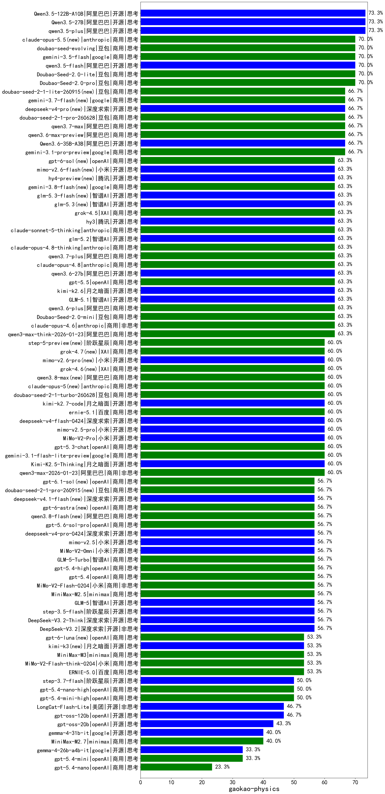

|类别|机构|大模型|【gaokao-physics】准确率|平均耗时|平均消耗token|花费/千次（元）|排名（准确率）|
|---|---|-----|-------------------|-------|-----------|-----------|-----------|
|开源|阿里巴巴|Qwen3.5-27B|73.3%|187s|6751|31.7|1|
|开源|阿里巴巴|Qwen3.5-122B-A10B|73.3%|639s|6170|38.6|2|
|商用|google|gemini-3.5-flash|70.0%|21s|3208|193.7|3|
|商用|豆包|doubao-seed-evolving|70.0%|376s|16122|478.9|4|
|商用|anthropic|claude-opus-5.5(new)|70.0%|17s|840|88.5|5|
|商用|google|gemini-4-argon(new)|70.0%|27s|785|89.6|6|
|商用|豆包|doubao-seed-2-1-pro-260628|66.7%|309s|15232|452.2|7|
|开源|阿里巴巴|Qwen3.6-35B-A3B|66.7%|19s|3740|39.0|8|
|商用|阿里巴巴|qwen3.7-max|66.7%|50s|2923|101.4|9|
|开源|深度求索|deepseek-v4-pro|66.7%|50s|2611|66.5|10|
|商用|阿里巴巴|qwen3.6-max-preview|66.7%|110s|3507|182.2|11|
|商用|google|gemini-3.7-flash|66.7%|22s|1380|32.9|12|
|商用|anthropic|claude-sonnet-5.5(new)|66.7%|7s|704|34.7|13|
|商用|google|gemini-3.1-pro-preview|66.7%|101s|3296|269.6|14|
|商用|anthropic|claude-haiku-5.5(new)|66.7%|7s|1245|3.6|15|
|商用|豆包|doubao-seed-2-1-lite-260915(new)|66.7%|104s|2065|5.2|16|
|开源|智谱AI|glm-5.3(new)|63.3%|335s|4202|114.4|17|
|商用|openAI|gpt-6-sol(new)|63.3%|181s|447|21.2|18|
|开源|智谱AI|glm-5.3-flash(new)|63.3%|101s|4208|11.5|19|
|商用|google|gemini-3.8-flash(new)|63.3%|20s|1684|81.8|20|
|商用|XAI|grok-4.5|63.3%|82s|3641|142.8|21|
|开源|腾讯|hy3|63.3%|49s|602|2.0|22|
|商用|anthropic|claude-sonnet-5-thinking|63.3%|26s|2312|147.4|23|
|开源|智谱AI|glm-5.2|63.3%|127s|5864|160.9|24|
|商用|anthropic|claude-opus-4.8-thinking|63.3%|20s|1705|262.4|25|
|开源|腾讯|hy4-preview(new)|63.3%|90s|5113|90.2|26|
|开源|小米|mimo-v2.6-flash(new)|63.3%|292s|3026|5.9|27|
|商用|阿里巴巴|qwen3.7-plus|63.3%|71s|3817|29.6|28|
|开源|阿里巴巴|qwen3.6-27b|63.3%|59s|3866|67.2|29|
|商用|阿里巴巴|qwen3.6-plus|63.3%|112s|5516|64.6|30|
|开源|智谱AI|GLM-5.1|63.3%|346s|4907|114.9|31|
|商用|openAI|gpt-5.5|63.3%|25s|1069|192.8|32|
|开源|月之暗面|kimi-k2.6|63.3%|259s|5160|136.3|33|
|商用|anthropic|claude-opus-4.8|63.3%|16s|929|126.5|34|
|商用|阶跃星辰|step-5-preview(new)|60.0%|49s|3673|71.5|35|
|商用|anthropic|claude-opus-5|60.0%|13s|979|135.2|36|
|开源|小米|mimo-v2.6-pro(new)|60.0%|136s|5198|30.7|37|
|商用|google|gemini-3.1-flash-lite-preview|60.0%|17s|762|6.6|38|
|商用|XAI|grok-4.6|60.0%|87s|3332|129.8|39|
|商用|阿里巴巴|qwen3.8-max|60.0%|93s|3971|138.2|40|
|开源|小米|mimo-v2.5-pro|60.0%|73s|3803|74.1|41|
|开源|深度求索|deepseek-v4-flash-0424|60.0%|90s|2796|5.4|42|
|商用|豆包|doubao-seed-2-1-turbo-260628|60.0%|275s|12575|186.3|43|
|开源|月之暗面|kimi-k2.7-code|60.0%|55s|2193|56.2|44|
|商用|百度|ernie-5.1|60.0%|86s|3670|63.8|45|
|商用|XAI|grok-4.7(new)|60.0%|77s|6532|235.2|46|
|开源|小米|mimo-v2.5|56.7%|62s|3468|44.0|47|
|商用|openAI|gpt-5.6-sol-pro|56.7%|25s|5288|469.5|48|
|开源|深度求索|deepseek-v4-pro-0424|56.7%|106s|3107|72.8|49|
|商用|openAI|gpt-6.1-sol(new)|56.7%|7s|517|26.0|50|
|商用|阿里巴巴|qwen3.8-flash(new)|56.7%|106s|7342|19.4|51|
|商用|豆包|doubao-seed-2-1-pro-260915(new)|56.7%|103s|1295|34.1|52|
|商用|openAI|gpt-6-astra(new)|56.7%|17s|548|140.9|53|
|开源|深度求索|deepseek-v4.1-flash(new)|56.7%|51s|1944|14.5|54|
|开源|深度求索|DeepSeek-V3.2-Think|56.7%|285s|4639|13.8|55|
|开源|深度求索|DeepSeek-V3.2|56.7%|41s|1342|3.9|56|
|商用|minimax|MiniMax-M3.1-Flash(new)|53.3%|39s|2760|10.0|57|
|商用|openAI|gpt-6-luna(new)|53.3%|163s|955|2.8|58|
|开源|月之暗面|kimi-k3|53.3%|130s|1713|153.1|59|
|商用|minimax|MiniMax-M3|53.3%|175s|6457|104.5|60|
|商用|百度|ERNIE-5.0|53.3%|432s|6628|156.5|61|
|开源|阶跃星辰|step-3.7-flash|50.0%|101s|10914|87.4|62|
|开源|openAI|gpt-oss-120b|46.7%|18s|1443|4.1|63|
|开源|openAI|gpt-oss-20b|43.3%|208s|1854|2.0|64|
|开源|google|gemma-4-31b-it|40.0%|115s|916|2.3|65|
|商用|minimax|MiniMax-M2.7|40.0%|122s|5248|43.0|66|
|开源|google|gemma-4-26b-a4b-it|33.3%|148s|1601|4.2|67|

