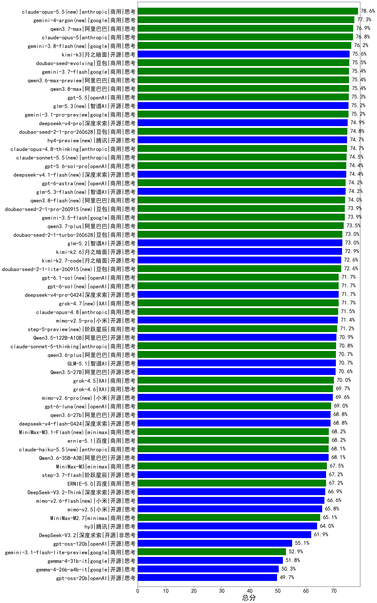

|类别|机构|大模型|【总分】准确率|平均耗时|平均消耗token|花费/千次（元）|排名（准确率）|
|---|---|-----|-------------------|-------|-----------|-----------|-----------|
|商用|anthropic|claude-opus-5.5(new)|78.6%|24s|959|98.9|1|
|商用|google|gemini-4-argon(new)|77.3%|19s|738|71.6|2|
|商用|阿里巴巴|qwen3.7-max|76.9%|51s|2920|99.0|3|
|商用|anthropic|claude-opus-5|76.8%|15s|1216|168.8|4|
|商用|google|gemini-3.8-flash(new)|76.2%|18s|1673|76.9|5|
|开源|月之暗面|kimi-k3|75.6%|80s|1962|172.4|6|
|商用|豆包|doubao-seed-evolving|75.5%|267s|10392|304.7|7|
|商用|google|gemini-3.7-flash|75.4%|10s|1269|27.8|8|
|商用|阿里巴巴|qwen3.6-max-preview|75.4%|80s|2789|139.2|9|
|商用|阿里巴巴|qwen3.8-max|75.4%|67s|3175|107.3|10|
|商用|openAI|gpt-5.5|75.3%|15s|955|158.5|11|
|开源|智谱AI|glm-5.3(new)|75.2%|154s|4981|134.9|12|
|商用|google|gemini-3.1-pro-preview|75.2%|53s|3157|250.5|13|
|开源|深度求索|deepseek-v4-pro|74.9%|145s|3679|94.1|14|
|商用|豆包|doubao-seed-2-1-pro-260628|74.8%|276s|10677|313.2|15|
|商用|anthropic|claude-opus-4.8-thinking|74.7%|19s|1612|238.2|16|
|开源|腾讯|hy4-preview(new)|74.7%|95s|6352|111.6|17|
|商用|anthropic|claude-sonnet-5.5(new)|74.5%|16s|916|46.5|18|
|商用|openAI|gpt-5.6-sol-pro|74.4%|28s|4882|398.7|19|
|开源|深度求索|deepseek-v4.1-flash(new)|74.4%|26s|2761|20.7|20|
|商用|openAI|gpt-6-astra(new)|74.2%|14s|350|108.1|21|
|开源|智谱AI|glm-5.3-flash(new)|74.2%|128s|4689|12.7|22|
|商用|阿里巴巴|qwen3.8-flash(new)|74.0%|64s|3904|10.0|23|
|商用|豆包|doubao-seed-2-1-pro-260915(new)|73.9%|90s|3094|85.7|24|
|商用|google|gemini-3.5-flash|73.9%|13s|2617|151.2|25|
|商用|阿里巴巴|qwen3.7-plus|73.5%|73s|4153|31.7|26|
|商用|豆包|doubao-seed-2-1-turbo-260628|73.0%|218s|9319|136.3|27|
|开源|智谱AI|glm-5.2|73.0%|93s|4109|110.5|28|
|开源|月之暗面|kimi-k2.6|72.9%|175s|3885|100.4|29|
|开源|月之暗面|kimi-k2.7-code|72.6%|57s|1999|49.7|30|
|商用|豆包|doubao-seed-2-1-lite-260915(new)|72.6%|96s|3518|9.0|31|
|商用|openAI|gpt-6.1-sol(new)|71.7%|22s|329|19.7|32|
|商用|openAI|gpt-6-sol(new)|71.7%|205s|337|25.7|33|
|开源|深度求索|deepseek-v4-pro-0424|71.7%|65s|2369|54.3|34|
|商用|XAI|grok-4.7(new)|71.7%|76s|5971|210.0|35|
|商用|anthropic|claude-opus-4.8|71.5%|9s|819|99.4|36|
|开源|小米|mimo-v2.5-pro|71.4%|56s|3396|64.3|37|
|商用|阶跃星辰|step-5-preview(new)|71.2%|42s|3192|61.0|38|
|开源|阿里巴巴|Qwen3.5-122B-A10B|70.9%|338s|5262|32.3|39|
|商用|anthropic|claude-sonnet-5-thinking|70.8%|20s|1590|93.7|40|
|商用|阿里巴巴|qwen3.6-plus|70.7%|68s|3676|41.6|41|
|开源|智谱AI|GLM-5.1|70.7%|183s|3241|73.8|42|
|开源|阿里巴巴|Qwen3.5-27B|70.6%|310s|5423|25.0|43|
|商用|XAI|grok-4.5|70.0%|92s|3276|125.7|44|
|商用|XAI|grok-4.6|69.7%|144s|3103|118.4|45|
|开源|小米|mimo-v2.6-pro(new)|69.6%|95s|4126|24.0|46|
|商用|openAI|gpt-6-luna(new)|69.0%|237s|607|2.8|47|
|开源|阿里巴巴|qwen3.6-27b|68.8%|62s|4275|73.2|48|
|开源|深度求索|deepseek-v4-flash-0424|68.8%|49s|2554|4.9|49|
|商用|minimax|MiniMax-M3.1-Flash(new)|68.2%|38s|2470|8.7|50|
|商用|百度|ernie-5.1|68.2%|50s|2014|32.6|51|
|商用|anthropic|claude-haiku-5.5(new)|68.1%|21s|1401|4.0|52|
|开源|阿里巴巴|Qwen3.6-35B-A3B|68.1%|81s|3965|40.5|53|
|商用|minimax|MiniMax-M3|67.5%|99s|2484|37.0|54|
|开源|阶跃星辰|step-3.7-flash|67.2%|183s|5190|40.6|55|
|商用|百度|ERNIE-5.0|67.2%|225s|3897|89.2|56|
|开源|深度求索|DeepSeek-V3.2-Think|66.9%|144s|2572|7.5|57|
|开源|小米|mimo-v2.6-flash(new)|66.6%|170s|3191|6.1|58|
|开源|小米|mimo-v2.5|65.8%|46s|3024|36.8|59|
|商用|minimax|MiniMax-M2.7|65.1%|87s|4044|32.4|60|
|开源|腾讯|hy3|64.0%|64s|618|1.8|61|
|开源|深度求索|DeepSeek-V3.2|61.9%|75s|853|2.4|62|
|开源|openAI|gpt-oss-120b|55.1%|86s|1108|2.9|63|
|商用|google|gemini-3.1-flash-lite-preview|52.9%|12s|587|3.9|64|
|开源|google|gemma-4-31b-it|51.8%|82s|687|1.4|65|
|开源|google|gemma-4-26b-a4b-it|50.3%|47s|799|1.7|66|
|开源|openAI|gpt-oss-20b|49.7%|136s|1983|2.1|67|

