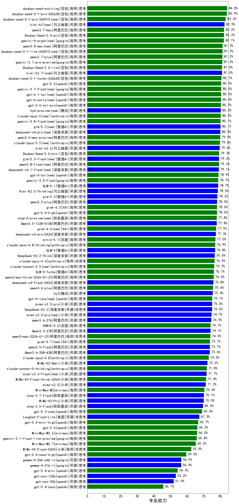

|类别|机构|大模型|【专业能力】准确率|平均耗时|平均消耗token|花费/千次（元）|排名（准确率）|
|---|---|-----|-------------------|-------|-----------|-----------|-----------|
|商用|豆包|doubao-seed-evolving|84.0%|246s|9277|274.8|1|
|商用|豆包|doubao-seed-2-1-pro-260628|83.9%|252s|9461|280.3|2|
|开源|月之暗面|kimi-k3.1-pro(new)|83.7%|72s|2393|153.1|3|
|商用|豆包|doubao-seed-2-1-pro-260915(new)|83.2%|77s|2109|59.7|4|
|开源|月之暗面|kimi-k3|82.5%|76s|1484|133.1|5|
|商用|阿里巴巴|qwen3.7-max|82.2%|36s|1824|63.1|6|
|商用|google|gemini-4-argon(new)|82.1%|18s|543|60.6|7|
|商用|阿里巴巴|qwen3.8-max|81.3%|55s|2337|80.7|8|
|商用|豆包|doubao-seed-2-1-lite-260915(new)|81.3%|88s|2258|5.8|9|
|商用|阿里巴巴|qwen3.7-plus|81.2%|48s|2610|20.2|10|
|商用|google|gemini-3.1-pro-preview|81.2%|43s|1991|161.6|11|
|开源|月之暗面|kimi-k2.7-code|81.0%|48s|1626|41.9|12|
|商用|豆包|doubao-seed-2-1-turbo-260628|80.7%|216s|8305|122.8|13|
|商用|openAI|gpt-5.5|80.5%|14s|780|141.7|14|
|商用|google|gemini-3.7-flash|80.5%|7s|878|20.7|15|
|商用|openAI|gpt-6.1-sol(new)|80.5%|24s|324|15.6|16|
|商用|openAI|gpt-6-astra(new)|80.4%|13s|359|90.5|17|
|商用|openAI|gpt-5.6-sol-pro|80.3%|28s|4179|354.2|18|
|开源|腾讯|hy4-preview(new)|80.2%|82s|4964|88.0|19|
|商用|anthropic|claude-opus-5|80.2%|14s|839|123.3|20|
|商用|google|gemini-3.8-flash(new)|80.1%|17s|1024|49.0|21|
|开源|智谱AI|glm-5.3(new)|80.1%|130s|3610|98.9|22|
|开源|深度求索|deepseek-v4-pro|80.0%|126s|2483|63.9|23|
|商用|阿里巴巴|qwen3.6-max-preview|79.9%|69s|2124|110.0|24|
|商用|anthropic|claude-opus-5.5(new)|79.8%|26s|750|85.9|25|
|开源|月之暗面|kimi-k2.6|79.6%|139s|2812|73.5|26|
|开源|智谱AI|glm-5.3-flash(new)|79.2%|106s|3356|9.2|27|
|商用|阿里巴巴|qwen3.8-flash(new)|79.2%|57s|2828|7.3|28|
|开源|深度求索|deepseek-v4.1-flash(new)|79.1%|16s|1771|13.4|29|
|商用|openAI|gpt-6-sol(new)|78.9%|230s|345|17.1|30|
|开源|智谱AI|GLM-5.1|78.7%|176s|2273|52.7|31|
|商用|google|gemini-3.5-flash|78.7%|11s|1851|110.7|32|
|开源|智谱AI|glm-5.2|78.2%|66s|2656|72.2|33|
|商用|XAI|grok-4.5|78.0%|82s|2626|101.6|34|
|商用|阶跃星辰|step-5-preview(new)|77.8%|38s|2700|52.6|35|
|开源|阿里巴巴|Qwen3.5-122B-A10B|77.8%|283s|3934|24.6|36|
|商用|XAI|grok-4.6|77.5%|117s|2265|86.5|37|
|开源|深度求索|deepseek-v4-pro-0424|77.3%|52s|1534|35.7|38|
|商用|百度|ernie-5.1|77.0%|43s|1629|27.8|39|
|商用|anthropic|claude-opus-4.8-thinking|76.9%|16s|1096|168.2|40|
|开源|深度求索|DeepSeek-V3.2-Think|76.6%|130s|1776|5.2|41|
|商用|anthropic|claude-sonnet-5.5(new)|76.3%|13s|675|37.7|42|
|开源|深度求索|deepseek-v4-flash-0424|75.8%|38s|1481|2.9|43|
|商用|阿里巴巴|qwen3.6-plus|75.6%|53s|2319|26.8|44|
|开源|腾讯|hy3|75.4%|65s|353|1.1|45|
|商用|openAI|gpt-6-luna(new)|75.1%|251s|679|2.0|46|
|开源|小米|mimo-v2.5-pro|75.0%|44s|2461|46.7|47|
|开源|深度求索|DeepSeek-V3.2|75.0%|65s|576|1.6|48|
|开源|小米|mimo-v2.6-pro(new)|74.7%|80s|2992|17.6|49|
|开源|阿里巴巴|qwen3.6-27b|74.5%|40s|2615|45.5|50|
|商用|百度|ERNIE-5.0|74.1%|200s|2891|67.7|51|
|开源|阿里巴巴|Qwen3.5-27B|74.1%|321s|4081|19.1|52|
|商用|XAI|grok-4.7(new)|73.7%|75s|5704|201.9|53|
|开源|阿里巴巴|Qwen3.6-35B-A3B|73.6%|83s|2512|26.2|54|
|商用|anthropic|claude-opus-4.8|73.0%|9s|647|89.7|55|
|商用|anthropic|claude-sonnet-5-thinking|71.8%|19s|1272|79.6|56|
|开源|小米|mimo-v2.6-flash(new)|71.7%|175s|2060|4.0|57|
|开源|小米|mimo-v2.5|71.2%|51s|2092|25.4|58|
|商用|minimax|MiniMax-M3|70.4%|69s|1799|26.9|59|
|开源|阶跃星辰|step-3.7-flash|70.1%|307s|3790|30.0|60|
|商用|anthropic|claude-haiku-5.5(new)|70.0%|13s|1017|3.1|61|
|商用|minimax|MiniMax-M3.1-Flash(new)|66.9%|43s|2552|9.3|62|
|商用|google|gemini-3.1-flash-lite-preview|65.8%|13s|480|4.1|63|
|商用|minimax|MiniMax-M2.7|65.2%|64s|2740|22.2|64|
|开源|google|gemma-4-26b-a4b-it|56.5%|55s|741|1.8|65|
|开源|google|gemma-4-31b-it|56.4%|89s|617|1.5|66|
|开源|openAI|gpt-oss-120b|53.2%|71s|894|2.5|67|
|开源|openAI|gpt-oss-20b|51.9%|88s|1679|1.8|68|

