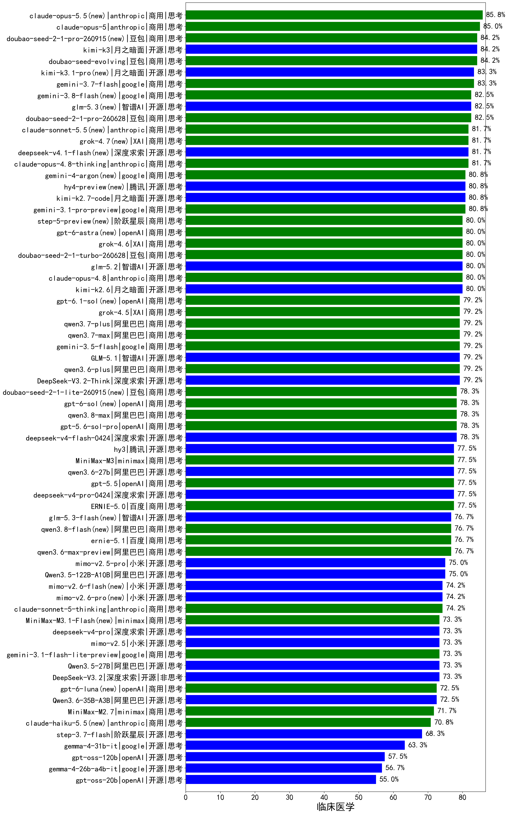

|类别|机构|大模型|【临床医学】准确率|平均耗时|平均消耗token|花费/千次（元）|排名（准确率）|
|---|---|-----|-------------------|-------|-----------|-----------|-----------|
|商用|anthropic|claude-opus-5.5(new)|85.8%|33s|658|81.3|1|
|商用|anthropic|claude-opus-5|85.0%|16s|732|114.7|2|
|商用|豆包|doubao-seed-evolving|84.2%|249s|7464|221.5|3|
|开源|月之暗面|kimi-k3|84.2%|45s|936|82.5|4|
|商用|豆包|doubao-seed-2-1-pro-260915(new)|84.2%|51s|1185|33.1|5|
|开源|月之暗面|kimi-k3.1-pro(new)|83.3%|57s|1955|125.3|6|
|商用|google|gemini-3.7-flash|83.3%|9s|798|19.6|7|
|商用|google|gemini-3.8-flash(new)|82.5%|19s|781|38.3|8|
|商用|豆包|doubao-seed-2-1-pro-260628|82.5%|217s|7585|225.1|9|
|开源|智谱AI|glm-5.3(new)|82.5%|1s|1666|45.3|10|
|商用|anthropic|claude-opus-4.8-thinking|81.7%|15s|777|122.6|11|
|开源|深度求索|deepseek-v4.1-flash(new)|81.7%|10s|1052|7.9|12|
|商用|XAI|grok-4.7(new)|81.7%|53s|4114|136.4|13|
|商用|anthropic|claude-sonnet-5.5(new)|81.7%|25s|548|32.9|14|
|开源|腾讯|hy4-preview(new)|80.8%|65s|3306|58.6|15|
|商用|google|gemini-3.1-pro-preview|80.8%|35s|1476|121.2|16|
|商用|google|gemini-4-argon(new)|80.8%|21s|436|50.9|17|
|开源|月之暗面|kimi-k2.7-code|80.8%|49s|1352|35.3|18|
|商用|anthropic|claude-opus-4.8|80.0%|10s|532|79.9|19|
|商用|XAI|grok-4.6|80.0%|203s|1559|58.1|20|
|商用|阶跃星辰|step-5-preview(new)|80.0%|31s|1798|35.1|21|
|开源|智谱AI|glm-5.2|80.0%|48s|1862|50.8|22|
|商用|openAI|gpt-6-astra(new)|80.0%|11s|262|69.8|23|
|商用|豆包|doubao-seed-2-1-turbo-260628|80.0%|194s|7534|111.8|24|
|开源|月之暗面|kimi-k2.6|80.0%|109s|2184|57.7|25|
|商用|google|gemini-3.5-flash|79.2%|8s|1400|84.8|26|
|商用|XAI|grok-4.5|79.2%|80s|1738|65.6|27|
|开源|深度求索|DeepSeek-V3.2-Think|79.2%|119s|1167|3.4|28|
|商用|openAI|gpt-6.1-sol(new)|79.2%|22s|235|12.1|29|
|商用|阿里巴巴|qwen3.6-plus|79.2%|32s|1551|17.9|30|
|商用|阿里巴巴|qwen3.7-max|79.2%|23s|1136|39.3|31|
|开源|智谱AI|GLM-5.1|79.2%|156s|1507|35.0|32|
|商用|阿里巴巴|qwen3.7-plus|79.2%|28s|1451|11.2|33|
|商用|豆包|doubao-seed-2-1-lite-260915(new)|78.3%|49s|1666|4.3|34|
|商用|openAI|gpt-5.6-sol-pro|78.3%|23s|3381|273.4|35|
|商用|openAI|gpt-6-sol(new)|78.3%|244s|254|13.4|36|
|商用|阿里巴巴|qwen3.8-max|78.3%|38s|1516|52.1|37|
|开源|深度求索|deepseek-v4-flash-0424|78.3%|33s|821|1.6|38|
|开源|深度求索|deepseek-v4-pro-0424|77.5%|37s|887|20.6|39|
|商用|minimax|MiniMax-M3|77.5%|24s|696|8.8|40|
|商用|百度|ERNIE-5.0|77.5%|143s|1995|46.9|41|
|开源|腾讯|hy3|77.5%|68s|229|0.7|42|
|商用|openAI|gpt-5.5|77.5%|8s|434|77.6|43|
|开源|阿里巴巴|qwen3.6-27b|77.5%|28s|1623|28.2|44|
|商用|阿里巴巴|qwen3.8-flash(new)|76.7%|58s|1880|4.9|45|
|开源|智谱AI|glm-5.3-flash(new)|76.7%|133s|2414|6.6|46|
|商用|百度|ernie-5.1|76.7%|30s|935|16.0|47|
|商用|阿里巴巴|qwen3.6-max-preview|76.7%|50s|1561|81.3|48|
|开源|小米|mimo-v2.5-pro|75.0%|23s|1224|21.3|49|
|开源|阿里巴巴|Qwen3.5-122B-A10B|75.0%|253s|2943|18.5|50|
|开源|小米|mimo-v2.6-pro(new)|74.2%|35s|1075|6.2|51|
|开源|小米|mimo-v2.6-flash(new)|74.2%|92s|1161|2.3|52|
|商用|anthropic|claude-sonnet-5-thinking|74.2%|15s|765|48.3|53|
|开源|阿里巴巴|Qwen3.5-27B|73.3%|279s|2978|14.0|54|
|开源|深度求索|DeepSeek-V3.2|73.3%|45s|322|0.9|55|
|商用|minimax|MiniMax-M3.1-Flash(new)|73.3%|21s|1303|4.4|56|
|开源|深度求索|deepseek-v4-pro|73.3%|108s|1162|28.9|57|
|开源|小米|mimo-v2.5|73.3%|22s|1273|14.4|58|
|商用|google|gemini-3.1-flash-lite-preview|73.3%|18s|356|3.2|59|
|商用|openAI|gpt-6-luna(new)|72.5%|273s|427|1.3|60|
|开源|阿里巴巴|Qwen3.6-35B-A3B|72.5%|84s|1780|18.6|61|
|商用|minimax|MiniMax-M2.7|71.7%|46s|1836|14.8|62|
|商用|anthropic|claude-haiku-5.5(new)|70.8%|10s|738|2.3|63|
|开源|阶跃星辰|step-3.7-flash|68.3%|36s|2806|22.3|64|
|开源|google|gemma-4-31b-it|63.3%|69s|513|1.3|65|
|开源|openAI|gpt-oss-120b|57.5%|34s|646|1.8|66|
|开源|google|gemma-4-26b-a4b-it|56.7%|54s|556|1.4|67|
|开源|openAI|gpt-oss-20b|55.0%|36s|933|1.0|68|

