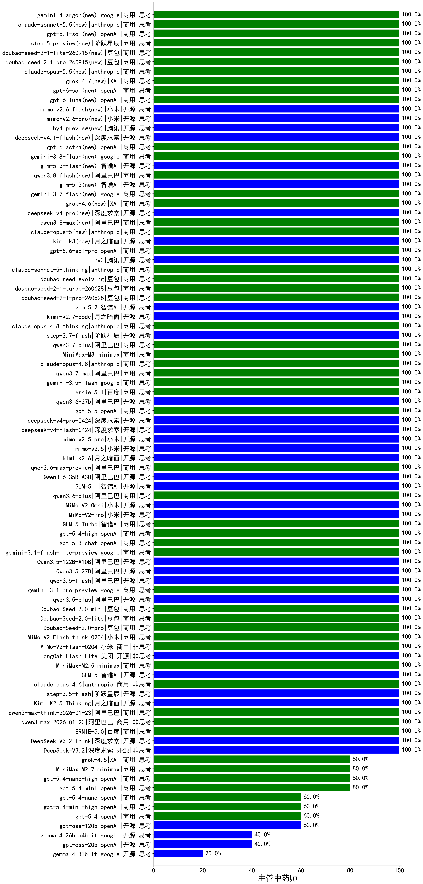

|类别|机构|大模型|【主管中药师】准确率|平均耗时|平均消耗token|花费/千次（元）|排名（准确率）|
|---|---|-----|-------------------|-------|-----------|-----------|-----------|
|商用|豆包|doubao-seed-2-1-pro-260628|100.0%|135s|2960|86.7|1|
|商用|豆包|doubao-seed-2-1-turbo-260628|100.0%|146s|2052|29.7|2|
|商用|anthropic|claude-sonnet-5-thinking|100.0%|15s|604|38.7|3|
|开源|腾讯|hy3|100.0%|30s|185|0.6|4|
|商用|openAI|gpt-5.6-sol-pro|100.0%|8s|2462|163.7|5|
|开源|月之暗面|kimi-k3|100.0%|18s|358|25.7|6|
|商用|anthropic|claude-opus-5|100.0%|11s|455|70.7|7|
|商用|阿里巴巴|qwen3.8-max|100.0%|7s|342|10.1|8|
|开源|深度求索|deepseek-v4-pro|100.0%|850s|378|8.0|9|
|商用|XAI|grok-4.6|100.0%|36s|1488|55.5|10|
|商用|google|gemini-3.7-flash|100.0%|18s|677|16.8|11|
|开源|智谱AI|glm-5.3(new)|100.0%|38s|843|22.5|12|
|商用|阿里巴巴|qwen3.8-flash(new)|100.0%|135s|467|1.1|13|
|开源|智谱AI|glm-5.3-flash(new)|100.0%|27s|841|2.2|14|
|商用|google|gemini-3.8-flash(new)|100.0%|19s|569|27.9|15|
|商用|openAI|gpt-6-astra(new)|100.0%|10s|190|51.5|16|
|开源|深度求索|deepseek-v4.1-flash(new)|100.0%|6s|375|2.6|17|
|开源|腾讯|hy4-preview(new)|100.0%|21s|1425|24.9|18|
|开源|小米|mimo-v2.6-pro(new)|100.0%|16s|586|3.4|19|
|开源|小米|mimo-v2.6-flash(new)|100.0%|416s|601|1.2|20|
|商用|openAI|gpt-6-luna(new)|100.0%|96s|244|0.7|21|
|商用|openAI|gpt-6-sol(new)|100.0%|53s|137|6.6|22|
|商用|XAI|grok-4.7(new)|100.0%|51s|2249|58.5|23|
|商用|anthropic|claude-opus-5.5(new)|100.0%|12s|516|64.8|24|
|商用|豆包|doubao-seed-2-1-pro-260915(new)|100.0%|28s|735|20.0|25|
|商用|豆包|doubao-seed-2-1-lite-260915(new)|100.0%|9s|510|1.2|26|
|商用|阶跃星辰|step-5-preview(new)|100.0%|5s|332|5.9|27|
|商用|openAI|gpt-6.1-sol(new)|100.0%|4s|150|7.5|28|
|商用|anthropic|claude-sonnet-5.5(new)|100.0%|9s|403|24.5|29|
|商用|google|gemini-4-argon(new)|100.0%|29s|416|49.9|30|
|商用|anthropic|claude-haiku-5.5(new)|100.0%|5s|468|1.5|31|
|商用|豆包|doubao-seed-evolving|100.0%|57s|2511|73.2|32|
|商用|minimax|MiniMax-M3.1-Flash(new)|100.0%|10s|594|1.7|33|
|开源|小米|mimo-v2.5|100.0%|11s|788|7.8|34|
|商用|百度|ERNIE-5.0|100.0%|413s|1141|26.7|35|
|开源|阿里巴巴|Qwen3.5-27B|100.0%|94s|1409|6.5|36|
|开源|阿里巴巴|Qwen3.5-122B-A10B|100.0%|288s|2097|13.1|37|
|商用|google|gemini-3.1-flash-lite-preview|100.0%|39s|277|2.5|38|
|商用|阿里巴巴|qwen3.6-plus|100.0%|30s|1497|17.4|39|
|开源|深度求索|DeepSeek-V3.2-Think|100.0%|134s|594|1.7|40|
|开源|深度求索|DeepSeek-V3.2|100.0%|10s|273|0.8|41|
|开源|智谱AI|GLM-5.1|100.0%|42s|1077|25.0|42|
|开源|阿里巴巴|Qwen3.6-35B-A3B|100.0%|107s|1520|15.9|43|
|商用|阿里巴巴|qwen3.6-max-preview|100.0%|40s|1349|70.5|44|
|开源|月之暗面|kimi-k2.6|100.0%|47s|902|23.4|45|
|开源|智谱AI|glm-5.2|100.0%|73s|999|26.9|46|
|开源|小米|mimo-v2.5-pro|100.0%|40s|1005|17.0|47|
|开源|深度求索|deepseek-v4-flash-0424|100.0%|14s|382|0.7|48|
|开源|深度求索|deepseek-v4-pro-0424|100.0%|18s|473|10.8|49|
|商用|openAI|gpt-5.5|100.0%|6s|241|41.2|50|
|开源|阿里巴巴|qwen3.6-27b|100.0%|23s|1481|25.9|51|
|商用|百度|ernie-5.1|100.0%|20s|616|10.5|52|
|商用|google|gemini-3.5-flash|100.0%|6s|1053|63.9|53|
|商用|阿里巴巴|qwen3.7-max|100.0%|23s|631|21.4|54|
|商用|anthropic|claude-opus-4.8|100.0%|9s|426|65.5|55|
|商用|minimax|MiniMax-M3|100.0%|24s|745|9.8|56|
|商用|阿里巴巴|qwen3.7-plus|100.0%|13s|636|4.8|57|
|开源|阶跃星辰|step-3.7-flash|100.0%|16s|1737|13.7|58|
|商用|anthropic|claude-opus-4.8-thinking|100.0%|19s|555|88.1|59|
|开源|月之暗面|kimi-k2.7-code|100.0%|14s|496|12.4|60|
|商用|google|gemini-3.1-pro-preview|100.0%|20s|1086|89.2|61|
|商用|XAI|grok-4.5|80.0%|28s|1090|38.8|62|
|商用|minimax|MiniMax-M2.7|80.0%|37s|1526|12.3|63|
|开源|openAI|gpt-oss-120b|60.0%|8s|952|2.8|64|
|开源|google|gemma-4-26b-a4b-it|40.0%|17s|444|1.1|65|
|开源|openAI|gpt-oss-20b|40.0%|24s|4989|5.7|66|
|开源|google|gemma-4-31b-it|20.0%|13s|379|1.0|67|

