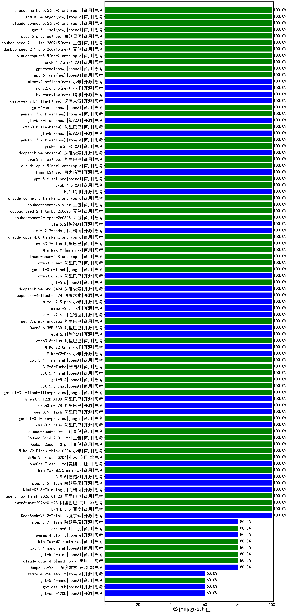

|类别|机构|大模型|【主管护师资格考试】准确率|平均耗时|平均消耗token|花费/千次（元）|排名（准确率）|
|---|---|-----|-------------------|-------|-----------|-----------|-----------|
|商用|豆包|doubao-seed-2-1-pro-260628|100.0%|326s|5693|168.1|1|
|商用|openAI|gpt-6-astra(new)|100.0%|13s|256|64.2|2|
|商用|anthropic|claude-sonnet-5-thinking|100.0%|16s|748|46.1|3|
|开源|腾讯|hy3|100.0%|50s|215|0.6|4|
|商用|XAI|grok-4.5|100.0%|34s|1084|37.9|5|
|商用|openAI|gpt-5.6-sol-pro|100.0%|14s|3005|222.1|6|
|开源|月之暗面|kimi-k3|100.0%|23s|560|44.1|7|
|商用|anthropic|claude-opus-5|100.0%|15s|702|107.3|8|
|商用|阿里巴巴|qwen3.8-max|100.0%|21s|595|18.7|9|
|开源|深度求索|deepseek-v4-pro|100.0%|626s|687|15.9|10|
|商用|XAI|grok-4.6|100.0%|16s|969|33.0|11|
|商用|google|gemini-3.7-flash|100.0%|6s|738|17.8|12|
|开源|智谱AI|glm-5.3(new)|100.0%|30s|1320|35.4|13|
|商用|阿里巴巴|qwen3.8-flash(new)|100.0%|137s|551|1.2|14|
|开源|智谱AI|glm-5.3-flash(new)|100.0%|36s|1360|3.7|15|
|商用|google|gemini-3.8-flash(new)|100.0%|11s|612|28.9|16|
|开源|深度求索|deepseek-v4.1-flash(new)|100.0%|6s|527|3.7|17|
|商用|豆包|doubao-seed-2-1-turbo-260628|100.0%|148s|5566|82.2|18|
|开源|腾讯|hy4-preview(new)|100.0%|32s|2068|36.2|19|
|开源|小米|mimo-v2.6-pro(new)|100.0%|26s|911|5.2|20|
|开源|小米|mimo-v2.6-flash(new)|100.0%|49s|1097|2.1|21|
|商用|openAI|gpt-6-luna(new)|100.0%|622s|269|0.7|22|
|商用|openAI|gpt-6-sol(new)|100.0%|145s|202|9.1|23|
|商用|XAI|grok-4.7(new)|100.0%|19s|2494|68.0|24|
|商用|anthropic|claude-opus-5.5(new)|100.0%|146s|630|75.5|25|
|商用|豆包|doubao-seed-2-1-pro-260915(new)|100.0%|45s|1016|27.8|26|
|商用|豆包|doubao-seed-2-1-lite-260915(new)|100.0%|23s|802|2.0|27|
|商用|阶跃星辰|step-5-preview(new)|100.0%|7s|617|11.4|28|
|商用|openAI|gpt-6.1-sol(new)|100.0%|5s|246|12.1|29|
|商用|anthropic|claude-sonnet-5.5(new)|100.0%|8s|562|33.0|30|
|商用|google|gemini-4-argon(new)|100.0%|25s|524|61.8|31|
|商用|anthropic|claude-haiku-5.5(new)|100.0%|12s|727|2.2|32|
|商用|豆包|doubao-seed-evolving|100.0%|149s|5037|148.5|33|
|商用|minimax|MiniMax-M3.1-Flash(new)|100.0%|66s|740|2.2|34|
|开源|小米|mimo-v2.5|100.0%|8s|1083|11.6|35|
|开源|深度求索|deepseek-v4-flash-0424|100.0%|14s|482|0.9|36|
|商用|google|gemini-3.1-pro-preview|100.0%|41s|1343|109.0|37|
|开源|阿里巴巴|Qwen3.5-27B|100.0%|300s|2360|11.0|38|
|开源|阿里巴巴|Qwen3.5-122B-A10B|100.0%|115s|1851|11.4|39|
|商用|google|gemini-3.1-flash-lite-preview|100.0%|3s|364|3.2|40|
|商用|阿里巴巴|qwen3.6-plus|100.0%|27s|1668|19.2|41|
|开源|智谱AI|GLM-5.1|100.0%|112s|1144|26.2|42|
|开源|阿里巴巴|Qwen3.6-35B-A3B|100.0%|8s|1508|15.6|43|
|商用|阿里巴巴|qwen3.6-max-preview|100.0%|45s|1441|74.4|44|
|开源|月之暗面|kimi-k2.6|100.0%|63s|984|25.1|45|
|开源|智谱AI|glm-5.2|100.0%|28s|1229|32.8|46|
|开源|深度求索|DeepSeek-V3.2-Think|100.0%|184s|611|1.8|47|
|开源|小米|mimo-v2.5-pro|100.0%|16s|1120|19.0|48|
|开源|深度求索|deepseek-v4-pro-0424|100.0%|22s|614|13.9|49|
|商用|openAI|gpt-5.5|100.0%|7s|333|53.9|50|
|开源|阿里巴巴|qwen3.6-27b|100.0%|28s|1670|28.9|51|
|商用|google|gemini-3.5-flash|100.0%|8s|1276|76.4|52|
|商用|阿里巴巴|qwen3.7-max|100.0%|24s|972|33.2|53|
|商用|anthropic|claude-opus-4.8|100.0%|12s|633|95.2|54|
|商用|minimax|MiniMax-M3|100.0%|24s|668|8.2|55|
|商用|阿里巴巴|qwen3.7-plus|100.0%|20s|926|6.9|56|
|商用|anthropic|claude-opus-4.8-thinking|100.0%|28s|721|110.7|57|
|开源|月之暗面|kimi-k2.7-code|100.0%|48s|462|11.0|58|
|商用|百度|ERNIE-5.0|100.0%|153s|1626|37.9|59|
|商用|百度|ernie-5.1|80.0%|24s|932|15.8|60|
|开源|深度求索|DeepSeek-V3.2|80.0%|19s|332|0.9|61|
|开源|google|gemma-4-31b-it|80.0%|86s|541|1.4|62|
|商用|minimax|MiniMax-M2.7|80.0%|36s|1467|11.7|63|
|开源|阶跃星辰|step-3.7-flash|80.0%|13s|1307|10.1|64|
|开源|openAI|gpt-oss-20b|60.0%|10s|1394|1.5|65|
|开源|google|gemma-4-26b-a4b-it|60.0%|63s|738|1.9|66|
|开源|openAI|gpt-oss-120b|60.0%|198s|649|1.7|67|

