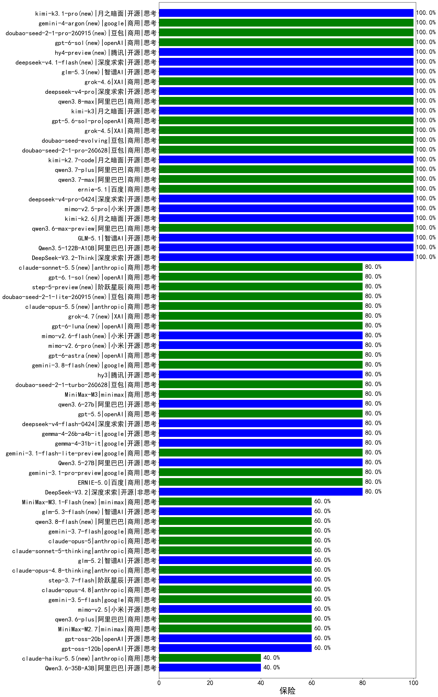

|类别|机构|大模型|【保险】准确率|平均耗时|平均消耗token|花费/千次（元）|排名（准确率）|
|---|---|-----|-------------------|-------|-----------|-----------|-----------|
|开源|月之暗面|kimi-k3.1-pro(new)|100.0%|54s|1828|115.3|1|
|商用|XAI|grok-4.5|100.0%|58s|1765|65.9|2|
|商用|豆包|doubao-seed-evolving|100.0%|237s|7808|231.0|3|
|开源|月之暗面|kimi-k3|100.0%|52s|1070|93.9|4|
|商用|豆包|doubao-seed-2-1-pro-260628|100.0%|477s|9787|290.3|5|
|商用|阿里巴巴|qwen3.8-max|100.0%|18s|904|29.3|6|
|开源|月之暗面|kimi-k2.7-code|100.0%|69s|2503|65.8|7|
|开源|深度求索|deepseek-v4-pro|100.0%|78s|2276|58.5|8|
|商用|XAI|grok-4.6|100.0%|37s|1885|70.9|9|
|商用|阿里巴巴|qwen3.7-plus|100.0%|27s|1413|10.7|10|
|开源|智谱AI|glm-5.3(new)|100.0%|103s|4144|114.1|11|
|商用|阿里巴巴|qwen3.7-max|100.0%|23s|1042|35.2|12|
|商用|百度|ernie-5.1|100.0%|54s|1044|17.5|13|
|开源|深度求索|deepseek-v4.1-flash(new)|100.0%|15s|2846|22.1|14|
|开源|腾讯|hy4-preview(new)|100.0%|43s|2885|50.8|15|
|开源|深度求索|deepseek-v4-pro-0424|100.0%|47s|1299|30.2|16|
|开源|小米|mimo-v2.5-pro|100.0%|28s|1747|31.9|17|
|商用|openAI|gpt-5.6-sol-pro|100.0%|54s|5076|487.9|18|
|开源|阿里巴巴|Qwen3.5-122B-A10B|100.0%|369s|3317|20.7|19|
|商用|google|gemini-4-argon(new)|100.0%|27s|400|42.3|20|
|商用|阿里巴巴|qwen3.6-max-preview|100.0%|61s|1998|103.6|21|
|开源|深度求索|DeepSeek-V3.2-Think|100.0%|157s|1523|4.5|22|
|开源|智谱AI|GLM-5.1|100.0%|170s|1365|31.2|23|
|商用|openAI|gpt-6-sol(new)|100.0%|177s|431|24.1|24|
|开源|月之暗面|kimi-k2.6|100.0%|91s|1693|44.0|25|
|商用|豆包|doubao-seed-2-1-pro-260915(new)|100.0%|50s|1372|37.9|26|
|商用|anthropic|claude-sonnet-5.5(new)|80.0%|9s|864|52.3|27|
|商用|openAI|gpt-6.1-sol(new)|80.0%|11s|342|17.9|28|
|商用|阶跃星辰|step-5-preview(new)|80.0%|29s|2193|42.7|29|
|开源|小米|mimo-v2.6-flash(new)|80.0%|94s|1654|3.2|30|
|商用|豆包|doubao-seed-2-1-lite-260915(new)|80.0%|31s|1731|4.4|31|
|商用|google|gemini-3.8-flash(new)|80.0%|11s|848|40.4|32|
|商用|XAI|grok-4.7(new)|80.0%|105s|8081|302.1|33|
|商用|openAI|gpt-6-astra(new)|80.0%|14s|406|111.8|34|
|商用|openAI|gpt-6-luna(new)|80.0%|376s|962|3.1|35|
|开源|小米|mimo-v2.6-pro(new)|80.0%|73s|1766|10.3|36|
|商用|anthropic|claude-opus-5.5(new)|80.0%|19s|817|98.1|37|
|商用|豆包|doubao-seed-2-1-turbo-260628|80.0%|302s|12235|181.9|38|
|开源|腾讯|hy3|80.0%|31s|249|0.7|39|
|开源|阿里巴巴|qwen3.6-27b|80.0%|30s|1898|32.7|40|
|开源|深度求索|DeepSeek-V3.2|80.0%|23s|451|1.3|41|
|商用|百度|ERNIE-5.0|80.0%|287s|3230|76.1|42|
|商用|google|gemini-3.1-pro-preview|80.0%|30s|1814|147.7|43|
|开源|阿里巴巴|Qwen3.5-27B|80.0%|195s|3771|17.7|44|
|商用|google|gemini-3.1-flash-lite-preview|80.0%|4s|441|3.8|45|
|开源|google|gemma-4-31b-it|80.0%|94s|600|1.5|46|
|开源|google|gemma-4-26b-a4b-it|80.0%|65s|570|1.4|47|
|商用|openAI|gpt-5.5|80.0%|34s|2064|414.5|48|
|开源|深度求索|deepseek-v4-flash-0424|80.0%|42s|1592|3.1|49|
|商用|minimax|MiniMax-M3|80.0%|28s|782|10.0|50|
|商用|anthropic|claude-opus-4.8|60.0%|10s|649|93.4|51|
|商用|minimax|MiniMax-M2.7|60.0%|70s|2491|20.2|52|
|商用|minimax|MiniMax-M3.1-Flash(new)|60.0%|125s|4142|15.7|53|
|开源|openAI|gpt-oss-20b|60.0%|12s|1117|1.2|54|
|商用|anthropic|claude-opus-5|60.0%|17s|1008|156.2|55|
|开源|智谱AI|glm-5.2|60.0%|77s|3254|89.2|56|
|商用|anthropic|claude-opus-4.8-thinking|60.0%|25s|988|152.8|57|
|开源|阶跃星辰|step-3.7-flash|60.0%|186s|4674|37.2|58|
|商用|阿里巴巴|qwen3.6-plus|60.0%|54s|2266|26.2|59|
|商用|google|gemini-3.5-flash|60.0%|10s|1842|111.0|60|
|商用|google|gemini-3.7-flash|60.0%|7s|883|21.2|61|
|开源|小米|mimo-v2.5|60.0%|24s|1659|19.4|62|
|商用|anthropic|claude-sonnet-5-thinking|60.0%|19s|1364|87.5|63|
|商用|阿里巴巴|qwen3.8-flash(new)|60.0%|119s|6530|17.4|64|
|开源|智谱AI|glm-5.3-flash(new)|60.0%|70s|2811|7.7|65|
|开源|openAI|gpt-oss-120b|60.0%|7s|735|2.0|66|
|开源|阿里巴巴|Qwen3.6-35B-A3B|40.0%|429s|2089|21.7|67|
|商用|anthropic|claude-haiku-5.5(new)|40.0%|7s|1132|3.6|68|

