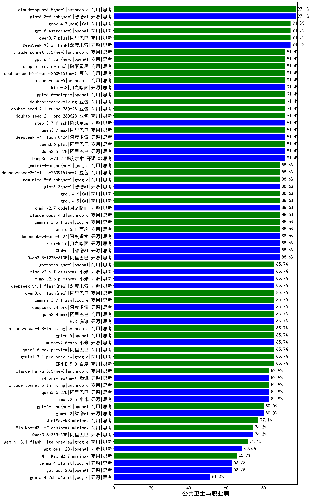

|类别|机构|大模型|【公共卫生与职业病】准确率|平均耗时|平均消耗token|花费/千次（元）|排名（准确率）|
|---|---|-----|-------------------|-------|-----------|-----------|-----------|
|开源|月之暗面|kimi-k3.1-pro(new)|97.1%|36s|1235|76.0|1|
|商用|anthropic|claude-opus-5.5(new)|97.1%|18s|664|81.4|2|
|开源|智谱AI|glm-5.3-flash(new)|97.1%|148s|1571|4.2|3|
|商用|阿里巴巴|qwen3.7-plus|94.3%|23s|1147|8.7|4|
|商用|XAI|grok-4.7(new)|94.3%|51s|4212|140.3|5|
|商用|openAI|gpt-6-astra(new)|94.3%|13s|270|71.3|6|
|开源|深度求索|DeepSeek-V3.2-Think|94.3%|104s|975|2.9|7|
|商用|豆包|doubao-seed-2-1-pro-260915(new)|91.4%|46s|745|19.7|8|
|商用|阶跃星辰|step-5-preview(new)|91.4%|21s|1449|28.0|9|
|商用|openAI|gpt-6.1-sol(new)|91.4%|11s|263|13.8|10|
|开源|深度求索|deepseek-v4-flash-0424|91.4%|35s|666|1.3|11|
|商用|anthropic|claude-opus-5|91.4%|14s|694|107.2|12|
|开源|月之暗面|kimi-k3|91.4%|47s|994|87.7|13|
|商用|openAI|gpt-5.6-sol-pro|91.4%|52s|3213|249.9|14|
|商用|豆包|doubao-seed-evolving|91.4%|156s|5718|168.9|15|
|商用|豆包|doubao-seed-2-1-pro-260628|91.4%|196s|5938|175.5|16|
|开源|阶跃星辰|step-3.7-flash|91.4%|38s|1704|13.3|17|
|商用|anthropic|claude-sonnet-5.5(new)|91.4%|8s|532|31.4|18|
|商用|阿里巴巴|qwen3.7-max|91.4%|27s|1045|35.9|19|
|商用|豆包|doubao-seed-2-1-turbo-260628|91.4%|158s|6179|91.4|20|
|开源|深度求索|DeepSeek-V3.2|91.4%|63s|373|1.1|21|
|开源|阿里巴巴|Qwen3.5-27B|91.4%|260s|3060|14.4|22|
|商用|阿里巴巴|qwen3.6-plus|91.4%|42s|1541|17.7|23|
|开源|深度求索|deepseek-v4-pro-0424|88.6%|29s|778|17.9|24|
|商用|XAI|grok-4.5|88.6%|121s|1716|64.5|25|
|商用|google|gemini-4-argon(new)|88.6%|15s|426|48.6|26|
|商用|豆包|doubao-seed-2-1-lite-260915(new)|88.6%|40s|1306|3.3|27|
|开源|阿里巴巴|Qwen3.5-122B-A10B|88.6%|257s|2781|17.4|28|
|商用|google|gemini-3.8-flash(new)|88.6%|27s|743|36.0|29|
|开源|智谱AI|glm-5.3(new)|88.6%|-40s|1947|53.0|30|
|开源|智谱AI|GLM-5.1|88.6%|160s|1715|40.0|31|
|商用|XAI|grok-4.6|88.6%|151s|1476|54.5|32|
|开源|月之暗面|kimi-k2.6|88.6%|109s|1849|48.5|33|
|商用|google|gemini-3.5-flash|88.6%|8s|1524|92.3|34|
|商用|anthropic|claude-opus-4.8|88.6%|11s|548|81.6|35|
|开源|月之暗面|kimi-k2.7-code|88.6%|16s|788|19.9|36|
|商用|百度|ernie-5.1|88.6%|27s|942|16.0|37|
|商用|阿里巴巴|qwen3.8-flash(new)|85.7%|35s|1964|5.1|38|
|商用|google|gemini-3.1-pro-preview|85.7%|36s|1394|113.7|39|
|开源|小米|mimo-v2.5-pro|85.7%|23s|1281|22.4|40|
|商用|openAI|gpt-6-sol(new)|85.7%|271s|264|13.9|41|
|开源|小米|mimo-v2.6-flash(new)|85.7%|184s|938|1.8|42|
|开源|小米|mimo-v2.6-pro(new)|85.7%|27s|843|4.8|43|
|开源|深度求索|deepseek-v4.1-flash(new)|85.7%|9s|1109|8.3|44|
|商用|阿里巴巴|qwen3.6-max-preview|85.7%|55s|1700|88.5|45|
|商用|百度|ERNIE-5.0|85.7%|195s|2499|58.9|46|
|商用|google|gemini-3.7-flash|85.7%|5s|780|19.0|47|
|商用|openAI|gpt-5.5|85.7%|13s|492|88.9|48|
|开源|腾讯|hy3|85.7%|56s|237|0.7|49|
|开源|深度求索|deepseek-v4-pro|85.7%|140s|1077|26.5|50|
|商用|阿里巴巴|qwen3.8-max|85.7%|28s|1041|34.8|51|
|商用|anthropic|claude-opus-4.8-thinking|85.7%|13s|657|100.8|52|
|商用|anthropic|claude-sonnet-5-thinking|82.9%|12s|750|46.8|53|
|商用|anthropic|claude-haiku-5.5(new)|82.9%|6s|753|2.3|54|
|开源|阿里巴巴|qwen3.6-27b|82.9%|26s|1605|27.8|55|
|开源|腾讯|hy4-preview(new)|82.9%|56s|2759|48.7|56|
|开源|小米|mimo-v2.5|82.9%|23s|1407|16.2|57|
|商用|openAI|gpt-6-luna(new)|80.0%|196s|443|1.3|58|
|开源|智谱AI|glm-5.2|80.0%|41s|1828|49.7|59|
|商用|minimax|MiniMax-M3|77.1%|25s|741|9.5|60|
|开源|阿里巴巴|Qwen3.6-35B-A3B|74.3%|97s|1645|17.1|61|
|商用|minimax|MiniMax-M3.1-Flash(new)|74.3%|20s|1258|4.3|62|
|商用|google|gemini-3.1-flash-lite-preview|71.4%|5s|386|3.4|63|
|开源|openAI|gpt-oss-120b|68.6%|61s|603|1.6|64|
|商用|minimax|MiniMax-M2.7|65.7%|36s|1446|11.5|65|
|开源|google|gemma-4-31b-it|62.9%|90s|545|1.4|66|
|开源|openAI|gpt-oss-20b|62.9%|72s|1499|1.6|67|
|开源|google|gemma-4-26b-a4b-it|51.4%|53s|617|1.6|68|

