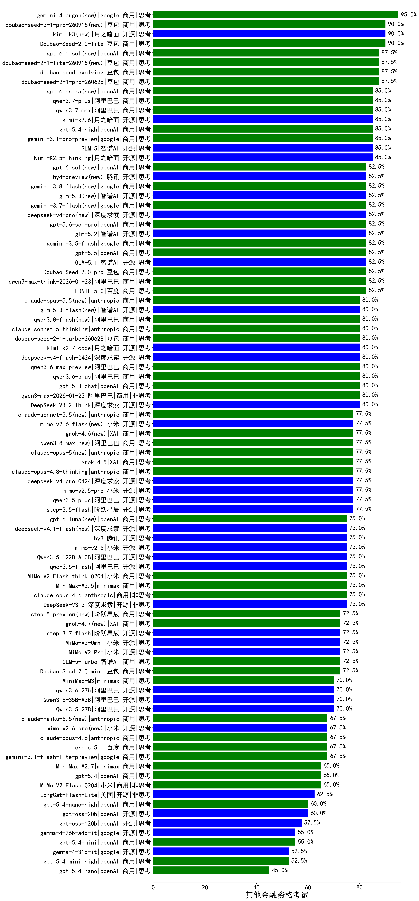

|类别|机构|大模型|【其他金融资格考试】准确率|平均耗时|平均消耗token|花费/千次（元）|排名（准确率）|
|---|---|-----|-------------------|-------|-----------|-----------|-----------|
|商用|google|gemini-4-argon(new)|95.0%|19s|498|57.3|1|
|开源|月之暗面|kimi-k3.1-pro(new)|90.0%|66s|2215|142.2|2|
|开源|月之暗面|kimi-k3|90.0%|74s|1790|166.8|3|
|商用|豆包|doubao-seed-2-1-pro-260915(new)|90.0%|70s|2196|62.9|4|
|商用|豆包|doubao-seed-2-1-lite-260915(new)|87.5%|69s|2322|6.1|5|
|商用|豆包|doubao-seed-2-1-pro-260628|87.5%|274s|10102|300.1|6|
|商用|豆包|doubao-seed-evolving|87.5%|280s|10527|312.9|7|
|商用|openAI|gpt-6.1-sol(new)|87.5%|15s|317|17.1|8|
|商用|google|gemini-3.1-pro-preview|85.0%|43s|1939|159.2|9|
|商用|阿里巴巴|qwen3.7-plus|85.0%|43s|2325|18.1|10|
|商用|阿里巴巴|qwen3.7-max|85.0%|41s|2220|78.0|11|
|商用|openAI|gpt-6-astra(new)|85.0%|14s|330|89.9|12|
|开源|月之暗面|kimi-k2.6|85.0%|157s|3417|90.7|13|
|商用|google|gemini-3.7-flash|82.5%|8s|978|23.9|14|
|商用|google|gemini-3.5-flash|82.5%|11s|1978|120.2|15|
|商用|openAI|gpt-5.6-sol-pro|82.5%|38s|4120|357.3|16|
|商用|openAI|gpt-5.5|82.5%|11s|697|130.1|17|
|开源|深度求索|deepseek-v4-pro|82.5%|136s|3503|91.8|18|
|开源|智谱AI|glm-5.2|82.5%|85s|3198|87.9|19|
|开源|智谱AI|glm-5.3(new)|82.5%|-10s|6776|188.0|20|
|开源|智谱AI|GLM-5.1|82.5%|160s|2812|66.1|21|
|商用|google|gemini-3.8-flash(new)|82.5%|28s|1071|52.7|22|
|开源|腾讯|hy4-preview(new)|82.5%|72s|5062|90.1|23|
|商用|openAI|gpt-6-sol(new)|82.5%|275s|366|20.5|24|
|商用|百度|ERNIE-5.0|82.5%|239s|4873|115.7|25|
|开源|月之暗面|kimi-k2.7-code|80.0%|47s|1556|40.5|26|
|开源|智谱AI|glm-5.3-flash(new)|80.0%|159s|4960|13.7|27|
|商用|anthropic|claude-sonnet-5-thinking|80.0%|15s|990|62.5|28|
|商用|anthropic|claude-opus-5.5(new)|80.0%|29s|734|89.1|29|
|商用|阿里巴巴|qwen3.8-flash(new)|80.0%|77s|3668|9.7|30|
|商用|豆包|doubao-seed-2-1-turbo-260628|80.0%|254s|10226|151.9|31|
|商用|阿里巴巴|qwen3.6-max-preview|80.0%|65s|2054|107.2|32|
|开源|深度求索|DeepSeek-V3.2-Think|80.0%|145s|2590|7.7|33|
|商用|阿里巴巴|qwen3.6-plus|80.0%|69s|2601|30.4|34|
|开源|深度求索|deepseek-v4-flash-0424|80.0%|53s|2121|4.2|35|
|商用|anthropic|claude-opus-4.8-thinking|77.5%|16s|1107|176.9|36|
|商用|anthropic|claude-sonnet-5.5(new)|77.5%|53s|681|40.8|37|
|开源|小米|mimo-v2.6-flash(new)|77.5%|290s|2746|5.4|38|
|商用|XAI|grok-4.5|77.5%|91s|2504|97.3|39|
|开源|深度求索|deepseek-v4-pro-0424|77.5%|67s|2018|47.6|40|
|商用|anthropic|claude-opus-5|77.5%|13s|844|130.9|41|
|商用|阿里巴巴|qwen3.8-max|77.5%|41s|1954|67.5|42|
|商用|XAI|grok-4.6|77.5%|45s|2107|80.6|43|
|开源|小米|mimo-v2.5-pro|77.5%|48s|2254|42.7|44|
|开源|阿里巴巴|Qwen3.5-122B-A10B|75.0%|273s|3677|23.1|45|
|商用|openAI|gpt-6-luna(new)|75.0%|311s|741|2.3|46|
|开源|深度求索|deepseek-v4.1-flash(new)|75.0%|32s|2981|23.3|47|
|开源|深度求索|DeepSeek-V3.2|75.0%|70s|517|1.5|48|
|开源|小米|mimo-v2.5|75.0%|62s|3647|47.4|49|
|开源|腾讯|hy3|75.0%|69s|387|1.3|50|
|商用|阶跃星辰|step-5-preview(new)|72.5%|51s|3799|74.9|51|
|开源|阶跃星辰|step-3.7-flash|72.5%|47s|4337|34.6|52|
|商用|XAI|grok-4.7(new)|72.5%|76s|5613|198.9|53|
|开源|阿里巴巴|Qwen3.6-35B-A3B|70.0%|73s|2353|24.7|54|
|商用|minimax|MiniMax-M3|70.0%|74s|2431|37.8|55|
|开源|阿里巴巴|qwen3.6-27b|70.0%|41s|2553|44.7|56|
|开源|阿里巴巴|Qwen3.5-27B|70.0%|339s|4046|19.1|57|
|商用|anthropic|claude-opus-4.8|67.5%|10s|551|79.6|58|
|商用|anthropic|claude-haiku-5.5(new)|67.5%|11s|990|3.1|59|
|商用|google|gemini-3.1-flash-lite-preview|67.5%|14s|459|4.1|60|
|商用|百度|ernie-5.1|67.5%|53s|1953|34.0|61|
|开源|小米|mimo-v2.6-pro(new)|67.5%|91s|4043|24.0|62|
|商用|minimax|MiniMax-M2.7|65.0%|87s|3823|31.4|63|
|商用|minimax|MiniMax-M3.1-Flash(new)|62.5%|42s|2349|8.6|64|
|开源|openAI|gpt-oss-20b|60.0%|51s|3253|3.6|65|
|开源|openAI|gpt-oss-120b|57.5%|60s|841|2.4|66|
|开源|google|gemma-4-26b-a4b-it|55.0%|71s|630|1.6|67|
|开源|google|gemma-4-31b-it|52.5%|65s|571|1.4|68|

