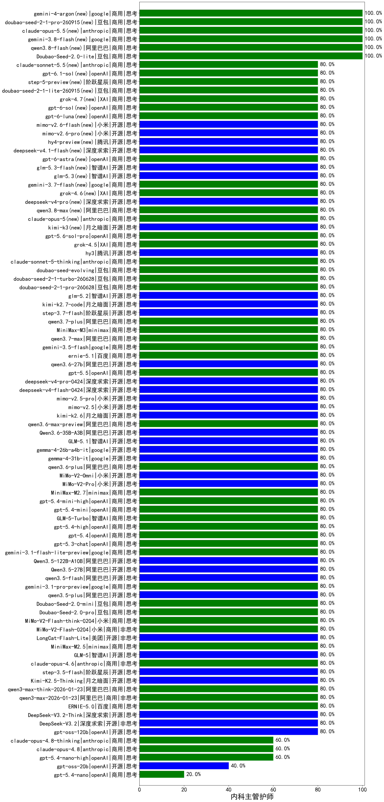

|类别|机构|大模型|【内科主管护师】准确率|平均耗时|平均消耗token|花费/千次（元）|排名（准确率）|
|---|---|-----|-------------------|-------|-----------|-----------|-----------|
|商用|豆包|doubao-seed-2-1-pro-260915(new)|100.0%|102s|2968|86.5|1|
|商用|google|gemini-4-argon(new)|100.0%|12s|483|56.6|2|
|商用|阿里巴巴|qwen3.8-flash(new)|100.0%|101s|631|1.5|3|
|商用|anthropic|claude-opus-5.5(new)|100.0%|13s|706|86.5|4|
|商用|google|gemini-3.8-flash(new)|100.0%|12s|742|35.8|5|
|商用|openAI|gpt-5.6-sol-pro|80.0%|9s|2822|191.6|6|
|开源|月之暗面|kimi-k3|80.0%|58s|651|53.5|7|
|商用|anthropic|claude-opus-5|80.0%|15s|745|115.1|8|
|商用|阿里巴巴|qwen3.8-max|80.0%|15s|682|21.9|9|
|商用|openAI|gpt-6-astra(new)|80.0%|15s|244|60.4|10|
|商用|XAI|grok-4.5|80.0%|55s|1083|37.9|11|
|开源|深度求索|deepseek-v4-pro|80.0%|27s|616|14.0|12|
|商用|XAI|grok-4.6|80.0%|20s|1001|34.5|13|
|商用|google|gemini-3.7-flash|80.0%|5s|684|16.4|14|
|开源|智谱AI|glm-5.3(new)|80.0%|42s|1049|27.9|15|
|开源|腾讯|hy3|80.0%|59s|209|0.6|16|
|开源|智谱AI|glm-5.3-flash(new)|80.0%|34s|1335|3.6|17|
|开源|openAI|gpt-oss-120b|80.0%|3s|635|1.7|18|
|开源|腾讯|hy4-preview(new)|80.0%|24s|1360|23.5|19|
|开源|深度求索|deepseek-v4.1-flash(new)|80.0%|35s|530|3.7|20|
|商用|豆包|doubao-seed-evolving|80.0%|206s|6512|192.8|21|
|开源|小米|mimo-v2.6-pro(new)|80.0%|28s|898|5.2|22|
|开源|小米|mimo-v2.6-flash(new)|80.0%|367s|669|1.3|23|
|商用|openAI|gpt-6-luna(new)|80.0%|438s|242|0.6|24|
|商用|openAI|gpt-6-sol(new)|80.0%|186s|178|7.5|25|
|商用|XAI|grok-4.7(new)|80.0%|19s|2526|69.5|26|
|商用|豆包|doubao-seed-2-1-lite-260915(new)|80.0%|92s|486|1.1|27|
|商用|阶跃星辰|step-5-preview(new)|80.0%|38s|2110|41.2|28|
|商用|openAI|gpt-6.1-sol(new)|80.0%|7s|227|10.9|29|
|商用|anthropic|claude-sonnet-5.5(new)|80.0%|7s|468|26.5|30|
|商用|anthropic|claude-haiku-5.5(new)|80.0%|12s|702|2.1|31|
|商用|minimax|MiniMax-M3.1-Flash(new)|80.0%|11s|659|1.9|32|
|商用|anthropic|claude-sonnet-5-thinking|80.0%|13s|715|43.9|33|
|商用|豆包|doubao-seed-2-1-turbo-260628|80.0%|165s|5341|78.8|34|
|开源|小米|mimo-v2.5|80.0%|402s|1358|15.5|35|
|商用|minimax|MiniMax-M2.7|80.0%|26s|1007|7.8|36|
|商用|阿里巴巴|qwen3.6-max-preview|80.0%|48s|1468|76.0|37|
|开源|阿里巴巴|Qwen3.6-35B-A3B|80.0%|112s|1517|15.7|38|
|开源|智谱AI|GLM-5.1|80.0%|184s|1456|33.7|39|
|开源|google|gemma-4-26b-a4b-it|80.0%|44s|625|1.6|40|
|开源|google|gemma-4-31b-it|80.0%|71s|559|1.4|41|
|商用|阿里巴巴|qwen3.6-plus|80.0%|24s|1397|16.0|42|
|商用|google|gemini-3.1-flash-lite-preview|80.0%|32s|405|3.6|43|
|商用|豆包|doubao-seed-2-1-pro-260628|80.0%|334s|5998|177.4|44|
|开源|阿里巴巴|Qwen3.5-122B-A10B|80.0%|319s|2283|14.2|45|
|开源|阿里巴巴|Qwen3.5-27B|80.0%|150s|2521|11.8|46|
|商用|google|gemini-3.1-pro-preview|80.0%|30s|1411|114.9|47|
|商用|百度|ERNIE-5.0|80.0%|166s|1449|33.7|48|
|开源|深度求索|DeepSeek-V3.2-Think|80.0%|32s|805|2.3|49|
|开源|深度求索|DeepSeek-V3.2|80.0%|144s|322|0.9|50|
|开源|月之暗面|kimi-k2.6|80.0%|97s|1643|43.0|51|
|开源|月之暗面|kimi-k3.1-pro(new)|80.0%|42s|1420|88.6|52|
|开源|小米|mimo-v2.5-pro|80.0%|14s|1037|17.3|53|
|开源|深度求索|deepseek-v4-flash-0424|80.0%|26s|508|0.9|54|
|开源|深度求索|deepseek-v4-pro-0424|80.0%|37s|797|18.3|55|
|商用|openAI|gpt-5.5|80.0%|6s|320|51.6|56|
|开源|阿里巴巴|qwen3.6-27b|80.0%|30s|1565|27.1|57|
|商用|百度|ernie-5.1|80.0%|28s|750|12.6|58|
|商用|google|gemini-3.5-flash|80.0%|8s|1103|65.6|59|
|商用|阿里巴巴|qwen3.7-max|80.0%|17s|845|28.7|60|
|商用|minimax|MiniMax-M3|80.0%|26s|723|9.2|61|
|商用|阿里巴巴|qwen3.7-plus|80.0%|19s|896|6.7|62|
|开源|阶跃星辰|step-3.7-flash|80.0%|20s|1112|8.5|63|
|开源|月之暗面|kimi-k2.7-code|80.0%|12s|506|12.3|64|
|开源|智谱AI|glm-5.2|80.0%|33s|1558|42.1|65|
|商用|anthropic|claude-opus-4.8|60.0%|9s|519|75.5|66|
|商用|anthropic|claude-opus-4.8-thinking|60.0%|11s|664|101.0|67|
|开源|openAI|gpt-oss-20b|40.0%|3s|763|0.8|68|

