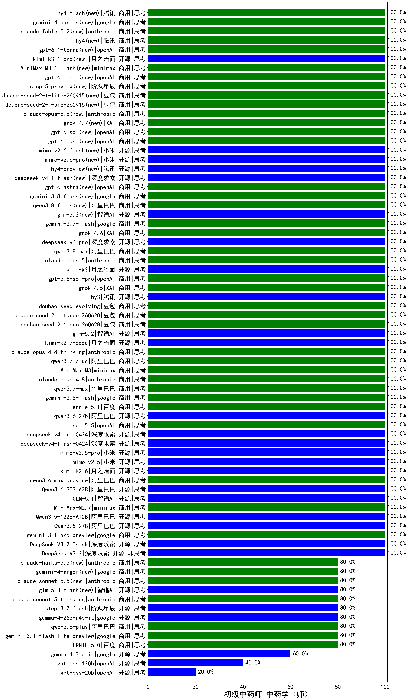

|类别|机构|大模型|【初级中药师-中药学（师）】准确率|平均耗时|平均消耗token|花费/千次（元）|排名（准确率）|
|---|---|-----|-------------------|-------|-----------|-----------|-----------|
|商用|XAI|grok-4.5|100.0%|52s|994|34.5|1|
|开源|智谱AI|glm-5.3|100.0%|23s|799|21.1|2|
|开源|小米|mimo-v2.6-pro|100.0%|32s|1196|7.0|3|
|开源|腾讯|hy4-preview|100.0%|26s|1723|30.2|4|
|开源|深度求索|deepseek-v4.1-flash|100.0%|5s|729|5.4|5|
|商用|openAI|gpt-6-astra|100.0%|8s|146|32.6|6|
|商用|google|gemini-3.8-flash|100.0%|42s|495|23.7|7|
|商用|阿里巴巴|qwen3.8-flash|100.0%|159s|3284|8.7|8|
|商用|google|gemini-3.7-flash|100.0%|6s|716|17.7|9|
|商用|openAI|gpt-6-luna|100.0%|262s|522|1.6|10|
|商用|XAI|grok-4.6|100.0%|1056s|1324|48.4|11|
|开源|深度求索|deepseek-v4-pro|100.0%|6s|322|6.3|12|
|商用|阿里巴巴|qwen3.8-max|100.0%|19s|460|14.2|13|
|商用|anthropic|claude-opus-5|100.0%|14s|564|87.6|14|
|开源|月之暗面|kimi-k3|100.0%|41s|972|86.6|15|
|商用|openAI|gpt-5.6-sol-pro|100.0%|13s|2654|185.4|16|
|开源|小米|mimo-v2.6-flash|100.0%|31s|867|1.7|17|
|商用|openAI|gpt-6-sol|100.0%|68s|160|7.5|18|
|商用|豆包|doubao-seed-evolving|100.0%|118s|3723|109.4|19|
|商用|openAI|gpt-6.1-terra(new)|100.0%|5s|230|6.2|20|
|商用|openAI|gpt-6.2-astra(new)|100.0%|30s|118|18.4|21|
|商用|阿里巴巴|qwen4-max(new)|100.0%|21s|488|13.2|22|
|商用|腾讯|hy4-flash(new)|100.0%|7s|1177|2.2|23|
|商用|google|gemini-4-carbon(new)|100.0%|22s|707|89.7|24|
|商用|anthropic|claude-fable-5.2(new)|100.0%|12s|342|77.9|25|
|商用|腾讯|hy4(new)|100.0%|46s|2269|40.0|26|
|开源|月之暗面|kimi-k3.1-pro(new)|100.0%|28s|1028|62.7|27|
|商用|XAI|grok-4.7|100.0%|18s|2185|55.6|28|
|商用|minimax|MiniMax-M3.1-Flash(new)|100.0%|17s|882|2.8|29|
|商用|openAI|gpt-6.1-sol(new)|100.0%|27s|160|7.5|30|
|商用|阶跃星辰|step-5-preview(new)|100.0%|7s|476|8.7|31|
|商用|豆包|doubao-seed-2-1-lite-260915(new)|100.0%|10s|656|1.6|32|
|商用|豆包|doubao-seed-2-1-pro-260915(new)|100.0%|19s|468|11.8|33|
|商用|anthropic|claude-opus-5.5(new)|100.0%|10s|453|54.6|34|
|开源|腾讯|hy3|100.0%|74s|178|0.5|35|
|商用|openAI|gpt-6.2-sol(new)|100.0%|4s|139|6.1|36|
|开源|小米|mimo-v2.5|100.0%|733s|841|8.4|37|
|商用|百度|ernie-5.1|100.0%|24s|805|13.8|38|
|开源|阿里巴巴|Qwen3.5-122B-A10B|100.0%|322s|2414|15.1|39|
|开源|阿里巴巴|Qwen3.5-27B|100.0%|335s|2720|12.8|40|
|商用|google|gemini-3.1-pro-preview|100.0%|29s|1031|84.0|41|
|开源|智谱AI|GLM-5.1|100.0%|28s|934|21.4|42|
|开源|阿里巴巴|Qwen3.6-35B-A3B|100.0%|10s|1480|15.5|43|
|商用|阿里巴巴|qwen3.6-max-preview|100.0%|31s|1189|61.5|44|
|开源|月之暗面|kimi-k2.6|100.0%|31s|741|18.9|45|
|商用|豆包|doubao-seed-2-1-turbo-260628|100.0%|62s|2828|41.3|46|
|开源|小米|mimo-v2.5-pro|100.0%|19s|925|15.2|47|
|开源|深度求索|deepseek-v4-flash-0424|100.0%|16s|361|0.7|48|
|开源|深度求索|deepseek-v4-pro-0424|100.0%|17s|354|7.9|49|
|商用|openAI|gpt-5.5|100.0%|5s|260|43.2|50|
|开源|阿里巴巴|qwen3.6-27b|100.0%|22s|1424|24.8|51|
|商用|google|gemini-3.5-flash|100.0%|10s|1095|66.2|52|
|商用|阿里巴巴|qwen3.7-max|100.0%|26s|637|21.5|53|
|商用|anthropic|claude-opus-4.8|100.0%|7s|406|60.1|54|
|商用|minimax|MiniMax-M3|100.0%|19s|484|5.3|55|
|商用|阿里巴巴|qwen3.7-plus|100.0%|15s|667|5.0|56|
|开源|深度求索|DeepSeek-V3.2-Think|100.0%|17s|522|1.5|57|
|商用|anthropic|claude-opus-4.8-thinking|100.0%|9s|503|77.1|58|
|开源|月之暗面|kimi-k2.7-code|100.0%|25s|818|21.0|59|
|开源|智谱AI|glm-5.2|100.0%|31s|1368|37.1|60|
|商用|豆包|doubao-seed-2-1-pro-260628|100.0%|110s|3043|89.0|61|
|开源|深度求索|DeepSeek-V3.2|100.0%|120s|238|0.7|62|
|商用|minimax|MiniMax-M2.7|100.0%|19s|780|6.0|63|
|商用|阿里巴巴|qwen3.6-plus|80.0%|27s|1392|16.1|64|
|商用|百度|ERNIE-5.0|80.0%|414s|925|21.3|65|
|商用|google|gemini-3.1-flash-lite-preview|80.0%|4s|245|2.1|66|
|商用|anthropic|claude-sonnet-5-thinking|80.0%|13s|594|37.2|67|
|商用|anthropic|claude-haiku-5.5(new)|80.0%|7s|752|2.4|68|
|商用|google|gemini-4-argon(new)|80.0%|45s|379|43.8|69|
|商用|anthropic|claude-sonnet-5.5(new)|80.0%|7s|367|21.2|70|
|开源|google|gemma-4-26b-a4b-it|80.0%|47s|427|1.1|71|
|开源|智谱AI|glm-5.3-flash|80.0%|85s|3069|8.5|72|
|开源|阶跃星辰|step-3.7-flash|80.0%|20s|3101|24.7|73|
|开源|google|gemma-4-31b-it|60.0%|69s|339|0.8|74|
|开源|openAI|gpt-oss-120b|40.0%|11s|574|1.6|75|
|开源|openAI|gpt-oss-20b|20.0%|10s|2164|2.4|76|

