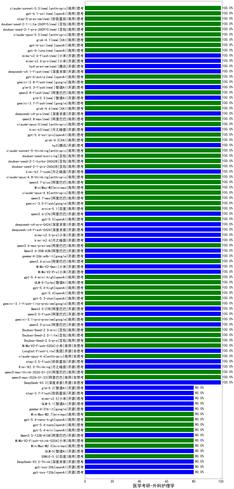

|类别|机构|大模型|【医学考研-外科护理学】准确率|平均耗时|平均消耗token|花费/千次（元）|排名（准确率）|
|---|---|-----|-------------------|-------|-----------|-----------|-----------|
|商用|豆包|doubao-seed-2-1-turbo-260628|100.0%|151s|2957|43.2|1|
|开源|深度求索|deepseek-v4.1-flash(new)|100.0%|13s|266|1.6|2|
|开源|腾讯|hy3|100.0%|83s|155|0.4|3|
|商用|XAI|grok-4.5|100.0%|122s|721|23.0|4|
|商用|openAI|gpt-5.6-sol-pro|100.0%|81s|2384|143.9|5|
|开源|月之暗面|kimi-k3|100.0%|18s|326|21.8|6|
|商用|anthropic|claude-opus-5|100.0%|11s|498|75.8|7|
|商用|阿里巴巴|qwen3.8-max|100.0%|14s|352|10.3|8|
|开源|深度求索|deepseek-v4-pro|100.0%|13s|320|6.2|9|
|商用|XAI|grok-4.6|100.0%|22s|858|28.8|10|
|商用|google|gemini-3.7-flash|100.0%|4s|685|16.7|11|
|开源|智谱AI|glm-5.3(new)|100.0%|23s|782|20.6|12|
|商用|阿里巴巴|qwen3.8-flash(new)|100.0%|11s|378|0.8|13|
|开源|智谱AI|glm-5.3-flash(new)|100.0%|20s|759|2.0|14|
|商用|google|gemini-3.8-flash(new)|100.0%|17s|519|24.7|15|
|商用|openAI|gpt-6-astra(new)|100.0%|11s|180|43.7|16|
|开源|腾讯|hy4-preview(new)|100.0%|13s|713|12.0|17|
|商用|豆包|doubao-seed-evolving|100.0%|259s|4027|118.5|18|
|开源|小米|mimo-v2.6-pro(new)|100.0%|65s|630|3.6|19|
|开源|小米|mimo-v2.6-flash(new)|100.0%|40s|539|1.0|20|
|商用|openAI|gpt-6-luna(new)|100.0%|332s|190|0.5|21|
|商用|openAI|gpt-6-sol(new)|100.0%|273s|141|6.0|22|
|商用|XAI|grok-4.7(new)|100.0%|10s|1956|45.9|23|
|商用|anthropic|claude-opus-5.5(new)|100.0%|12s|522|63.8|24|
|商用|豆包|doubao-seed-2-1-pro-260915(new)|100.0%|67s|521|13.3|25|
|商用|豆包|doubao-seed-2-1-lite-260915(new)|100.0%|8s|328|0.7|26|
|商用|阶跃星辰|step-5-preview(new)|100.0%|4s|255|4.3|27|
|商用|openAI|gpt-6.1-sol(new)|100.0%|367s|166|7.8|28|
|商用|anthropic|claude-sonnet-5.5(new)|100.0%|7s|383|22.2|29|
|商用|google|gemini-4-argon(new)|100.0%|12s|530|64.4|30|
|商用|anthropic|claude-haiku-5.5(new)|100.0%|8s|513|1.6|31|
|商用|minimax|MiniMax-M3.1-Flash(new)|100.0%|11s|650|1.8|32|
|商用|anthropic|claude-sonnet-5-thinking|100.0%|21s|506|30.8|33|
|开源|月之暗面|kimi-k3.1-pro(new)|100.0%|15s|501|26.6|34|
|商用|openAI|gpt-5.5|100.0%|5s|211|32.3|35|
|开源|深度求索|deepseek-v4-pro-0424|100.0%|14s|324|7.1|36|
|开源|阿里巴巴|Qwen3.5-27B|100.0%|261s|1643|7.6|37|
|商用|阿里巴巴|qwen3.6-plus|100.0%|24s|1192|13.7|38|
|商用|google|gemini-3.1-pro-preview|100.0%|28s|1002|81.2|39|
|开源|google|gemma-4-26b-a4b-it|100.0%|49s|414|1.0|40|
|开源|阿里巴巴|Qwen3.6-35B-A3B|100.0%|8s|1204|12.4|41|
|商用|阿里巴巴|qwen3.6-max-preview|100.0%|31s|1202|62.1|42|
|开源|月之暗面|kimi-k2.6|100.0%|32s|709|18.0|43|
|商用|豆包|doubao-seed-2-1-pro-260628|100.0%|120s|3848|113.1|44|
|开源|小米|mimo-v2.5-pro|100.0%|38s|831|13.1|45|
|开源|深度求索|deepseek-v4-flash-0424|100.0%|22s|326|0.6|46|
|商用|google|gemini-3.1-flash-lite-preview|100.0%|2s|271|2.3|47|
|开源|阿里巴巴|qwen3.6-27b|100.0%|19s|1262|21.8|48|
|商用|百度|ernie-5.1|100.0%|18s|686|11.6|49|
|商用|google|gemini-3.5-flash|100.0%|7s|923|55.1|50|
|商用|阿里巴巴|qwen3.7-max|100.0%|28s|588|19.7|51|
|商用|anthropic|claude-opus-4.8|100.0%|11s|451|67.6|52|
|商用|minimax|MiniMax-M3|100.0%|19s|497|5.5|53|
|商用|阿里巴巴|qwen3.7-plus|100.0%|15s|649|4.8|54|
|商用|anthropic|claude-opus-4.8-thinking|100.0%|9s|496|75.3|55|
|开源|月之暗面|kimi-k2.7-code|100.0%|7s|266|6.0|56|
|开源|深度求索|DeepSeek-V3.2|100.0%|118s|229|0.6|57|
|开源|阿里巴巴|Qwen3.5-122B-A10B|80.0%|121s|2553|16.0|58|
|商用|百度|ERNIE-5.0|80.0%|60s|1340|31.2|59|
|开源|深度求索|DeepSeek-V3.2-Think|80.0%|81s|457|1.3|60|
|开源|openAI|gpt-oss-20b|80.0%|9s|569|0.6|61|
|开源|小米|mimo-v2.5|80.0%|36s|803|7.8|62|
|商用|minimax|MiniMax-M2.7|80.0%|22s|916|7.1|63|
|开源|google|gemma-4-31b-it|80.0%|67s|451|1.1|64|
|开源|智谱AI|GLM-5.1|80.0%|62s|829|18.9|65|
|开源|阶跃星辰|step-3.7-flash|80.0%|18s|1427|11.1|66|
|开源|智谱AI|glm-5.2|80.0%|76s|876|23.2|67|
|开源|openAI|gpt-oss-120b|80.0%|6s|382|0.9|68|

