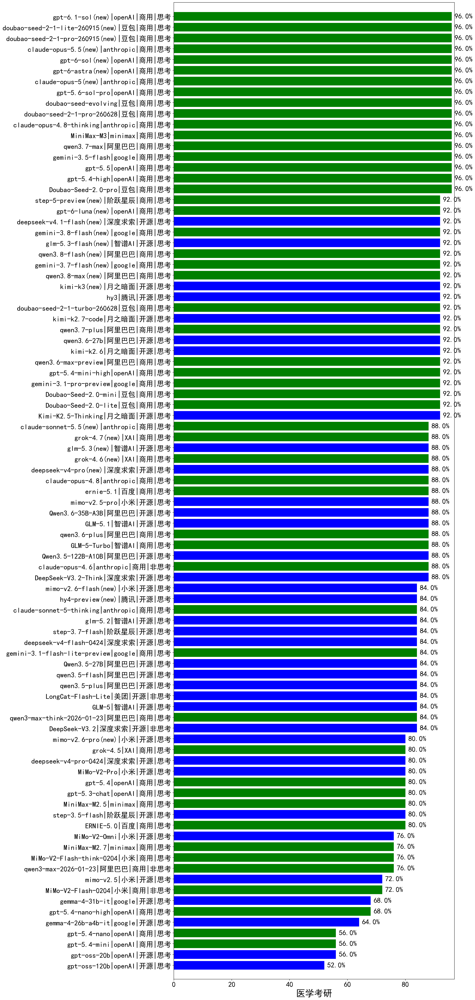

|类别|机构|大模型|【医学考研】准确率|平均耗时|平均消耗token|花费/千次（元）|排名（准确率）|
|---|---|-----|-------------------|-------|-----------|-----------|-----------|
|商用|豆包|doubao-seed-2-1-pro-260628|96.0%|226s|6412|189.8|1|
|商用|anthropic|claude-opus-5.5(new)|96.0%|43s|649|79.2|2|
|商用|openAI|gpt-5.6-sol-pro|96.0%|27s|3162|238.7|3|
|商用|google|gemini-3.5-flash|96.0%|8s|1196|71.7|4|
|商用|阿里巴巴|qwen3.7-max|96.0%|24s|920|31.4|5|
|商用|minimax|MiniMax-M3|96.0%|28s|726|9.2|6|
|商用|openAI|gpt-6-astra(new)|96.0%|12s|245|62.1|7|
|商用|anthropic|claude-opus-4.8-thinking|96.0%|11s|685|105.8|8|
|商用|openAI|gpt-6-sol(new)|96.0%|371s|246|12.5|9|
|商用|豆包|doubao-seed-2-1-pro-260915(new)|96.0%|41s|803|21.5|10|
|商用|豆包|doubao-seed-2-1-lite-260915(new)|96.0%|31s|657|1.6|11|
|商用|anthropic|claude-opus-5|96.0%|14s|648|99.2|12|
|商用|openAI|gpt-6.1-sol(new)|96.0%|78s|228|11.3|13|
|商用|豆包|doubao-seed-evolving|96.0%|216s|5546|163.8|14|
|商用|openAI|gpt-5.5|96.0%|9s|371|63.1|15|
|商用|阿里巴巴|qwen3.8-max|92.0%|19s|833|27.3|16|
|开源|阿里巴巴|qwen3.6-27b|92.0%|26s|1694|29.4|17|
|开源|月之暗面|kimi-k2.7-code|92.0%|11s|497|12.1|18|
|商用|阿里巴巴|qwen3.7-plus|92.0%|19s|972|7.3|19|
|商用|豆包|doubao-seed-2-1-turbo-260628|92.0%|135s|5071|74.8|20|
|开源|月之暗面|kimi-k3|92.0%|28s|576|46.1|21|
|商用|google|gemini-3.7-flash|92.0%|5s|740|18.0|22|
|商用|阿里巴巴|qwen3.8-flash(new)|92.0%|18s|898|2.2|23|
|开源|智谱AI|glm-5.3-flash(new)|92.0%|103s|1249|3.3|24|
|商用|google|gemini-3.8-flash(new)|92.0%|31s|1137|56.7|25|
|开源|月之暗面|kimi-k2.6|92.0%|63s|1047|26.9|26|
|商用|阿里巴巴|qwen3.6-max-preview|92.0%|47s|1561|81.1|27|
|开源|深度求索|deepseek-v4.1-flash(new)|92.0%|8s|632|4.5|28|
|商用|openAI|gpt-6-luna(new)|92.0%|271s|398|1.2|29|
|商用|阶跃星辰|step-5-preview(new)|92.0%|20s|1099|21.0|30|
|商用|google|gemini-3.1-pro-preview|92.0%|41s|1674|137.7|31|
|商用|google|gemini-4-argon(new)|92.0%|19s|537|64.3|32|
|开源|腾讯|hy3|92.0%|86s|229|0.7|33|
|开源|智谱AI|glm-5.3(new)|88.0%|48s|1922|52.3|34|
|商用|XAI|grok-4.6|88.0%|52s|1385|50.6|35|
|开源|深度求索|deepseek-v4-pro|88.0%|86s|746|17.5|36|
|商用|XAI|grok-4.7(new)|88.0%|56s|4336|145.5|37|
|商用|anthropic|claude-sonnet-5.5(new)|88.0%|8s|525|31.0|38|
|商用|minimax|MiniMax-M3.1-Flash(new)|88.0%|16s|1036|3.4|39|
|开源|深度求索|DeepSeek-V3.2-Think|88.0%|58s|958|2.8|40|
|商用|百度|ernie-5.1|88.0%|31s|920|15.7|41|
|商用|阿里巴巴|qwen3.6-plus|88.0%|38s|1538|17.8|42|
|开源|智谱AI|GLM-5.1|88.0%|137s|1453|33.7|43|
|开源|阿里巴巴|Qwen3.6-35B-A3B|88.0%|70s|1936|20.3|44|
|开源|小米|mimo-v2.5-pro|88.0%|35s|1227|21.3|45|
|开源|阿里巴巴|Qwen3.5-122B-A10B|88.0%|181s|2813|17.6|46|
|商用|anthropic|claude-opus-4.8|88.0%|10s|543|80.7|47|
|开源|深度求索|DeepSeek-V3.2|84.0%|88s|314|0.9|48|
|开源|深度求索|deepseek-v4-flash-0424|84.0%|26s|652|1.2|49|
|商用|google|gemini-3.1-flash-lite-preview|84.0%|3s|354|3.1|50|
|开源|阶跃星辰|step-3.7-flash|84.0%|33s|1970|15.5|51|
|开源|智谱AI|glm-5.2|84.0%|51s|1641|44.4|52|
|开源|腾讯|hy4-preview(new)|84.0%|50s|3176|56.2|53|
|商用|anthropic|claude-sonnet-5-thinking|84.0%|15s|769|48.2|54|
|开源|小米|mimo-v2.6-flash(new)|84.0%|63s|775|1.5|55|
|开源|阿里巴巴|Qwen3.5-27B|84.0%|287s|2616|12.3|56|
|商用|百度|ERNIE-5.0|80.0%|199s|1889|44.3|57|
|商用|anthropic|claude-haiku-5.5(new)|80.0%|14s|767|2.4|58|
|商用|XAI|grok-4.5|80.0%|73s|1442|53.0|59|
|开源|小米|mimo-v2.6-pro(new)|80.0%|47s|968|5.6|60|
|开源|深度求索|deepseek-v4-pro-0424|80.0%|29s|706|16.2|61|
|商用|minimax|MiniMax-M2.7|76.0%|35s|1391|11.1|62|
|开源|小米|mimo-v2.5|72.0%|34s|1430|16.5|63|
|开源|google|gemma-4-31b-it|68.0%|84s|528|1.3|64|
|开源|google|gemma-4-26b-a4b-it|64.0%|69s|582|1.5|65|
|开源|openAI|gpt-oss-20b|56.0%|100s|871|0.9|66|
|开源|openAI|gpt-oss-120b|52.0%|6s|638|1.7|67|

