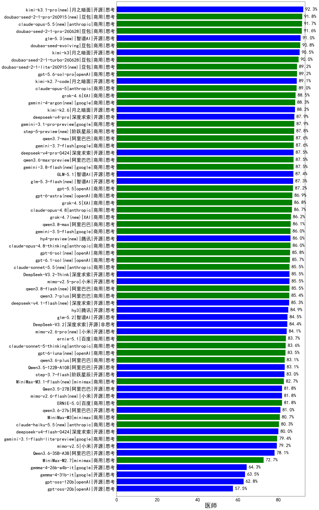

|类别|机构|大模型|【医师】准确率|平均耗时|平均消耗token|花费/千次（元）|排名（准确率）|
|---|---|-----|-------------------|-------|-----------|-----------|-----------|
|开源|月之暗面|kimi-k3.1-pro(new)|92.3%|50s|1716|108.3|1|
|商用|豆包|doubao-seed-2-1-pro-260915(new)|91.8%|51s|1189|32.9|2|
|商用|anthropic|claude-opus-5.5(new)|91.7%|32s|708|85.4|3|
|商用|豆包|doubao-seed-2-1-pro-260628|91.6%|225s|7212|213.6|4|
|开源|智谱AI|glm-5.3(new)|91.0%|74s|2066|56.2|5|
|商用|豆包|doubao-seed-evolving|90.8%|218s|7315|216.7|6|
|开源|月之暗面|kimi-k3|90.5%|49s|742|62.0|7|
|商用|豆包|doubao-seed-2-1-turbo-260628|90.0%|195s|6635|98.1|8|
|商用|豆包|doubao-seed-2-1-lite-260915(new)|89.2%|43s|1252|3.2|9|
|商用|openAI|gpt-5.6-sol-pro|89.2%|33s|3471|275.2|10|
|开源|月之暗面|kimi-k2.7-code|89.1%|39s|1232|31.7|11|
|商用|anthropic|claude-opus-5|89.0%|15s|730|111.1|12|
|商用|XAI|grok-4.6|88.5%|208s|1624|60.4|13|
|商用|google|gemini-4-argon(new)|88.3%|20s|539|63.4|14|
|开源|月之暗面|kimi-k2.6|88.2%|109s|1977|51.8|15|
|开源|深度求索|deepseek-v4-pro|87.9%|127s|1124|27.6|16|
|商用|google|gemini-3.1-pro-preview|87.9%|41s|1745|142.7|17|
|商用|阶跃星辰|step-5-preview(new)|87.8%|32s|1651|32.0|18|
|商用|阿里巴巴|qwen3.7-max|87.6%|25s|1210|41.6|19|
|商用|google|gemini-3.7-flash|87.6%|7s|808|19.5|20|
|开源|深度求索|deepseek-v4-pro-0424|87.5%|48s|1137|26.4|21|
|商用|阿里巴巴|qwen3.6-max-preview|87.5%|55s|1737|90.1|22|
|商用|google|gemini-3.8-flash(new)|87.5%|22s|808|39.0|23|
|开源|智谱AI|GLM-5.1|87.4%|150s|1637|37.9|24|
|开源|智谱AI|glm-5.3-flash(new)|87.3%|80s|1983|5.4|25|
|商用|openAI|gpt-5.5|87.2%|10s|555|99.4|26|
|商用|openAI|gpt-6-astra(new)|86.9%|12s|297|76.1|27|
|商用|XAI|grok-4.5|86.8%|87s|1644|61.3|28|
|商用|anthropic|claude-opus-4.8|86.7%|10s|589|86.3|29|
|商用|XAI|grok-4.7(new)|86.2%|57s|4235|141.0|30|
|商用|阿里巴巴|qwen3.8-max|86.1%|47s|1468|50.0|31|
|商用|google|gemini-3.5-flash|86.0%|9s|1489|89.5|32|
|商用|anthropic|claude-opus-4.8-thinking|86.0%|13s|769|117.8|33|
|开源|腾讯|hy4-preview(new)|86.0%|68s|3349|59.2|34|
|商用|openAI|gpt-6-sol(new)|85.8%|225s|263|13.0|35|
|商用|openAI|gpt-6.1-sol(new)|85.7%|50s|263|12.9|36|
|开源|深度求索|DeepSeek-V3.2-Think|85.5%|110s|1243|3.7|37|
|商用|anthropic|claude-sonnet-5.5(new)|85.5%|28s|570|33.1|38|
|开源|小米|mimo-v2.5-pro|85.5%|29s|1438|25.6|39|
|商用|阿里巴巴|qwen3.8-flash(new)|85.5%|49s|1428|3.6|40|
|商用|阿里巴巴|qwen3.7-plus|85.4%|27s|1454|11.1|41|
|开源|深度求索|deepseek-v4.1-flash(new)|85.3%|13s|1273|9.6|42|
|开源|腾讯|hy3|84.9%|58s|257|0.8|43|
|开源|智谱AI|glm-5.2|84.5%|48s|1937|52.6|44|
|开源|深度求索|DeepSeek-V3.2|84.4%|71s|415|1.2|45|
|开源|小米|mimo-v2.6-pro(new)|84.1%|63s|1747|10.2|46|
|商用|百度|ernie-5.1|83.7%|35s|1003|17.0|47|
|商用|anthropic|claude-sonnet-5-thinking|83.6%|16s|848|52.6|48|
|商用|openAI|gpt-6-luna(new)|83.5%|197s|481|1.4|49|
|商用|阿里巴巴|qwen3.6-plus|83.1%|37s|1705|19.7|50|
|开源|阿里巴巴|Qwen3.5-122B-A10B|83.1%|296s|3295|20.6|51|
|开源|阶跃星辰|step-3.7-flash|83.0%|37s|2777|21.9|52|
|商用|minimax|MiniMax-M3.1-Flash(new)|82.7%|24s|1444|5.0|53|
|开源|阿里巴巴|Qwen3.5-27B|81.8%|302s|3273|15.4|54|
|开源|小米|mimo-v2.6-flash(new)|81.8%|103s|1305|2.5|55|
|商用|百度|ERNIE-5.0|81.8%|168s|2226|52.2|56|
|开源|阿里巴巴|qwen3.6-27b|81.0%|30s|1829|31.7|57|
|商用|minimax|MiniMax-M3|80.7%|25s|697|8.7|58|
|商用|anthropic|claude-haiku-5.5(new)|80.3%|15s|843|2.6|59|
|开源|深度求索|deepseek-v4-flash-0424|80.0%|35s|883|1.7|60|
|商用|google|gemini-3.1-flash-lite-preview|79.4%|11s|414|3.6|61|
|开源|小米|mimo-v2.5|79.2%|28s|1598|18.7|62|
|开源|阿里巴巴|Qwen3.6-35B-A3B|78.1%|82s|1951|20.3|63|
|商用|minimax|MiniMax-M2.7|72.7%|41s|1672|13.4|64|
|开源|google|gemma-4-26b-a4b-it|64.3%|52s|611|1.5|65|
|开源|google|gemma-4-31b-it|63.5%|85s|556|1.4|66|
|开源|openAI|gpt-oss-120b|62.8%|42s|727|2.0|67|
|开源|openAI|gpt-oss-20b|57.5%|36s|1190|1.3|68|

