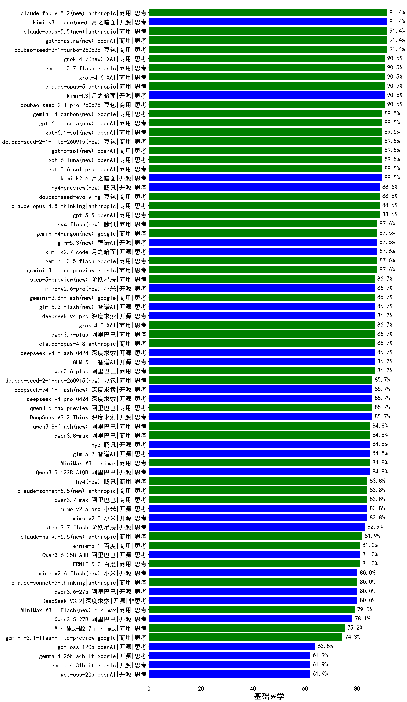

|类别|机构|大模型|【基础医学】准确率|平均耗时|平均消耗token|花费/千次（元）|排名（准确率）|
|---|---|-----|-------------------|-------|-----------|-----------|-----------|
|商用|豆包|doubao-seed-2-1-turbo-260628|91.4%|203s|6361|94.2|1|
|商用|anthropic|claude-fable-5.2(new)|91.4%|33s|464|109.4|2|
|开源|月之暗面|kimi-k3.1-pro(new)|91.4%|43s|1495|94.2|3|
|商用|openAI|gpt-6-astra|91.4%|11s|242|63.9|4|
|商用|anthropic|claude-opus-5.5(new)|91.4%|25s|630|77.9|5|
|开源|月之暗面|kimi-k3|90.5%|33s|608|49.9|6|
|商用|XAI|grok-4.7|90.5%|46s|3301|102.4|7|
|商用|openAI|gpt-6.2-astra(new)|90.5%|26s|176|32.6|8|
|商用|豆包|doubao-seed-2-1-pro-260628|90.5%|247s|7289|216.3|9|
|商用|anthropic|claude-opus-5|90.5%|14s|644|100.1|10|
|商用|XAI|grok-4.6|90.5%|30s|1216|43.8|11|
|商用|google|gemini-3.7-flash|90.5%|6s|787|19.4|12|
|商用|openAI|gpt-5.6-sol-pro|89.5%|38s|2964|219.4|13|
|商用|openAI|gpt-6-sol|89.5%|204s|212|10.7|14|
|开源|月之暗面|kimi-k2.6|89.5%|76s|1497|39.2|15|
|商用|openAI|gpt-6-luna|89.5%|243s|344|1.0|16|
|商用|豆包|doubao-seed-2-1-lite-260915(new)|89.5%|33s|1111|2.8|17|
|商用|openAI|gpt-6.1-terra(new)|89.5%|5s|264|7.2|18|
|商用|openAI|gpt-6.1-sol(new)|89.5%|14s|216|11.0|19|
|商用|google|gemini-4-carbon(new)|89.5%|32s|1079|141.4|20|
|商用|豆包|doubao-seed-evolving|88.6%|225s|7407|219.9|21|
|商用|anthropic|claude-opus-4.8-thinking|88.6%|13s|682|106.8|22|
|商用|openAI|gpt-6.2-sol(new)|88.6%|5s|203|10.1|23|
|商用|openAI|gpt-5.5|88.6%|8s|386|68.0|24|
|开源|腾讯|hy4-preview|88.6%|44s|2454|43.3|25|
|商用|google|gemini-3.5-flash|87.6%|9s|1269|76.8|26|
|商用|google|gemini-4-argon(new)|87.6%|18s|441|52.0|27|
|开源|月之暗面|kimi-k2.7-code|87.6%|32s|749|19.0|28|
|商用|google|gemini-3.1-pro-preview|87.6%|55s|1387|114.0|29|
|商用|腾讯|hy4-flash(new)|87.6%|27s|1081|2.1|30|
|商用|阿里巴巴|qwen4-max(new)|87.6%|30s|548|15.0|31|
|开源|智谱AI|glm-5.3|87.6%|38s|1328|35.9|32|
|商用|google|gemini-3.8-flash|86.7%|26s|735|36.1|33|
|开源|智谱AI|glm-5.3-flash|86.7%|46s|1299|3.5|34|
|商用|阶跃星辰|step-5-preview(new)|86.7%|22s|1319|25.6|35|
|开源|深度求索|deepseek-v4-pro|86.7%|149s|944|23.1|36|
|开源|小米|mimo-v2.6-pro|86.7%|92s|999|5.8|37|
|商用|XAI|grok-4.5|86.7%|93s|1327|48.5|38|
|商用|阿里巴巴|qwen3.6-plus|86.7%|36s|1493|17.3|39|
|开源|智谱AI|GLM-5.1|86.7%|163s|1400|32.5|40|
|开源|深度求索|deepseek-v4-flash-0424|86.7%|31s|943|1.8|41|
|商用|阿里巴巴|qwen3.7-plus|86.7%|22s|1106|8.5|42|
|商用|anthropic|claude-opus-4.8|86.7%|10s|569|87.0|43|
|商用|阿里巴巴|qwen3.6-max-preview|85.7%|47s|1491|77.7|44|
|开源|深度求索|deepseek-v4-pro-0424|85.7%|37s|900|20.9|45|
|开源|深度求索|deepseek-v4.1-flash|85.7%|9s|862|6.4|46|
|开源|深度求索|DeepSeek-V3.2-Think|85.7%|102s|1255|3.7|47|
|商用|豆包|doubao-seed-2-1-pro-260915(new)|85.7%|40s|1118|31.2|48|
|开源|腾讯|hy3|84.8%|87s|231|0.7|49|
|商用|minimax|MiniMax-M3|84.8%|23s|655|8.2|50|
|商用|阿里巴巴|qwen3.8-max|84.8%|20s|746|24.5|51|
|开源|智谱AI|glm-5.2|84.8%|39s|1418|38.4|52|
|开源|阿里巴巴|Qwen3.5-122B-A10B|84.8%|272s|2871|18.0|53|
|商用|阿里巴巴|qwen3.8-flash|84.8%|41s|1201|3.0|54|
|商用|anthropic|claude-sonnet-5.5(new)|83.8%|25s|495|29.5|55|
|商用|腾讯|hy4(new)|83.8%|67s|3271|58.0|56|
|开源|小米|mimo-v2.5-pro|83.8%|20s|1169|20.2|57|
|开源|小米|mimo-v2.5|83.8%|55s|1343|15.4|58|
|商用|阿里巴巴|qwen3.7-max|83.8%|23s|1043|36.1|59|
|开源|阶跃星辰|step-3.7-flash|82.9%|42s|2696|21.4|60|
|商用|anthropic|claude-haiku-5.5(new)|81.9%|9s|683|2.1|61|
|开源|阿里巴巴|Qwen3.6-35B-A3B|81.0%|85s|2386|25.2|62|
|商用|百度|ERNIE-5.0|81.0%|169s|2032|47.9|63|
|商用|百度|ernie-5.1|81.0%|31s|912|15.7|64|
|开源|小米|mimo-v2.6-flash|80.0%|181s|912|1.8|65|
|开源|深度求索|DeepSeek-V3.2|80.0%|54s|355|1.0|66|
|开源|阿里巴巴|qwen3.6-27b|80.0%|27s|1632|28.4|67|
|商用|anthropic|claude-sonnet-5-thinking|80.0%|18s|770|49.0|68|
|商用|minimax|MiniMax-M3.1-Flash(new)|79.0%|17s|1061|3.5|69|
|开源|阿里巴巴|Qwen3.5-27B|78.1%|254s|3065|14.4|70|
|商用|minimax|MiniMax-M2.7|75.2%|31s|1225|9.7|71|
|商用|google|gemini-3.1-flash-lite-preview|74.3%|20s|354|3.2|72|
|开源|openAI|gpt-oss-120b|63.8%|17s|604|1.6|73|
|开源|google|gemma-4-31b-it|61.9%|90s|530|1.4|74|
|开源|google|gemma-4-26b-a4b-it|61.9%|67s|582|1.5|75|
|开源|openAI|gpt-oss-20b|61.9%|54s|1096|1.2|76|

