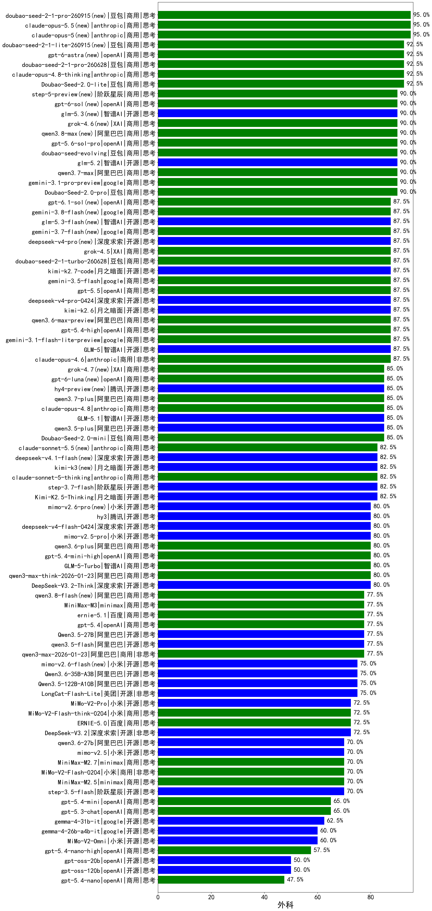

|类别|机构|大模型|【外科】准确率|平均耗时|平均消耗token|花费/千次（元）|排名（准确率）|
|---|---|-----|-------------------|-------|-----------|-----------|-----------|
|商用|豆包|doubao-seed-2-1-pro-260915(new)|95.0%|44s|1273|35.5|1|
|商用|anthropic|claude-opus-5.5(new)|95.0%|16s|685|82.8|2|
|商用|anthropic|claude-opus-5|95.0%|16s|770|118.8|3|
|商用|豆包|doubao-seed-2-1-pro-260628|92.5%|230s|8587|254.9|4|
|商用|豆包|doubao-seed-2-1-lite-260915(new)|92.5%|64s|1515|3.9|5|
|商用|openAI|gpt-6-astra(new)|92.5%|14s|305|80.2|6|
|商用|anthropic|claude-opus-4.8-thinking|92.5%|12s|792|122.6|7|
|商用|阿里巴巴|qwen3.7-max|90.0%|24s|1221|42.1|8|
|商用|openAI|gpt-6-sol(new)|90.0%|263s|289|14.9|9|
|开源|智谱AI|glm-5.3(new)|90.0%|95s|1807|49.0|10|
|商用|XAI|grok-4.6|90.0%|259s|1553|57.5|11|
|商用|阿里巴巴|qwen3.8-max|90.0%|47s|1947|67.4|12|
|商用|openAI|gpt-5.6-sol-pro|90.0%|41s|3523|282.2|13|
|商用|豆包|doubao-seed-evolving|90.0%|277s|9038|268.5|14|
|开源|智谱AI|glm-5.2|90.0%|46s|1688|45.7|15|
|商用|阶跃星辰|step-5-preview(new)|90.0%|70s|1786|34.7|16|
|商用|google|gemini-3.1-pro-preview|90.0%|40s|2121|175.2|17|
|商用|google|gemini-4-argon(new)|90.0%|18s|532|62.8|18|
|开源|月之暗面|kimi-k2.6|87.5%|191s|2712|71.8|19|
|商用|openAI|gpt-6.1-sol(new)|87.5%|17s|282|14.5|20|
|商用|google|gemini-3.8-flash(new)|87.5%|24s|922|45.1|21|
|开源|智谱AI|glm-5.3-flash(new)|87.5%|49s|1884|5.1|22|
|商用|google|gemini-3.7-flash|87.5%|5s|818|19.8|23|
|商用|google|gemini-3.1-flash-lite-preview|87.5%|23s|416|3.7|24|
|开源|深度求索|deepseek-v4-pro|87.5%|133s|1385|34.7|25|
|商用|XAI|grok-4.5|87.5%|112s|1987|75.8|26|
|商用|豆包|doubao-seed-2-1-turbo-260628|87.5%|203s|8001|118.7|27|
|开源|月之暗面|kimi-k2.7-code|87.5%|56s|1462|38.0|28|
|商用|openAI|gpt-5.5|87.5%|11s|517|92.0|29|
|商用|阿里巴巴|qwen3.6-max-preview|87.5%|62s|1797|93.6|30|
|开源|深度求索|deepseek-v4-pro-0424|87.5%|70s|1894|44.6|31|
|商用|google|gemini-3.5-flash|87.5%|9s|1455|87.6|32|
|商用|XAI|grok-4.7(new)|85.0%|54s|4241|141.4|33|
|商用|openAI|gpt-6-luna(new)|85.0%|205s|545|1.6|34|
|开源|腾讯|hy4-preview(new)|85.0%|66s|4033|71.6|35|
|商用|阿里巴巴|qwen3.7-plus|85.0%|26s|1285|9.8|36|
|商用|anthropic|claude-opus-4.8|85.0%|9s|592|87.6|37|
|开源|智谱AI|GLM-5.1|85.0%|151s|1734|40.3|38|
|商用|anthropic|claude-sonnet-5-thinking|82.5%|18s|957|60.6|39|
|商用|anthropic|claude-sonnet-5.5(new)|82.5%|56s|591|34.9|40|
|开源|月之暗面|kimi-k3|82.5%|42s|783|66.4|41|
|开源|深度求索|deepseek-v4.1-flash(new)|82.5%|21s|1468|11.2|42|
|开源|阶跃星辰|step-3.7-flash|82.5%|48s|2982|23.6|43|
|开源|深度求索|DeepSeek-V3.2-Think|80.0%|106s|1443|4.3|44|
|开源|小米|mimo-v2.5-pro|80.0%|25s|1366|24.2|45|
|开源|小米|mimo-v2.6-pro(new)|80.0%|38s|1422|8.3|46|
|开源|腾讯|hy3|80.0%|64s|270|0.9|47|
|开源|深度求索|deepseek-v4-flash-0424|80.0%|34s|1031|2.0|48|
|商用|阿里巴巴|qwen3.6-plus|80.0%|34s|1802|20.9|49|
|商用|阿里巴巴|qwen3.8-flash(new)|77.5%|35s|1908|4.9|50|
|开源|阿里巴巴|Qwen3.5-27B|77.5%|339s|3701|17.4|51|
|商用|百度|ernie-5.1|77.5%|29s|1002|17.1|52|
|商用|minimax|MiniMax-M3|77.5%|27s|742|9.4|53|
|开源|阿里巴巴|Qwen3.5-122B-A10B|75.0%|299s|3605|22.6|54|
|开源|小米|mimo-v2.6-flash(new)|75.0%|151s|1030|2.0|55|
|开源|阿里巴巴|Qwen3.6-35B-A3B|75.0%|66s|2896|30.6|56|
|商用|百度|ERNIE-5.0|72.5%|154s|2700|63.7|57|
|开源|深度求索|DeepSeek-V3.2|72.5%|95s|394|1.1|58|
|开源|阿里巴巴|qwen3.6-27b|70.0%|32s|1978|34.5|59|
|商用|minimax|MiniMax-M2.7|70.0%|46s|1855|14.9|60|
|开源|小米|mimo-v2.5|70.0%|20s|1460|16.9|61|
|商用|anthropic|claude-haiku-5.5(new)|67.5%|13s|894|2.8|62|
|商用|minimax|MiniMax-M3.1-Flash(new)|67.5%|28s|1699|6.0|63|
|开源|google|gemma-4-31b-it|62.5%|77s|542|1.4|64|
|开源|google|gemma-4-26b-a4b-it|60.0%|70s|606|1.5|65|
|开源|openAI|gpt-oss-20b|50.0%|43s|1057|1.1|66|
|开源|openAI|gpt-oss-120b|50.0%|57s|690|1.9|67|

