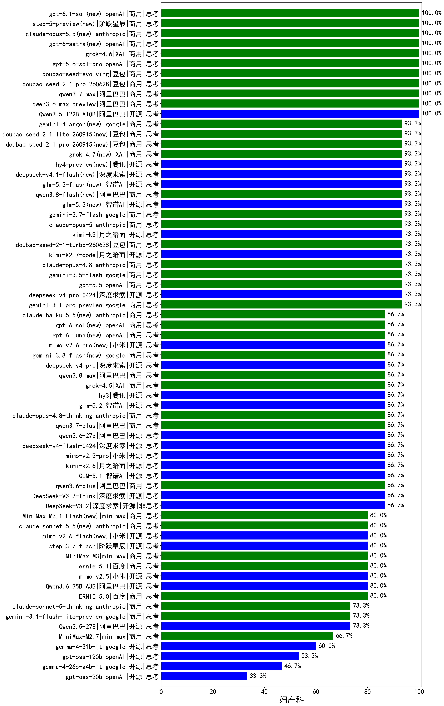

|类别|机构|大模型|【妇产科】准确率|平均耗时|平均消耗token|花费/千次（元）|排名（准确率）|
|---|---|-----|-------------------|-------|-----------|-----------|-----------|
|商用|豆包|doubao-seed-2-1-pro-260628|100.0%|282s|7632|225.6|1|
|商用|XAI|grok-4.6|100.0%|42s|1736|64.4|2|
|商用|阿里巴巴|qwen3.7-max|100.0%|29s|1394|47.7|3|
|商用|anthropic|claude-opus-5.5(new)|100.0%|55s|827|98.2|4|
|商用|阿里巴巴|qwen3.6-max-preview|100.0%|61s|1933|99.6|5|
|商用|豆包|doubao-seed-evolving|100.0%|169s|6942|204.9|6|
|商用|openAI|gpt-5.6-sol-pro|100.0%|59s|4228|366.9|7|
|商用|openAI|gpt-6.1-sol(new)|100.0%|8s|351|17.5|8|
|商用|阶跃星辰|step-5-preview(new)|100.0%|42s|2808|54.8|9|
|开源|阿里巴巴|Qwen3.5-122B-A10B|100.0%|392s|4055|25.4|10|
|商用|openAI|gpt-6-astra(new)|100.0%|17s|411|108.6|11|
|商用|anthropic|claude-opus-5|93.3%|18s|856|128.2|12|
|商用|XAI|grok-4.7(new)|93.3%|62s|4745|161.8|13|
|开源|月之暗面|kimi-k3|93.3%|56s|1301|116.2|14|
|商用|google|gemini-3.7-flash|93.3%|4s|746|17.3|15|
|开源|智谱AI|glm-5.3(new)|93.3%|73s|2352|63.7|16|
|商用|阿里巴巴|qwen3.8-flash(new)|93.3%|58s|854|2.0|17|
|商用|豆包|doubao-seed-2-1-turbo-260628|93.3%|280s|8002|118.3|18|
|开源|智谱AI|glm-5.3-flash(new)|93.3%|68s|2346|6.4|19|
|开源|月之暗面|kimi-k2.7-code|93.3%|42s|1297|33.1|20|
|开源|腾讯|hy4-preview(new)|93.3%|64s|3101|54.5|21|
|商用|google|gemini-3.5-flash|93.3%|10s|1781|106.5|22|
|商用|anthropic|claude-opus-4.8|93.3%|9s|665|94.7|23|
|开源|深度求索|deepseek-v4.1-flash(new)|93.3%|20s|897|6.4|24|
|开源|深度求索|deepseek-v4-pro-0424|93.3%|62s|1542|35.9|25|
|商用|google|gemini-3.1-pro-preview|93.3%|48s|1940|157.5|26|
|商用|google|gemini-4-argon(new)|93.3%|17s|577|65.7|27|
|商用|豆包|doubao-seed-2-1-pro-260915(new)|93.3%|51s|1555|43.3|28|
|商用|豆包|doubao-seed-2-1-lite-260915(new)|93.3%|30s|1150|2.9|29|
|商用|openAI|gpt-5.5|93.3%|11s|655|115.5|30|
|开源|智谱AI|GLM-5.1|86.7%|123s|1631|37.4|31|
|开源|深度求索|DeepSeek-V3.2|86.7%|26s|451|1.3|32|
|商用|google|gemini-3.8-flash(new)|86.7%|27s|1033|49.7|33|
|开源|深度求索|DeepSeek-V3.2-Think|86.7%|120s|1333|3.9|34|
|商用|anthropic|claude-haiku-5.5(new)|86.7%|10s|993|3.0|35|
|开源|深度求索|deepseek-v4-pro|86.7%|33s|1178|28.6|36|
|商用|阿里巴巴|qwen3.8-max|86.7%|58s|1816|61.9|37|
|商用|阿里巴巴|qwen3.6-plus|86.7%|39s|1915|22.0|38|
|开源|阿里巴巴|qwen3.6-27b|86.7%|35s|2177|37.6|39|
|商用|XAI|grok-4.5|86.7%|55s|1607|59.0|40|
|开源|小米|mimo-v2.6-pro(new)|86.7%|65s|1770|10.3|41|
|开源|月之暗面|kimi-k2.6|86.7%|103s|1824|47.3|42|
|开源|智谱AI|glm-5.2|86.7%|50s|2155|58.2|43|
|开源|小米|mimo-v2.5-pro|86.7%|49s|1817|33.2|44|
|商用|anthropic|claude-opus-4.8-thinking|86.7%|14s|890|134.1|45|
|商用|openAI|gpt-6-luna(new)|86.7%|177s|661|2.0|46|
|商用|阿里巴巴|qwen3.7-plus|86.7%|35s|1921|14.7|47|
|商用|openAI|gpt-6-sol(new)|86.7%|212s|356|17.9|48|
|开源|深度求索|deepseek-v4-flash-0424|86.7%|33s|951|1.8|49|
|开源|腾讯|hy3|86.7%|90s|335|1.0|50|
|开源|小米|mimo-v2.6-flash(new)|80.0%|57s|1373|2.6|51|
|商用|anthropic|claude-sonnet-5.5(new)|80.0%|7s|626|35.0|52|
|商用|minimax|MiniMax-M3.1-Flash(new)|80.0%|24s|1816|6.4|53|
|开源|阶跃星辰|step-3.7-flash|80.0%|22s|2101|16.3|54|
|商用|minimax|MiniMax-M3|80.0%|26s|708|8.5|55|
|商用|百度|ernie-5.1|80.0%|50s|1578|27.0|56|
|开源|小米|mimo-v2.5|80.0%|30s|1588|18.3|57|
|开源|阿里巴巴|Qwen3.6-35B-A3B|80.0%|48s|2220|23.0|58|
|商用|百度|ERNIE-5.0|80.0%|181s|2128|49.4|59|
|商用|anthropic|claude-sonnet-5-thinking|73.3%|16s|970|59.2|60|
|商用|google|gemini-3.1-flash-lite-preview|73.3%|6s|487|4.2|61|
|开源|阿里巴巴|Qwen3.5-27B|73.3%|278s|3759|17.6|62|
|商用|minimax|MiniMax-M2.7|66.7%|49s|2059|16.5|63|
|开源|google|gemma-4-31b-it|60.0%|54s|632|1.6|64|
|开源|openAI|gpt-oss-120b|53.3%|91s|898|2.5|65|
|开源|google|gemma-4-26b-a4b-it|46.7%|83s|708|1.8|66|
|开源|openAI|gpt-oss-20b|33.3%|11s|1207|1.2|67|

