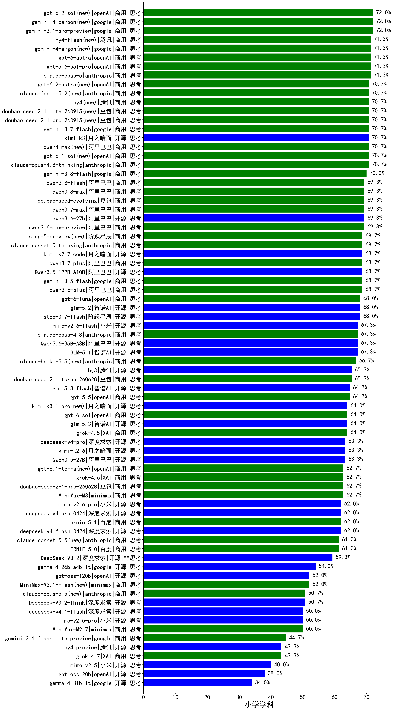

|类别|机构|大模型|【小学学科】准确率|平均耗时|平均消耗token|花费/千次（元）|排名（准确率）|
|---|---|-----|-------------------|-------|-----------|-----------|-----------|
|商用|google|gemini-3.1-pro-preview|72.0%|37s|2085|173.6|1|
|商用|google|gemini-4-argon(new)|71.3%|14s|457|54.3|2|
|商用|openAI|gpt-6-astra(new)|71.3%|12s|232|63.7|3|
|商用|openAI|gpt-5.6-sol-pro|71.3%|18s|3296|265.9|4|
|商用|anthropic|claude-opus-5|71.3%|17s|607|94.4|5|
|商用|腾讯|hy4(new)|70.7%|77s|4079|72.6|6|
|商用|豆包|doubao-seed-2-1-lite-260915(new)|70.7%|422s|2397|6.3|7|
|商用|豆包|doubao-seed-2-1-pro-260915(new)|70.7%|85s|1666|47.7|8|
|商用|google|gemini-3.7-flash|70.7%|8s|694|17.0|9|
|开源|月之暗面|kimi-k3|70.7%|69s|1257|115.2|10|
|商用|openAI|gpt-6.1-sol(new)|70.7%|28s|220|11.9|11|
|商用|anthropic|claude-opus-4.8-thinking|70.7%|12s|857|138.0|12|
|商用|google|gemini-3.8-flash(new)|70.0%|13s|1041|52.2|13|
|商用|阿里巴巴|qwen3.8-max|69.3%|62s|2510|88.1|14|
|商用|阿里巴巴|qwen3.8-flash(new)|69.3%|59s|2596|6.8|15|
|开源|阿里巴巴|qwen3.6-27b|69.3%|80s|5436|97.0|16|
|商用|阿里巴巴|qwen3.7-max|69.3%|40s|1985|70.1|17|
|商用|豆包|doubao-seed-evolving|69.3%|265s|9424|280.4|18|
|商用|阿里巴巴|qwen3.6-max-preview|69.3%|68s|1902|100.1|19|
|商用|阿里巴巴|qwen3.7-plus|68.7%|57s|2954|23.3|20|
|商用|anthropic|claude-sonnet-5-thinking|68.7%|25s|1582|105.9|21|
|商用|阶跃星辰|step-5-preview(new)|68.7%|17s|1331|25.8|22|
|开源|阿里巴巴|Qwen3.5-122B-A10B|68.7%|348s|4572|28.9|23|
|开源|月之暗面|kimi-k2.7-code|68.7%|39s|1301|34.0|24|
|商用|阿里巴巴|qwen3.6-plus|68.7%|65s|2865|33.8|25|
|商用|google|gemini-3.5-flash|68.7%|11s|1796|110.1|26|
|开源|阶跃星辰|step-3.7-flash|68.0%|34s|3122|24.9|27|
|商用|openAI|gpt-6-luna(new)|68.0%|268s|470|1.5|28|
|开源|智谱AI|glm-5.2|68.0%|77s|2663|73.3|29|
|开源|智谱AI|GLM-5.1|67.3%|135s|2278|53.7|30|
|开源|阿里巴巴|Qwen3.6-35B-A3B|67.3%|48s|4477|47.8|31|
|商用|anthropic|claude-opus-4.8|67.3%|10s|659|103.4|32|
|开源|小米|mimo-v2.6-flash(new)|67.3%|80s|3110|6.2|33|
|商用|anthropic|claude-haiku-5.5(new)|66.7%|9s|840|2.7|34|
|开源|腾讯|hy3|65.3%|54s|304|1.0|35|
|商用|豆包|doubao-seed-2-1-turbo-260628|65.3%|196s|8338|123.9|36|
|开源|智谱AI|glm-5.3-flash(new)|64.7%|83s|2295|6.3|37|
|商用|openAI|gpt-5.5|64.7%|21s|473|88.4|38|
|商用|openAI|gpt-6-sol(new)|64.0%|243s|243|13.5|39|
|开源|月之暗面|kimi-k3.1-pro(new)|64.0%|60s|1897|121.8|40|
|商用|XAI|grok-4.5|64.0%|85s|2908|114.8|41|
|开源|智谱AI|glm-5.3(new)|64.0%|188s|4376|121.3|42|
|开源|深度求索|deepseek-v4-pro|63.3%|84s|3317|87.2|43|
|开源|月之暗面|kimi-k2.6|63.3%|116s|2938|78.2|44|
|开源|阿里巴巴|Qwen3.5-27B|63.3%|317s|4168|19.8|45|
|商用|openAI|gpt-6.1-terra(new)|62.7%|6s|299|8.7|46|
|商用|minimax|MiniMax-M3|62.7%|194s|2606|41.0|47|
|商用|豆包|doubao-seed-2-1-pro-260628|62.7%|222s|8556|254.4|48|
|商用|XAI|grok-4.6|62.7%|54s|2151|83.1|49|
|开源|小米|mimo-v2.6-pro(new)|62.0%|101s|3035|18.0|50|
|开源|深度求索|deepseek-v4-pro-0424|62.0%|58s|1747|41.3|51|
|开源|深度求索|deepseek-v4-flash-0424|62.0%|42s|1994|3.9|52|
|商用|百度|ernie-5.1|62.0%|44s|1453|25.4|53|
|商用|anthropic|claude-sonnet-5.5(new)|61.3%|7s|424|24.8|54|
|商用|百度|ERNIE-5.0|61.3%|222s|2859|67.7|55|
|开源|深度求索|DeepSeek-V3.2|59.3%|81s|620|1.8|56|
|开源|google|gemma-4-26b-a4b-it|54.0%|39s|662|1.7|57|
|开源|openAI|gpt-oss-120b|52.0%|122s|681|1.9|58|
|商用|minimax|MiniMax-M3.1-Flash(new)|52.0%|28s|1370|4.7|59|
|商用|anthropic|claude-opus-5.5(new)|50.7%|42s|537|65.4|60|
|开源|深度求索|DeepSeek-V3.2-Think|50.7%|180s|1929|5.7|61|
|开源|深度求索|deepseek-v4.1-flash(new)|50.0%|17s|1711|13.2|62|
|商用|minimax|MiniMax-M2.7|50.0%|71s|3152|25.9|63|
|开源|小米|mimo-v2.5-pro|50.0%|39s|2153|41.0|64|
|商用|google|gemini-3.1-flash-lite-preview|44.7%|21s|332|3.0|65|
|开源|腾讯|hy4-preview(new)|43.3%|110s|6573|117.5|66|
|商用|XAI|grok-4.7(new)|43.3%|63s|5020|174.5|67|
|开源|小米|mimo-v2.5|40.0%|39s|2406|30.3|68|
|开源|openAI|gpt-oss-20b|38.0%|69s|1195|1.3|69|
|开源|google|gemma-4-31b-it|34.0%|54s|438|1.1|70|

