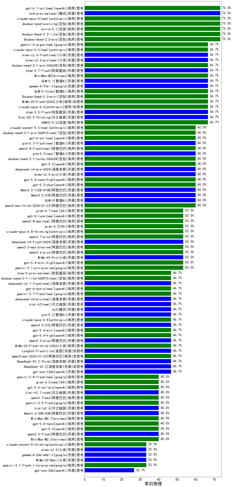

|类别|机构|大模型|【常识推理】准确率|平均耗时|平均消耗token|花费/千次（元）|排名（准确率）|
|---|---|-----|-------------------|-------|-----------|-----------|-----------|
|商用|anthropic|claude-opus-5|73.3%|9s|455|69.3|1|
|商用|豆包|doubao-seed-evolving|73.3%|280s|5435|160.9|2|
|商用|openAI|gpt-6.1-sol(new)|73.3%|7s|122|5.4|3|
|商用|百度|ernie-5.1|73.3%|44s|713|12.2|4|
|开源|腾讯|hy4-preview(new)|73.3%|108s|7150|128.0|5|
|商用|豆包|doubao-seed-2-1-pro-260628|66.7%|196s|6816|202.3|6|
|开源|阶跃星辰|step-3.7-flash|66.7%|15s|1479|11.6|7|
|商用|google|gemini-4-argon(new)|66.7%|25s|258|27.9|8|
|商用|百度|ERNIE-5.0|66.7%|89s|1388|32.6|9|
|开源|小米|mimo-v2.6-flash(new)|66.7%|154s|504|1.0|10|
|商用|anthropic|claude-opus-5.5(new)|66.7%|13s|386|45.5|11|
|商用|minimax|MiniMax-M3|66.7%|32s|788|10.5|12|
|开源|google|gemma-4-31b-it|66.7%|11s|111|0.2|13|
|开源|智谱AI|GLM-5.1|66.7%|261s|1740|40.9|14|
|开源|小米|mimo-v2.6-pro(new)|66.7%|15s|584|3.4|15|
|商用|豆包|doubao-seed-2-1-turbo-260628|60.0%|178s|8170|121.5|16|
|开源|智谱AI|glm-5.3-flash(new)|60.0%|103s|1255|3.4|17|
|商用|阿里巴巴|qwen3.8-flash(new)|60.0%|46s|2197|5.7|18|
|开源|智谱AI|glm-5.3(new)|60.0%|291s|1982|54.5|19|
|商用|openAI|gpt-6-sol(new)|60.0%|160s|200|10.9|20|
|商用|openAI|gpt-5.5|60.0%|6s|287|50.6|21|
|开源|阿里巴巴|Qwen3.5-122B-A10B|60.0%|589s|3931|24.9|22|
|开源|深度求索|deepseek-v4-pro-0424|60.0%|37s|1299|30.7|23|
|开源|阿里巴巴|Qwen3.5-27B|60.0%|193s|3966|18.8|24|
|商用|anthropic|claude-sonnet-5.5(new)|60.0%|129s|451|27.4|25|
|开源|小米|mimo-v2.5-pro|60.0%|24s|1371|24.7|26|
|商用|豆包|doubao-seed-2-1-pro-260915(new)|60.0%|60s|1842|53.1|27|
|商用|anthropic|claude-haiku-5.5(new)|53.3%|13s|652|2.1|28|
|商用|阿里巴巴|qwen3.6-plus|53.3%|31s|1309|15.2|29|
|商用|google|gemini-3.1-pro-preview|53.3%|45s|2481|208.1|30|
|商用|XAI|grok-4.7(new)|53.3%|40s|3427|107.9|31|
|商用|阿里巴巴|qwen3.8-max|53.3%|53s|2000|69.9|32|
|商用|anthropic|claude-opus-4.8-thinking|53.3%|10s|457|69.6|33|
|商用|XAI|grok-4.5|53.3%|78s|2335|91.1|34|
|商用|阿里巴巴|qwen3.7-plus|53.3%|39s|1962|15.4|35|
|商用|openAI|gpt-6-luna(new)|53.3%|166s|372|1.1|36|
|开源|深度求索|deepseek-v4-flash-0424|53.3%|26s|626|1.2|37|
|商用|阿里巴巴|qwen3.6-max-preview|53.3%|45s|1262|65.9|38|
|商用|google|gemini-3.7-flash|46.7%|4s|564|13.8|39|
|商用|openAI|gpt-6-astra(new)|46.7%|10s|154|38.2|40|
|开源|深度求索|deepseek-v4.1-flash(new)|46.7%|12s|2358|18.4|41|
|商用|豆包|doubao-seed-2-1-lite-260915(new)|46.7%|83s|3473|9.2|42|
|商用|阶跃星辰|step-5-preview(new)|46.7%|24s|1415|27.7|43|
|开源|openAI|gpt-oss-120b|46.7%|2s|412|1.1|44|
|商用|minimax|MiniMax-M3.1-Flash(new)|46.7%|18s|920|3.0|45|
|开源|阿里巴巴|qwen3.6-27b|46.7%|25s|1368|23.9|46|
|开源|月之暗面|kimi-k3|46.7%|27s|622|52.4|47|
|开源|深度求索|DeepSeek-V3.2|46.7%|106s|258|0.7|48|
|开源|腾讯|hy3|46.7%|59s|152|0.4|49|
|开源|深度求索|DeepSeek-V3.2-Think|46.7%|65s|1901|5.7|50|
|开源|智谱AI|glm-5.2|46.7%|39s|1715|47.0|51|
|商用|anthropic|claude-opus-4.8|46.7%|16s|284|39.3|52|
|开源|深度求索|deepseek-v4-pro|46.7%|47s|2301|59.9|53|
|商用|minimax|MiniMax-M2.7|40.0%|48s|1842|15.0|54|
|开源|阿里巴巴|Qwen3.6-35B-A3B|40.0%|8s|1313|13.7|55|
|开源|月之暗面|kimi-k2.6|40.0%|164s|2765|73.7|56|
|商用|XAI|grok-4.6|40.0%|31s|1685|63.8|57|
|商用|google|gemini-3.5-flash|40.0%|18s|1493|91.6|58|
|开源|月之暗面|kimi-k2.7-code|40.0%|65s|2600|69.3|59|
|商用|google|gemini-3.8-flash(new)|40.0%|24s|1389|71.0|60|
|商用|openAI|gpt-5.6-sol-pro|40.0%|24s|2556|172.8|61|
|商用|阿里巴巴|qwen3.7-max|40.0%|21s|984|34.2|62|
|开源|小米|mimo-v2.5|33.3%|31s|1547|18.4|63|
|开源|google|gemma-4-26b-a4b-it|33.3%|30s|298|0.7|64|
|商用|anthropic|claude-sonnet-5-thinking|33.3%|10s|346|20.1|65|
|商用|google|gemini-3.1-flash-lite-preview|33.3%|11s|167|1.3|66|
|开源|openAI|gpt-oss-20b|26.7%|202s|650|0.7|67|

