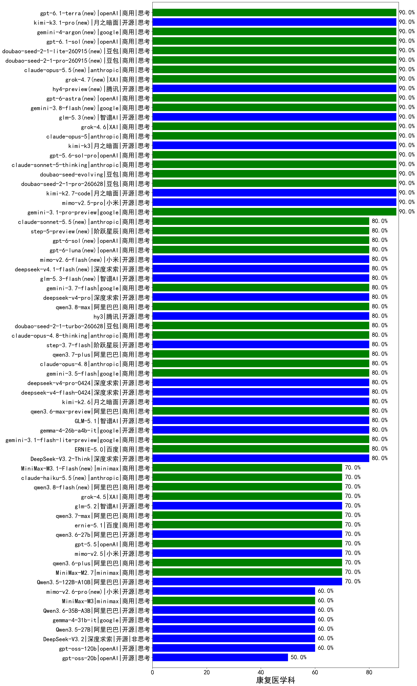

|类别|机构|大模型|【康复医学科】准确率|平均耗时|平均消耗token|花费/千次（元）|排名（准确率）|
|---|---|-----|-------------------|-------|-----------|-----------|-----------|
|商用|openAI|gpt-6.1-terra(new)|90.0%|6s|389|11.1|1|
|开源|腾讯|hy4-preview(new)|90.0%|98s|5704|101.7|2|
|开源|月之暗面|kimi-k2.7-code|90.0%|99s|2565|67.9|3|
|商用|anthropic|claude-sonnet-5-thinking|90.0%|17s|836|52.4|4|
|商用|openAI|gpt-5.6-sol-pro|90.0%|15s|3453|278.2|5|
|开源|月之暗面|kimi-k3|90.0%|31s|632|51.6|6|
|商用|anthropic|claude-opus-5|90.0%|13s|718|110.4|7|
|商用|XAI|grok-4.6|90.0%|681s|2380|92.4|8|
|开源|智谱AI|glm-5.3(new)|90.0%|-297s|2299|62.9|9|
|商用|google|gemini-3.8-flash(new)|90.0%|14s|750|36.3|10|
|开源|小米|mimo-v2.5-pro|90.0%|32s|1871|34.8|11|
|商用|openAI|gpt-6-astra(new)|90.0%|13s|278|72.5|12|
|商用|豆包|doubao-seed-2-1-pro-260628|90.0%|371s|9644|286.7|13|
|商用|豆包|doubao-seed-evolving|90.0%|216s|7716|228.9|14|
|商用|openAI|gpt-6.1-sol(new)|90.0%|385s|253|12.8|15|
|开源|月之暗面|kimi-k3.1-pro(new)|90.0%|34s|1212|74.4|16|
|商用|XAI|grok-4.7(new)|90.0%|62s|4256|142.1|17|
|商用|anthropic|claude-opus-5.5(new)|90.0%|13s|624|74.8|18|
|商用|豆包|doubao-seed-2-1-pro-260915(new)|90.0%|77s|2195|63.2|19|
|商用|google|gemini-4-argon(new)|90.0%|22s|455|52.7|20|
|商用|豆包|doubao-seed-2-1-lite-260915(new)|90.0%|35s|1859|4.8|21|
|商用|google|gemini-3.1-pro-preview|90.0%|36s|1871|154.3|22|
|开源|小米|mimo-v2.6-flash(new)|80.0%|42s|784|1.5|23|
|开源|腾讯|hy3|80.0%|32s|212|0.6|24|
|商用|anthropic|claude-sonnet-5.5(new)|80.0%|9s|651|39.3|25|
|商用|阶跃星辰|step-5-preview(new)|80.0%|19s|1502|29.1|26|
|商用|阿里巴巴|qwen3.8-max|80.0%|233s|2299|80.1|27|
|开源|深度求索|deepseek-v4-pro|80.0%|208s|1197|29.7|28|
|商用|openAI|gpt-6-luna(new)|80.0%|148s|454|1.3|29|
|商用|google|gemini-3.7-flash|80.0%|7s|809|19.7|30|
|开源|智谱AI|glm-5.3-flash(new)|80.0%|59s|2162|5.9|31|
|商用|openAI|gpt-6-sol(new)|80.0%|206s|279|14.6|32|
|开源|深度求索|deepseek-v4.1-flash(new)|80.0%|10s|1105|8.3|33|
|商用|豆包|doubao-seed-2-1-turbo-260628|80.0%|269s|10675|158.8|34|
|开源|月之暗面|kimi-k2.6|80.0%|80s|2013|53.0|35|
|商用|google|gemini-3.5-flash|80.0%|11s|1600|97.0|36|
|商用|google|gemini-3.1-flash-lite-preview|80.0%|7s|373|3.3|37|
|开源|深度求索|DeepSeek-V3.2-Think|80.0%|178s|1177|3.5|38|
|开源|google|gemma-4-26b-a4b-it|80.0%|38s|500|1.2|39|
|开源|智谱AI|GLM-5.1|80.0%|213s|2145|50.2|40|
|商用|阿里巴巴|qwen3.6-max-preview|80.0%|55s|1593|82.7|41|
|开源|深度求索|deepseek-v4-flash-0424|80.0%|17s|650|1.2|42|
|商用|百度|ERNIE-5.0|80.0%|99s|2088|49.0|43|
|开源|深度求索|deepseek-v4-pro-0424|80.0%|67s|1214|28.4|44|
|商用|anthropic|claude-opus-4.8-thinking|80.0%|11s|757|117.1|45|
|商用|anthropic|claude-opus-4.8|80.0%|9s|475|67.9|46|
|开源|阶跃星辰|step-3.7-flash|80.0%|70s|4650|37.2|47|
|商用|阿里巴巴|qwen3.7-plus|80.0%|35s|1826|14.2|48|
|商用|百度|ernie-5.1|70.0%|34s|913|15.5|49|
|商用|anthropic|claude-haiku-5.5(new)|70.0%|7s|730|2.2|50|
|商用|minimax|MiniMax-M2.7|70.0%|37s|1513|12.1|51|
|商用|阿里巴巴|qwen3.6-plus|70.0%|38s|1847|21.4|52|
|商用|XAI|grok-4.5|70.0%|69s|2571|100.4|53|
|商用|minimax|MiniMax-M3.1-Flash(new)|70.0%|41s|2438|9.0|54|
|开源|阿里巴巴|qwen3.6-27b|70.0%|36s|1727|30.0|55|
|开源|智谱AI|glm-5.2|70.0%|75s|2584|70.8|56|
|开源|小米|mimo-v2.5|70.0%|25s|1898|23.0|57|
|商用|阿里巴巴|qwen3.7-max|70.0%|26s|1370|47.6|58|
|商用|阿里巴巴|qwen3.8-flash(new)|70.0%|23s|1110|2.8|59|
|商用|openAI|gpt-5.5|70.0%|15s|656|122.3|60|
|开源|阿里巴巴|Qwen3.5-122B-A10B|70.0%|392s|3564|22.4|61|
|开源|深度求索|DeepSeek-V3.2|60.0%|64s|339|1.0|62|
|开源|openAI|gpt-oss-120b|60.0%|6s|774|2.2|63|
|开源|阿里巴巴|Qwen3.5-27B|60.0%|308s|3641|17.2|64|
|开源|google|gemma-4-31b-it|60.0%|92s|471|1.2|65|
|开源|阿里巴巴|Qwen3.6-35B-A3B|60.0%|109s|1622|16.9|66|
|开源|小米|mimo-v2.6-pro(new)|60.0%|80s|2327|13.7|67|
|商用|minimax|MiniMax-M3|60.0%|36s|1006|14.0|68|
|开源|openAI|gpt-oss-20b|50.0%|13s|1444|1.6|69|

