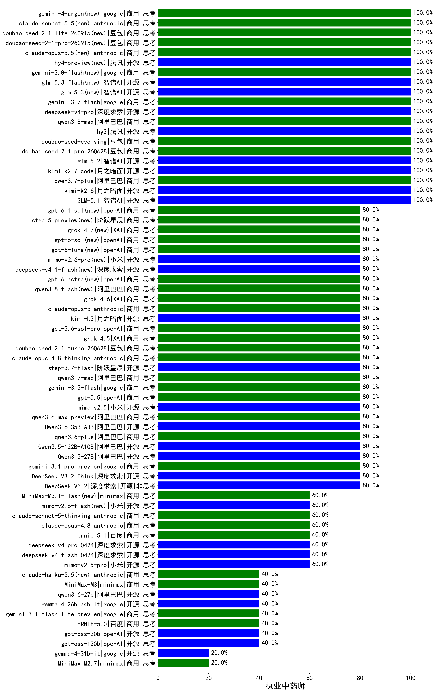

|类别|机构|大模型|【执业中药师】准确率|平均耗时|平均消耗token|花费/千次（元）|排名（准确率）|
|---|---|-----|-------------------|-------|-----------|-----------|-----------|
|商用|豆包|doubao-seed-2-1-pro-260628|100.0%|470s|10557|314.4|1|
|开源|月之暗面|kimi-k2.6|100.0%|183s|2599|69.0|2|
|开源|智谱AI|glm-5.3-flash(new)|100.0%|119s|5437|15.1|3|
|开源|智谱AI|glm-5.3(new)|100.0%|48s|1344|36.4|4|
|商用|google|gemini-3.7-flash|100.0%|26s|724|17.9|5|
|开源|深度求索|deepseek-v4-pro|100.0%|19s|537|12.1|6|
|商用|阿里巴巴|qwen3.8-max|100.0%|41s|1887|65.6|7|
|开源|腾讯|hy3|100.0%|47s|175|0.5|8|
|商用|豆包|doubao-seed-evolving|100.0%|222s|8689|258.4|9|
|开源|腾讯|hy4-preview(new)|100.0%|63s|4353|77.5|10|
|开源|智谱AI|glm-5.2|100.0%|92s|1332|36.1|11|
|开源|月之暗面|kimi-k2.7-code|100.0%|10s|546|13.6|12|
|商用|阿里巴巴|qwen3.7-plus|100.0%|17s|892|6.8|13|
|商用|anthropic|claude-opus-5.5(new)|100.0%|13s|533|65.8|14|
|商用|豆包|doubao-seed-2-1-pro-260915(new)|100.0%|109s|721|19.4|15|
|商用|google|gemini-3.8-flash(new)|100.0%|10s|733|36.2|16|
|商用|anthropic|claude-sonnet-5.5(new)|100.0%|7s|476|28.9|17|
|开源|智谱AI|GLM-5.1|100.0%|140s|1163|26.9|18|
|商用|google|gemini-4-argon(new)|100.0%|19s|404|47.2|19|
|商用|豆包|doubao-seed-2-1-lite-260915(new)|100.0%|17s|766|1.9|20|
|商用|anthropic|claude-opus-5|80.0%|13s|611|96.3|21|
|开源|深度求索|deepseek-v4.1-flash(new)|80.0%|19s|1784|13.8|22|
|开源|阿里巴巴|Qwen3.5-122B-A10B|80.0%|191s|3543|22.3|23|
|商用|XAI|grok-4.5|80.0%|169s|1744|66.1|24|
|商用|openAI|gpt-5.6-sol-pro|80.0%|12s|3196|248.7|25|
|开源|月之暗面|kimi-k3|80.0%|32s|636|53.0|26|
|商用|阿里巴巴|qwen3.6-max-preview|80.0%|54s|1534|80.1|27|
|商用|豆包|doubao-seed-2-1-turbo-260628|80.0%|252s|13227|197.3|28|
|商用|google|gemini-3.1-pro-preview|80.0%|49s|1619|134.1|29|
|商用|XAI|grok-4.6|80.0%|61s|2476|96.8|30|
|开源|深度求索|DeepSeek-V3.2-Think|80.0%|105s|879|2.6|31|
|商用|阿里巴巴|qwen3.8-flash(new)|80.0%|23s|846|2.1|32|
|开源|深度求索|DeepSeek-V3.2|80.0%|9s|302|0.9|33|
|开源|阿里巴巴|Qwen3.5-27B|80.0%|416s|4430|21.0|34|
|商用|openAI|gpt-6.1-sol(new)|80.0%|7s|196|10.1|35|
|开源|小米|mimo-v2.5|80.0%|16s|947|9.9|36|
|商用|阿里巴巴|qwen3.6-plus|80.0%|44s|1515|17.6|37|
|商用|阶跃星辰|step-5-preview(new)|80.0%|14s|1053|20.3|38|
|商用|anthropic|claude-opus-4.8-thinking|80.0%|20s|850|138.1|39|
|开源|阶跃星辰|step-3.7-flash|80.0%|82s|1390|10.8|40|
|开源|小米|mimo-v2.6-pro(new)|80.0%|24s|725|4.2|41|
|商用|openAI|gpt-6-astra(new)|80.0%|11s|228|61.4|42|
|商用|google|gemini-3.5-flash|80.0%|9s|1515|92.6|43|
|商用|openAI|gpt-6-luna(new)|80.0%|227s|411|1.3|44|
|商用|openAI|gpt-6-sol(new)|80.0%|467s|266|15.0|45|
|商用|openAI|gpt-5.5|80.0%|19s|423|77.4|46|
|商用|XAI|grok-4.7(new)|80.0%|49s|3458|109.0|47|
|开源|阿里巴巴|Qwen3.6-35B-A3B|80.0%|113s|1661|17.4|48|
|商用|阿里巴巴|qwen3.7-max|80.0%|18s|857|29.4|49|
|开源|小米|mimo-v2.6-flash(new)|60.0%|28s|907|1.8|50|
|商用|minimax|MiniMax-M3.1-Flash(new)|60.0%|22s|1112|3.7|51|
|商用|anthropic|claude-sonnet-5-thinking|60.0%|15s|706|45.1|52|
|商用|anthropic|claude-opus-4.8|60.0%|8s|451|68.2|53|
|商用|百度|ernie-5.1|60.0%|25s|1002|17.3|54|
|开源|深度求索|deepseek-v4-pro-0424|60.0%|47s|701|16.2|55|
|开源|深度求索|deepseek-v4-flash-0424|60.0%|98s|2800|5.5|56|
|开源|小米|mimo-v2.5-pro|60.0%|35s|1945|36.6|57|
|开源|openAI|gpt-oss-20b|40.0%|15s|1268|1.4|58|
|商用|minimax|MiniMax-M3|40.0%|15s|470|5.1|59|
|开源|阿里巴巴|qwen3.6-27b|40.0%|24s|1498|26.1|60|
|开源|google|gemma-4-26b-a4b-it|40.0%|35s|486|1.2|61|
|商用|google|gemini-3.1-flash-lite-preview|40.0%|2s|253|2.2|62|
|商用|百度|ERNIE-5.0|40.0%|108s|2504|59.2|63|
|商用|anthropic|claude-haiku-5.5(new)|40.0%|12s|1018|3.3|64|
|开源|openAI|gpt-oss-120b|40.0%|3s|721|2.1|65|
|开源|google|gemma-4-31b-it|20.0%|106s|430|1.1|66|
|商用|minimax|MiniMax-M2.7|20.0%|32s|1256|10.0|67|

