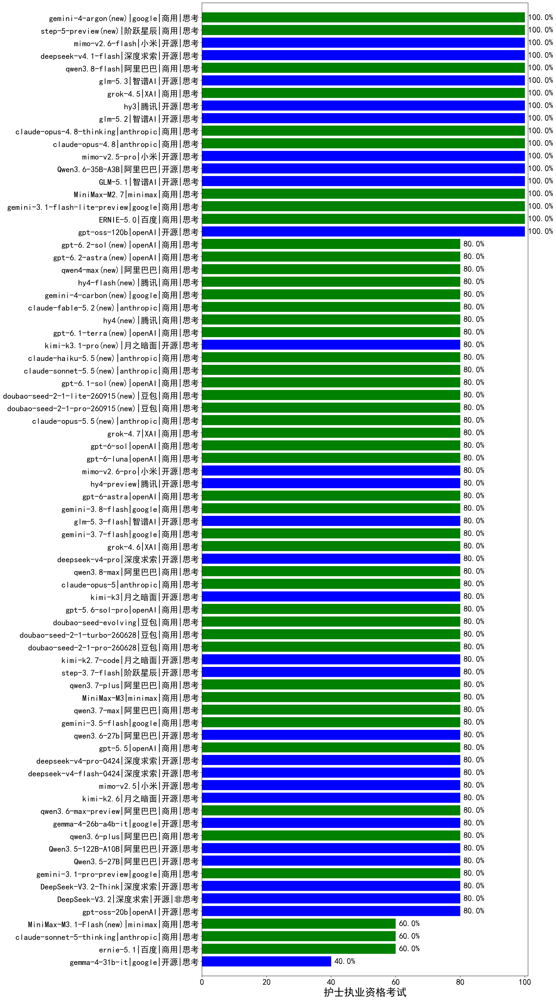

|类别|机构|大模型|【护士执业资格考试】准确率|平均耗时|平均消耗token|花费/千次（元）|排名（准确率）|
|---|---|-----|-------------------|-------|-----------|-----------|-----------|
|开源|openAI|gpt-oss-120b|100.0%|68s|575|1.5|1|
|开源|阿里巴巴|Qwen3.6-35B-A3B|100.0%|110s|1496|15.5|2|
|商用|google|gemini-4-argon(new)|100.0%|19s|479|55.6|3|
|商用|阶跃星辰|step-5-preview(new)|100.0%|8s|614|11.3|4|
|开源|小米|mimo-v2.6-flash|100.0%|258s|600|1.1|5|
|开源|深度求索|deepseek-v4.1-flash|100.0%|6s|984|7.3|6|
|商用|阿里巴巴|qwen3.8-flash|100.0%|19s|513|1.1|7|
|开源|智谱AI|glm-5.3|100.0%|42s|1253|33.5|8|
|开源|腾讯|hy3|100.0%|45s|191|0.5|9|
|开源|智谱AI|glm-5.2|100.0%|39s|1397|37.6|10|
|商用|anthropic|claude-opus-4.8-thinking|100.0%|12s|599|89.3|11|
|商用|anthropic|claude-opus-4.8|100.0%|12s|571|84.6|12|
|开源|小米|mimo-v2.5-pro|100.0%|14s|986|16.2|13|
|商用|XAI|grok-4.5|100.0%|28s|964|32.9|14|
|开源|智谱AI|GLM-5.1|100.0%|132s|1071|24.4|15|
|商用|google|gemini-3.1-flash-lite-preview|100.0%|41s|358|3.1|16|
|商用|百度|ERNIE-5.0|100.0%|139s|1096|25.2|17|
|商用|minimax|MiniMax-M2.7|100.0%|25s|976|7.6|18|
|商用|豆包|doubao-seed-2-1-pro-260915(new)|80.0%|19s|529|13.2|19|
|开源|智谱AI|glm-5.3-flash|80.0%|25s|1047|2.8|20|
|商用|google|gemini-3.8-flash|80.0%|23s|667|31.8|21|
|商用|openAI|gpt-6-astra|80.0%|15s|251|63.2|22|
|商用|google|gemini-3.1-pro-preview|80.0%|29s|1127|90.6|23|
|开源|腾讯|hy4-preview|80.0%|20s|1206|20.7|24|
|开源|小米|mimo-v2.6-pro|80.0%|35s|1506|8.8|25|
|商用|openAI|gpt-6-luna|80.0%|93s|357|1.0|26|
|商用|openAI|gpt-6-sol|80.0%|232s|248|12.5|27|
|商用|XAI|grok-4.7|80.0%|18s|2473|67.3|28|
|商用|anthropic|claude-opus-5.5(new)|80.0%|14s|633|76.0|29|
|商用|豆包|doubao-seed-2-1-lite-260915(new)|80.0%|10s|567|1.4|30|
|开源|阿里巴巴|Qwen3.5-122B-A10B|80.0%|325s|2239|13.9|31|
|开源|深度求索|DeepSeek-V3.2-Think|80.0%|72s|780|2.3|32|
|商用|openAI|gpt-6.1-sol(new)|80.0%|6s|209|9.7|33|
|商用|anthropic|claude-sonnet-5.5(new)|80.0%|7s|460|25.9|34|
|开源|深度求索|DeepSeek-V3.2|80.0%|156s|339|0.9|35|
|商用|anthropic|claude-haiku-5.5(new)|80.0%|5s|665|2.0|36|
|开源|月之暗面|kimi-k3.1-pro(new)|80.0%|34s|1163|71.2|37|
|商用|openAI|gpt-6.1-terra(new)|80.0%|5s|260|6.7|38|
|商用|腾讯|hy4(new)|80.0%|59s|2979|52.6|39|
|商用|anthropic|claude-fable-5.2(new)|80.0%|12s|437|97.3|40|
|商用|google|gemini-4-carbon(new)|80.0%|27s|824|103.9|41|
|商用|腾讯|hy4-flash(new)|80.0%|6s|666|1.2|42|
|商用|阿里巴巴|qwen4-max(new)|80.0%|14s|484|12.8|43|
|商用|openAI|gpt-6.2-astra(new)|80.0%|4s|171|28.2|44|
|开源|阿里巴巴|Qwen3.5-27B|80.0%|160s|2616|12.2|45|
|商用|google|gemini-3.7-flash|80.0%|38s|826|20.1|46|
|商用|阿里巴巴|qwen3.6-max-preview|80.0%|40s|1373|70.8|47|
|开源|阶跃星辰|step-3.7-flash|80.0%|16s|1457|11.3|48|
|开源|月之暗面|kimi-k2.6|80.0%|35s|900|22.9|49|
|开源|小米|mimo-v2.5|80.0%|9s|1093|11.7|50|
|开源|google|gemma-4-26b-a4b-it|80.0%|65s|548|1.4|51|
|开源|深度求索|deepseek-v4-flash-0424|80.0%|16s|587|1.1|52|
|开源|深度求索|deepseek-v4-pro-0424|80.0%|15s|417|9.2|53|
|商用|openAI|gpt-5.5|80.0%|7s|368|62.0|54|
|开源|阿里巴巴|qwen3.6-27b|80.0%|27s|1656|28.7|55|
|商用|google|gemini-3.5-flash|80.0%|8s|1278|76.5|56|
|商用|阿里巴巴|qwen3.7-max|80.0%|18s|737|24.7|57|
|商用|minimax|MiniMax-M3|80.0%|26s|628|7.6|58|
|商用|XAI|grok-4.6|80.0%|22s|1096|38.5|59|
|商用|阿里巴巴|qwen3.7-plus|80.0%|16s|766|5.7|60|
|商用|阿里巴巴|qwen3.6-plus|80.0%|39s|1453|16.7|61|
|开源|月之暗面|kimi-k2.7-code|80.0%|13s|407|9.6|62|
|商用|豆包|doubao-seed-2-1-pro-260628|80.0%|84s|3338|97.5|63|
|商用|豆包|doubao-seed-2-1-turbo-260628|80.0%|106s|4041|59.3|64|
|商用|豆包|doubao-seed-evolving|80.0%|138s|4044|118.7|65|
|开源|openAI|gpt-oss-20b|80.0%|9s|950|1.0|66|
|商用|openAI|gpt-5.6-sol-pro|80.0%|9s|2974|217.0|67|
|开源|月之暗面|kimi-k3|80.0%|34s|564|44.9|68|
|商用|anthropic|claude-opus-5|80.0%|17s|663|100.6|69|
|商用|阿里巴巴|qwen3.8-max|80.0%|13s|581|18.2|70|
|开源|深度求索|deepseek-v4-pro|80.0%|20s|624|14.2|71|
|商用|openAI|gpt-6.2-sol(new)|80.0%|4s|208|9.7|72|
|商用|minimax|MiniMax-M3.1-Flash(new)|60.0%|14s|781|2.3|73|
|商用|百度|ernie-5.1|60.0%|30s|847|14.3|74|
|商用|anthropic|claude-sonnet-5-thinking|60.0%|14s|765|47.4|75|
|开源|google|gemma-4-31b-it|40.0%|98s|545|1.4|76|

