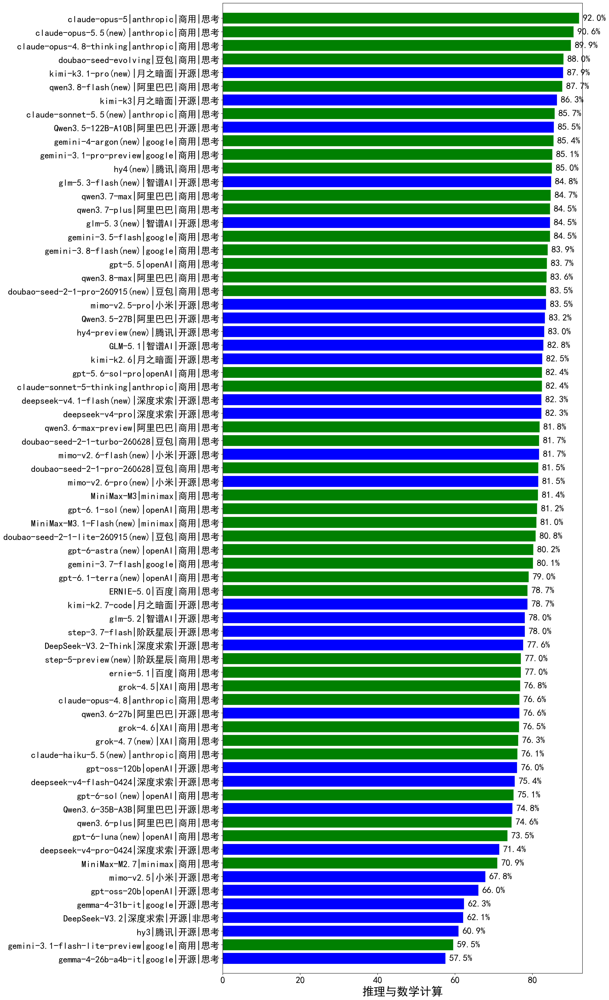

|类别|机构|大模型|【推理与数学计算】准确率|平均耗时|平均消耗token|花费/千次（元）|排名（准确率）|
|---|---|-----|-------------------|-------|-----------|-----------|-----------|
|商用|anthropic|claude-fable-5.2(new)|92.9%|28s|1477|259.5|1|
|商用|anthropic|claude-opus-5|92.0%|22s|2340|313.5|2|
|商用|anthropic|claude-opus-5.5(new)|90.6%|21s|1627|150.8|3|
|商用|anthropic|claude-opus-4.8-thinking|89.9%|32s|3208|465.5|4|
|商用|豆包|doubao-seed-evolving|88.0%|365s|16044|464.3|5|
|开源|月之暗面|kimi-k3.1-pro(new)|87.9%|154s|5547|344.2|6|
|商用|阿里巴巴|qwen3.8-flash(new)|87.7%|102s|7842|19.8|7|
|开源|月之暗面|kimi-k3|86.3%|94s|3191|271.1|8|
|商用|anthropic|claude-sonnet-5.5(new)|85.7%|28s|1622|75.0|9|
|开源|阿里巴巴|Qwen3.5-122B-A10B|85.5%|433s|9568|57.5|10|
|商用|google|gemini-4-argon(new)|85.4%|23s|1489|131.3|11|
|商用|google|gemini-3.1-pro-preview|85.1%|75s|5575|427.5|12|
|商用|腾讯|hy4(new)|85.0%|134s|7670|131.6|13|
|开源|智谱AI|glm-5.3-flash(new)|84.8%|196s|8729|23.3|14|
|商用|阿里巴巴|qwen3.7-max|84.7%|99s|6172|206.1|15|
|商用|阿里巴巴|qwen3.7-plus|84.5%|127s|7502|56.0|16|
|开源|智谱AI|glm-5.3(new)|84.5%|130s|6862|181.1|17|
|商用|google|gemini-3.5-flash|84.5%|21s|4981|278.7|18|
|商用|google|gemini-3.8-flash(new)|83.9%|20s|3315|145.9|19|
|商用|openAI|gpt-5.5|83.7%|26s|1776|279.2|20|
|商用|阿里巴巴|qwen3.8-max|83.6%|119s|6193|206.0|21|
|商用|豆包|doubao-seed-2-1-pro-260915(new)|83.5%|121s|5688|153.7|22|
|开源|小米|mimo-v2.5-pro|83.5%|107s|6907|132.4|23|
|开源|阿里巴巴|Qwen3.5-27B|83.2%|313s|9899|44.7|24|
|开源|腾讯|hy4-preview(new)|83.0%|104s|8282|142.6|25|
|开源|智谱AI|GLM-5.1|82.8%|177s|5902|131.8|26|
|开源|月之暗面|kimi-k2.6|82.5%|324s|8103|208.1|27|
|商用|openAI|gpt-5.6-sol-pro|82.4%|34s|7809|652.6|28|
|商用|anthropic|claude-sonnet-5-thinking|82.4%|26s|3060|175.8|29|
|开源|深度求索|deepseek-v4-pro|82.3%|190s|7350|187.6|30|
|开源|深度求索|deepseek-v4.1-flash(new)|82.3%|47s|5347|39.5|31|
|商用|阿里巴巴|qwen3.6-max-preview|81.8%|128s|5188|250.1|32|
|商用|豆包|doubao-seed-2-1-turbo-260628|81.7%|278s|14128|203.4|33|
|开源|小米|mimo-v2.6-flash(new)|81.7%|228s|7075|13.5|34|
|商用|豆包|doubao-seed-2-1-pro-260628|81.5%|363s|16253|470.6|35|
|开源|小米|mimo-v2.6-pro(new)|81.5%|141s|8037|46.3|36|
|商用|minimax|MiniMax-M3|81.4%|197s|4572|68.2|37|
|商用|openAI|gpt-6.1-sol(new)|81.2%|36s|/|34.1|38|
|商用|minimax|MiniMax-M3.1-Flash(new)|81.0%|38s|3156|10.5|39|
|商用|豆包|doubao-seed-2-1-lite-260915(new)|80.8%|103s|4989|12.2|40|
|商用|openAI|gpt-6-astra(new)|80.2%|19s|/|180.1|41|
|商用|google|gemini-3.7-flash|80.1%|19s|2507|51.8|42|
|商用|openAI|gpt-6.1-terra(new)|79.0%|8s|/|21.6|43|
|商用|百度|ERNIE-5.0|78.7%|365s|7975|179.6|44|
|开源|月之暗面|kimi-k2.7-code|78.7%|89s|3187|75.3|45|
|开源|智谱AI|glm-5.2|78.0%|132s|6113|160.1|46|
|开源|阶跃星辰|step-3.7-flash|78.0%|93s|11548|90.0|47|
|开源|深度求索|DeepSeek-V3.2-Think|77.6%|185s|5371|15.6|48|
|商用|阶跃星辰|step-5-preview(new)|77.0%|52s|4392|81.0|49|
|商用|百度|ernie-5.1|77.0%|80s|3804|59.1|50|
|商用|XAI|grok-4.5|76.8%|127s|5972|230.3|51|
|商用|anthropic|claude-opus-4.8|76.6%|13s|1440|156.1|52|
|开源|阿里巴巴|qwen3.6-27b|76.6%|135s|9861|167.5|53|
|商用|XAI|grok-4.6|76.5%|115s|5907|227.6|54|
|商用|XAI|grok-4.7(new)|76.3%|99s|8379|302.7|55|
|商用|anthropic|claude-haiku-5.5(new)|76.1%|13s|2716|7.6|56|
|开源|openAI|gpt-oss-120b|76.0%|75s|1955|5.0|57|
|开源|深度求索|deepseek-v4-flash-0424|75.4%|95s|6257|12.0|58|
|商用|openAI|gpt-6-sol(new)|75.1%|222s|/|55.2|59|
|开源|阿里巴巴|Qwen3.6-35B-A3B|74.8%|90s|9010|91.3|60|
|商用|阿里巴巴|qwen3.6-plus|74.6%|127s|8194|91.7|61|
|商用|openAI|gpt-6-luna(new)|73.5%|222s|/|5.7|62|
|开源|深度求索|deepseek-v4-pro-0424|71.4%|125s|5354|122.0|63|
|商用|minimax|MiniMax-M2.7|70.9%|173s|8757|70.1|64|
|开源|小米|mimo-v2.5|67.8%|63s|6469|80.5|65|
|开源|openAI|gpt-oss-20b|66.0%|223s|3253|3.3|66|
|开源|google|gemma-4-31b-it|62.3%|106s|1134|1.9|67|
|开源|深度求索|DeepSeek-V3.2|62.1%|102s|1873|5.1|68|
|开源|腾讯|hy3|60.9%|64s|1416|4.1|69|
|商用|google|gemini-3.1-flash-lite-preview|59.5%|9s|1026|4.9|70|
|开源|google|gemma-4-26b-a4b-it|57.5%|44s|1274|2.3|71|

