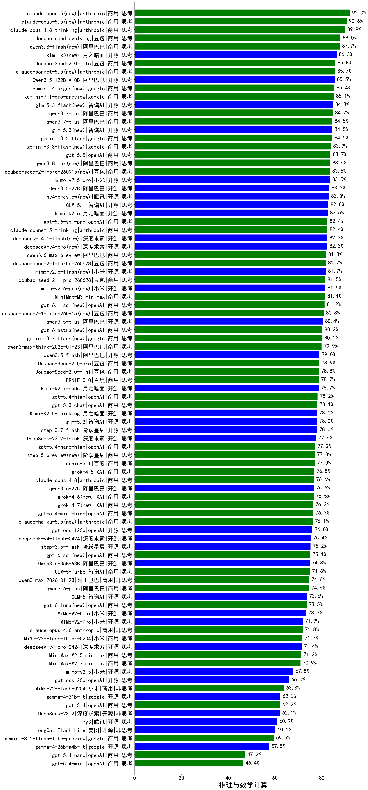

|类别|机构|大模型|【推理与数学计算】准确率|平均耗时|平均消耗token|花费/千次（元）|排名（准确率）|
|---|---|-----|-------------------|-------|-----------|-----------|-----------|
|商用|anthropic|claude-opus-5(new)|92.0%|22s|2340|313.5|1|
|商用|anthropic|claude-opus-5.5(new)|90.6%|21s|1627|150.8|2|
|商用|anthropic|claude-opus-4.8-thinking|89.9%|32s|3208|465.5|3|
|商用|豆包|doubao-seed-evolving|88.0%|365s|16044|464.3|4|
|商用|阿里巴巴|qwen3.8-flash(new)|87.7%|102s|7842|19.8|5|
|开源|月之暗面|kimi-k3(new)|86.3%|94s|3191|271.1|6|
|商用|豆包|Doubao-Seed-2.0-lite|85.8%|388s|3477|10.4|7|
|商用|anthropic|claude-sonnet-5.5(new)|85.7%|28s|1622|75.0|8|
|开源|阿里巴巴|Qwen3.5-122B-A10B|85.5%|433s|9568|57.5|9|
|商用|google|gemini-3.1-pro-preview|85.1%|75s|5575|427.5|10|
|开源|智谱AI|glm-5.3-flash(new)|84.8%|196s|8729|23.3|11|
|商用|阿里巴巴|qwen3.7-max|84.7%|99s|6172|206.1|12|
|商用|阿里巴巴|qwen3.7-plus|84.5%|127s|7502|56.0|13|
|开源|智谱AI|glm-5.3(new)|84.5%|130s|6862|181.1|14|
|商用|google|gemini-3.5-flash|84.5%|21s|4981|278.7|15|
|商用|google|gemini-3.8-flash(new)|83.9%|20s|3315|145.9|16|
|商用|openAI|gpt-5.5|83.7%|26s|1776|279.2|17|
|商用|阿里巴巴|qwen3.8-max(new)|83.6%|119s|6193|206.0|18|
|商用|豆包|doubao-seed-2-1-pro-260915(new)|83.5%|121s|5688|153.7|19|
|开源|小米|mimo-v2.5-pro|83.5%|107s|6907|132.4|20|
|开源|阿里巴巴|Qwen3.5-27B|83.2%|313s|9899|44.7|21|
|开源|腾讯|hy4-preview(new)|83.0%|104s|8282|142.6|22|
|开源|智谱AI|GLM-5.1|82.8%|177s|5902|131.8|23|
|开源|月之暗面|kimi-k2.6|82.5%|324s|8103|208.1|24|
|商用|openAI|gpt-5.6-sol-pro|82.4%|34s|7809|652.6|25|
|商用|anthropic|claude-sonnet-5-thinking|82.4%|26s|3060|175.8|26|
|开源|深度求索|deepseek-v4-pro(new)|82.3%|190s|7350|187.6|27|
|开源|深度求索|deepseek-v4.1-flash(new)|82.3%|47s|5347|39.5|28|
|商用|阿里巴巴|qwen3.6-max-preview|81.8%|128s|5188|250.1|29|
|商用|豆包|doubao-seed-2-1-turbo-260628|81.7%|278s|14128|203.4|30|
|开源|小米|mimo-v2.6-flash(new)|81.7%|228s|7075|13.5|31|
|商用|豆包|doubao-seed-2-1-pro-260628|81.5%|363s|16253|470.6|32|
|开源|小米|mimo-v2.6-pro(new)|81.5%|141s|8037|46.3|33|
|商用|minimax|MiniMax-M3|81.4%|197s|4572|68.2|34|
|商用|openAI|gpt-6.1-sol(new)|81.2%|36s|/|34.1|35|
|商用|豆包|doubao-seed-2-1-lite-260915(new)|80.8%|103s|4989|12.2|36|
|开源|阿里巴巴|qwen3.5-plus|80.4%|96s|8878|39.9|37|
|商用|openAI|gpt-6-astra(new)|80.2%|19s|/|180.1|38|
|商用|google|gemini-3.7-flash(new)|80.1%|19s|2507|51.8|39|
|商用|阿里巴巴|qwen3-max-think-2026-01-23|79.9%|301s|7072|65.8|40|
|开源|阿里巴巴|qwen3.5-flash|79.0%|411s|8987|16.8|41|
|商用|豆包|Doubao-Seed-2.0-pro|78.9%|450s|2834|36.3|42|
|商用|豆包|Doubao-Seed-2.0-mini|78.8%|363s|7044|12.8|43|
|商用|百度|ERNIE-5.0|78.7%|365s|7975|179.6|44|
|开源|月之暗面|kimi-k2.7-code|78.7%|89s|3187|75.3|45|
|商用|openAI|gpt-5.4-high|78.2%|39s|2560|222.0|46|
|商用|openAI|gpt-5.3-chat|78.1%|27s|1427|93.9|47|
|开源|月之暗面|Kimi-K2.5-Thinking|78.0%|423s|7428|147.1|48|
|开源|智谱AI|glm-5.2|78.0%|132s|6113|160.1|49|
|开源|阶跃星辰|step-3.7-flash|78.0%|93s|11548|90.0|50|
|开源|深度求索|DeepSeek-V3.2-Think|77.6%|185s|5371|15.6|51|
|商用|openAI|gpt-5.4-nano-high|77.2%|156s|4462|31.2|52|
|商用|阶跃星辰|step-5-preview(new)|77.0%|52s|4392|81.0|53|
|商用|百度|ernie-5.1|77.0%|80s|3804|59.1|54|
|商用|XAI|grok-4.5|76.8%|127s|5972|230.3|55|
|商用|anthropic|claude-opus-4.8|76.6%|13s|1440|156.1|56|
|开源|阿里巴巴|qwen3.6-27b|76.6%|135s|9861|167.5|57|
|商用|XAI|grok-4.6(new)|76.5%|115s|5907|227.6|58|
|商用|XAI|grok-4.7(new)|76.3%|99s|8379|302.7|59|
|商用|openAI|gpt-5.4-mini-high|76.3%|97s|5611|162.7|60|
|开源|openAI|gpt-oss-120b|76.0%|75s|1955|5.0|61|
|开源|深度求索|deepseek-v4-flash-0424|75.4%|95s|6257|12.0|62|
|开源|阶跃星辰|step-3.5-flash|75.2%|56s|9065|18.3|63|
|商用|openAI|gpt-6-sol(new)|75.1%|222s|/|55.2|64|
|开源|阿里巴巴|Qwen3.6-35B-A3B|74.8%|90s|9010|91.3|65|
|商用|智谱AI|GLM-5-Turbo|74.8%|76s|5682|115.7|66|
|商用|阿里巴巴|qwen3-max-2026-01-23|74.6%|127s|2431|19.4|67|
|商用|阿里巴巴|qwen3.6-plus|74.6%|127s|8194|91.7|68|
|开源|智谱AI|GLM-5|73.6%|187s|6104|102.3|69|
|商用|openAI|gpt-6-luna(new)|73.5%|222s|/|5.7|70|
|开源|小米|MiMo-V2-Omni|73.3%|327s|6062|74.8|71|
|开源|小米|MiMo-V2-Pro|71.9%|263s|6327|120.3|72|
|商用|anthropic|claude-opus-4.6|71.8%|14s|1154|112.2|73|
|商用|小米|MiMo-V2-Flash-think-0204|71.7%|703s|8014|15.9|74|
|开源|深度求索|deepseek-v4-pro-0424|71.4%|125s|5354|122.0|75|
|商用|minimax|MiniMax-M2.5|71.2%|99s|6957|55.0|76|
|商用|minimax|MiniMax-M2.7|70.9%|173s|8757|70.1|77|
|开源|小米|mimo-v2.5|67.8%|63s|6469|80.5|78|
|开源|openAI|gpt-oss-20b|66.0%|223s|3253|3.3|79|
|商用|小米|MiMo-V2-Flash-0204|63.8%|262s|1818|2.9|80|
|开源|google|gemma-4-31b-it|62.3%|106s|1134|1.9|81|
|商用|openAI|gpt-5.4|62.2%|8s|1019|60.1|82|
|开源|深度求索|DeepSeek-V3.2|62.1%|102s|1873|5.1|83|
|开源|腾讯|hy3|60.9%|64s|1416|4.1|84|
|开源|美团|LongCat-Flash-Lite|60.1%|161s|2727|0.0|85|
|商用|google|gemini-3.1-flash-lite-preview|59.5%|9s|1026|4.9|86|
|开源|google|gemma-4-26b-a4b-it|57.5%|44s|1274|2.3|87|
|商用|openAI|gpt-5.4-nano|47.2%|51s|784|2.9|88|
|商用|openAI|gpt-5.4-mini|46.4%|33s|719|8.6|89|

