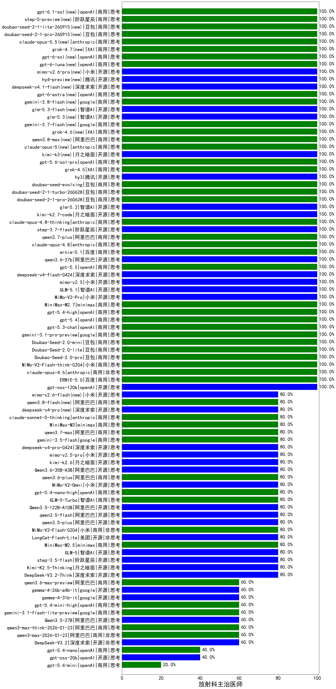

|类别|机构|大模型|【放射科主治医师】准确率|平均耗时|平均消耗token|花费/千次（元）|排名（准确率）|
|---|---|-----|-------------------|-------|-----------|-----------|-----------|
|开源|openAI|gpt-oss-120b|100.0%|2s|529|1.3|1|
|商用|openAI|gpt-6-astra(new)|100.0%|13s|256|62.5|2|
|商用|豆包|doubao-seed-2-1-turbo-260628|100.0%|242s|9491|141.1|3|
|商用|豆包|doubao-seed-evolving|100.0%|300s|10942|325.7|4|
|开源|腾讯|hy3|100.0%|72s|245|0.8|5|
|商用|XAI|grok-4.5|100.0%|80s|1417|51.9|6|
|商用|openAI|gpt-5.6-sol-pro|100.0%|22s|2973|213.4|7|
|开源|月之暗面|kimi-k3|100.0%|23s|482|36.6|8|
|商用|anthropic|claude-opus-5|100.0%|13s|707|108.2|9|
|商用|阿里巴巴|qwen3.8-max|100.0%|12s|538|16.7|10|
|商用|XAI|grok-4.6|100.0%|21s|1243|44.6|11|
|商用|google|gemini-3.7-flash|100.0%|7s|873|21.4|12|
|开源|智谱AI|glm-5.3(new)|100.0%|33s|1236|33.1|13|
|开源|智谱AI|glm-5.3-flash(new)|100.0%|33s|1311|3.5|14|
|商用|google|gemini-3.8-flash(new)|100.0%|10s|724|34.9|15|
|开源|深度求索|deepseek-v4.1-flash(new)|100.0%|13s|1323|10.0|16|
|开源|月之暗面|kimi-k2.7-code|100.0%|13s|475|11.5|17|
|开源|腾讯|hy4-preview(new)|100.0%|39s|2572|45.3|18|
|开源|小米|mimo-v2.6-pro(new)|100.0%|18s|852|4.9|19|
|商用|openAI|gpt-6-luna(new)|100.0%|381s|466|1.4|20|
|商用|openAI|gpt-6-sol(new)|100.0%|249s|247|11.9|21|
|商用|XAI|grok-4.7(new)|100.0%|47s|5085|176.9|22|
|商用|anthropic|claude-opus-5.5(new)|100.0%|14s|636|76.5|23|
|商用|豆包|doubao-seed-2-1-pro-260915(new)|100.0%|35s|683|17.9|24|
|商用|豆包|doubao-seed-2-1-lite-260915(new)|100.0%|39s|974|2.5|25|
|商用|阶跃星辰|step-5-preview(new)|100.0%|17s|773|14.5|26|
|商用|openAI|gpt-6.1-sol(new)|100.0%|7s|215|9.6|27|
|商用|anthropic|claude-sonnet-5.5(new)|100.0%|51s|544|31.8|28|
|商用|google|gemini-4-argon(new)|100.0%|47s|401|44.8|29|
|商用|anthropic|claude-haiku-5.5(new)|100.0%|6s|790|2.5|30|
|开源|智谱AI|glm-5.2|100.0%|41s|1816|49.3|31|
|商用|豆包|doubao-seed-2-1-pro-260628|100.0%|546s|11017|327.9|32|
|商用|anthropic|claude-opus-4.8-thinking|100.0%|10s|661|100.3|33|
|商用|百度|ernie-5.1|100.0%|26s|1082|18.5|34|
|商用|百度|ERNIE-5.0|100.0%|98s|1820|42.6|35|
|商用|google|gemini-3.1-pro-preview|100.0%|41s|1524|124.5|36|
|商用|minimax|MiniMax-M2.7|100.0%|30s|1336|10.6|37|
|开源|智谱AI|GLM-5.1|100.0%|88s|1726|40.2|38|
|开源|深度求索|deepseek-v4-flash-0424|100.0%|38s|1047|2.0|39|
|商用|openAI|gpt-5.5|100.0%|5s|340|54.5|40|
|开源|阿里巴巴|qwen3.6-27b|100.0%|30s|1881|32.7|41|
|开源|小米|mimo-v2.5|100.0%|13s|1037|11.0|42|
|商用|minimax|MiniMax-M3.1-Flash(new)|100.0%|11s|728|2.1|43|
|开源|阶跃星辰|step-3.7-flash|100.0%|17s|1818|14.2|44|
|商用|anthropic|claude-opus-4.8|100.0%|8s|532|77.7|45|
|商用|阿里巴巴|qwen3.7-plus|100.0%|26s|1337|10.2|46|
|商用|minimax|MiniMax-M3|80.0%|19s|571|6.6|47|
|开源|深度求索|DeepSeek-V3.2-Think|80.0%|133s|1974|5.9|48|
|开源|阿里巴巴|Qwen3.5-122B-A10B|80.0%|399s|4163|26.2|49|
|商用|anthropic|claude-sonnet-5-thinking|80.0%|14s|737|45.4|50|
|商用|阿里巴巴|qwen3.6-plus|80.0%|28s|1885|21.9|51|
|开源|深度求索|deepseek-v4-pro|80.0%|209s|902|21.7|52|
|商用|google|gemini-3.5-flash|80.0%|8s|1456|87.8|53|
|开源|阿里巴巴|Qwen3.6-35B-A3B|80.0%|10s|1662|17.3|54|
|开源|月之暗面|kimi-k2.6|80.0%|100s|2085|54.9|55|
|开源|小米|mimo-v2.5-pro|80.0%|20s|1326|23.3|56|
|商用|阿里巴巴|qwen3.8-flash(new)|80.0%|16s|738|1.8|57|
|开源|深度求索|deepseek-v4-pro-0424|80.0%|26s|918|21.2|58|
|商用|阿里巴巴|qwen3.7-max|80.0%|38s|1773|62.0|59|
|开源|小米|mimo-v2.6-flash(new)|80.0%|28s|695|1.3|60|
|商用|阿里巴巴|qwen3.6-max-preview|60.0%|55s|1713|89.1|61|
|开源|google|gemma-4-26b-a4b-it|60.0%|61s|555|1.4|62|
|开源|google|gemma-4-31b-it|60.0%|60s|496|1.2|63|
|商用|google|gemini-3.1-flash-lite-preview|60.0%|5s|405|3.6|64|
|开源|阿里巴巴|Qwen3.5-27B|60.0%|487s|6033|28.6|65|
|开源|深度求索|DeepSeek-V3.2|60.0%|9s|310|0.9|66|
|开源|openAI|gpt-oss-20b|40.0%|244s|1071|1.1|67|

