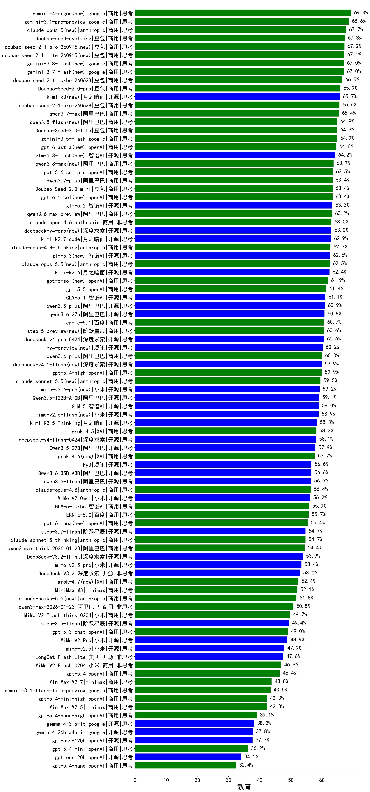

|类别|机构|大模型|【教育】准确率|平均耗时|平均消耗token|花费/千次（元）|排名（准确率）|
|---|---|-----|-------------------|-------|-----------|-----------|-----------|
|商用|google|gemini-4-argon(new)|69.3%|17s|631|69.8|1|
|商用|google|gemini-3.1-pro-preview|68.6%|49s|2782|226.9|2|
|商用|anthropic|claude-opus-5|67.7%|15s|889|126.2|3|
|商用|豆包|doubao-seed-evolving|67.3%|275s|11062|327.7|4|
|商用|豆包|doubao-seed-2-1-pro-260915(new)|67.2%|90s|2339|66.0|5|
|商用|豆包|doubao-seed-2-1-lite-260915(new)|67.1%|170s|3209|8.4|6|
|商用|google|gemini-3.8-flash(new)|67.0%|16s|1271|60.8|7|
|商用|google|gemini-3.7-flash|67.0%|8s|1005|23.4|8|
|商用|豆包|doubao-seed-2-1-turbo-260628|66.5%|235s|9667|142.9|9|
|开源|月之暗面|kimi-k3|65.7%|82s|1773|161.0|10|
|商用|豆包|doubao-seed-2-1-pro-260628|65.6%|275s|11564|342.8|11|
|商用|阿里巴巴|qwen3.7-max|65.4%|57s|2957|103.2|12|
|商用|阿里巴巴|qwen3.8-flash(new)|64.9%|78s|4350|11.4|13|
|商用|google|gemini-3.5-flash|64.9%|13s|2325|139.1|14|
|商用|openAI|gpt-6-astra(new)|64.6%|14s|408|99.5|15|
|开源|智谱AI|glm-5.3-flash(new)|64.2%|140s|4732|13.0|16|
|商用|阿里巴巴|qwen3.8-max|63.7%|87s|3743|130.6|17|
|商用|openAI|gpt-5.6-sol-pro|63.5%|25s|4639|402.1|18|
|商用|阿里巴巴|qwen3.7-plus|63.4%|89s|4804|37.6|19|
|商用|openAI|gpt-6.1-sol(new)|63.4%|14s|377|17.8|20|
|开源|智谱AI|glm-5.2|63.3%|96s|3980|108.7|21|
|商用|阿里巴巴|qwen3.6-max-preview|63.2%|88s|2663|137.8|22|
|开源|深度求索|deepseek-v4-pro|63.0%|131s|3175|82.1|23|
|开源|月之暗面|kimi-k2.7-code|62.9%|55s|2157|55.7|24|
|商用|anthropic|claude-opus-4.8-thinking|62.7%|17s|1342|205.6|25|
|开源|智谱AI|glm-5.3(new)|62.6%|241s|5309|145.8|26|
|商用|anthropic|claude-opus-5.5(new)|62.5%|24s|793|87.3|27|
|开源|月之暗面|kimi-k2.6|62.4%|187s|4252|111.4|28|
|商用|openAI|gpt-6-sol(new)|61.9%|291s|403|19.5|29|
|商用|openAI|gpt-5.5|61.4%|19s|856|152.6|30|
|开源|智谱AI|GLM-5.1|61.1%|230s|3520|82.1|31|
|开源|阿里巴巴|qwen3.6-27b|60.8%|63s|4182|73.3|32|
|商用|百度|ernie-5.1|60.7%|54s|2090|35.8|33|
|商用|阶跃星辰|step-5-preview(new)|60.6%|44s|3232|62.9|34|
|开源|深度求索|deepseek-v4-pro-0424|60.6%|79s|2538|59.4|35|
|开源|腾讯|hy4-preview(new)|60.2%|112s|6781|120.4|36|
|商用|阿里巴巴|qwen3.6-plus|60.0%|70s|3297|38.2|37|
|开源|深度求索|deepseek-v4.1-flash(new)|59.9%|22s|2541|19.4|38|
|商用|anthropic|claude-sonnet-5.5(new)|59.5%|10s|704|37.4|39|
|开源|小米|mimo-v2.6-pro(new)|59.2%|116s|4675|27.6|40|
|开源|阿里巴巴|Qwen3.5-122B-A10B|59.1%|377s|5513|34.5|41|
|开源|小米|mimo-v2.6-flash(new)|58.9%|176s|3205|6.3|42|
|商用|XAI|grok-4.5|58.2%|93s|3952|156.5|43|
|开源|深度求索|deepseek-v4-flash-0424|58.1%|53s|2224|4.3|44|
|开源|阿里巴巴|Qwen3.5-27B|57.9%|404s|5707|26.8|45|
|商用|XAI|grok-4.6|57.7%|147s|3093|120.5|46|
|开源|腾讯|hy3|56.6%|64s|471|1.5|47|
|开源|阿里巴巴|Qwen3.6-35B-A3B|56.6%|79s|3650|38.2|48|
|商用|anthropic|claude-opus-4.8|56.4%|9s|738|99.9|49|
|商用|百度|ERNIE-5.0|55.7%|242s|3891|91.2|50|
|商用|openAI|gpt-6-luna(new)|55.4%|217s|789|2.3|51|
|开源|阶跃星辰|step-3.7-flash|54.7%|237s|4925|39.0|52|
|商用|anthropic|claude-sonnet-5-thinking|54.7%|24s|1717|108.4|53|
|开源|深度求索|DeepSeek-V3.2-Think|53.9%|181s|2588|7.6|54|
|开源|小米|mimo-v2.5-pro|53.4%|69s|3789|74.2|55|
|开源|深度求索|DeepSeek-V3.2|53.0%|78s|747|2.1|56|
|商用|XAI|grok-4.7(new)|52.4%|108s|7701|285.0|57|
|商用|minimax|MiniMax-M3.1-Flash(new)|52.3%|47s|3040|11.2|58|
|商用|minimax|MiniMax-M3|52.1%|121s|2898|45.0|59|
|商用|anthropic|claude-haiku-5.5(new)|51.8%|9s|1096|3.2|60|
|开源|小米|mimo-v2.5|47.9%|49s|2892|36.2|61|
|商用|minimax|MiniMax-M2.7|43.8%|88s|3803|31.0|62|
|商用|google|gemini-3.1-flash-lite-preview|43.5%|21s|539|4.4|63|
|开源|google|gemma-4-31b-it|38.2%|86s|673|1.6|64|
|开源|google|gemma-4-26b-a4b-it|37.8%|65s|845|2.1|65|
|开源|openAI|gpt-oss-120b|37.7%|98s|1020|2.8|66|
|开源|openAI|gpt-oss-20b|34.1%|113s|1805|1.9|67|

